# The Windows 11 taskbar styling guide

## Table of contents

* [Introduction](#introduction)
  * [Using the styles in this guide](#using-the-styles-in-this-guide)
  * [Supported components](#supported-components)
  * [Finding targets](#finding-targets)
  * [Troubleshooting](#troubleshooting)
  * [Known limitations](#known-limitations)
  * [Missing customizations](#missing-customizations)
  * [Contributing](#contributing)
* [Themes](#themes)
  * [Customizing a theme](#customizing-a-theme)
* [General](#general)
  * [Taskbar size](#taskbar-size)
  * [Taskbar background](#taskbar-background)
  * [Taskbar background for maximized windows](#taskbar-background-for-maximized-windows)
  * [Taskbar border](#taskbar-border)
  * [Click-through taskbar](#click-through-taskbar)
  * [Thumbnail preview background](#thumbnail-preview-background)
  * [Thumbnail preview frame](#thumbnail-preview-frame)
  * [Thumbnail preview items](#thumbnail-preview-items)
  * [Text color](#text-color)
  * [Context menus](#context-menus)
  * [Tooltips](#tooltips)
  * [Tasklist + System tray grouped alignment](#Tasklist--System-tray-grouped-alignment)
* [Task list](#task-list)
  * [Start button image](#start-button-image)
  * [Hide the start button](#hide-the-start-button)
  * [Start button position](#start-button-position)
  * [Task list buttons size](#task-list-buttons-size)
  * [Task list buttons background](#task-list-buttons-background)
  * [Task list buttons corner radius](#task-list-buttons-corner-radius)
  * [Task list labels](#task-list-labels)
  * [Task list labels font and color](#task-list-labels-font-and-color)
  * [Task list running indicator](#task-list-running-indicator)
  * [Multi-window indicator](#multi-window-indicator)
  * [Progress bar](#progress-bar)
* [Search box](#search-box)
  * [Search box background](#search-box-background)
  * [Search box text](#search-box-text)
  * [Hide the search box image](#hide-the-search-box-image)
* [Widgets](#widgets)
  * [Widgets button background](#widgets-button-background)
  * [Widgets button size and content](#widgets-button-size-and-content)
* [Notification area (system tray)](#notification-area-system-tray)
  * [System tray background](#system-tray-background)
  * [Tray buttons hover background](#tray-buttons-hover-background)
  * [Tray overflow background](#tray-overflow-background)
  * [Tray icons size](#tray-icons-size)
  * [Tray icons size (system icons)](#tray-icons-size-system-icons)
  * [Tray icons spacing](#tray-icons-spacing)
  * [Hide the network icon](#hide-the-network-icon)
  * [Hide the volume icon](#hide-the-volume-icon)
  * [Hide the battery icon](#hide-the-battery-icon)
  * [Hide the microphone and location icons](#hide-the-microphone-and-location-icons)
  * [Hide the language indicator](#hide-the-language-indicator)
  * [Hide the chevron icon](#hide-the-chevron-icon)
  * [Chevron icon](#chevron-icon)
  * [Clock](#clock)
  * [Language indicator](#language-indicator)
  * [Hide the notification bell icon](#hide-the-notification-bell-icon)
  * ["Show Desktop" line](#show-desktop-line)
  * [Hide the "Show Desktop" button](#hide-the-show-desktop-button)
  * [Hide the entire system tray](#hide-the-entire-system-tray)
  * [Notification Center and quick settings position](#notification-center-and-quick-settings-position)
* [Alt+Tab](#alttab)
  * [Alt+Tab background](#alttab-background)
* [Task view](#task-view)
  * [Task view background](#task-view-background)
  * [Virtual desktops bar](#virtual-desktops-bar)
  * [Hide virtual desktops](#hide-virtual-desktops)
* [Volume popup](#volume-popup)
  * [Volume popup background](#volume-popup-background)
  * [Slider thickness](#slider-thickness)
* [Language popup](#language-popup)
  * [Language popup background](#language-popup-background)
* [Snap layout popups](#snap-layout-popups)
  * [Snap layout popups background](#snap-layout-popups-background)
* [Transforms](#transforms)
  * [Translate](#translate)
  * [Rotate](#rotate)
  * [Scale](#scale)
  * [Skew](#skew)
  * [Other properties and attributes](#other-properties-and-attributes)
* [Colors](#colors)
  * [Solid color](#solid-color)
  * [Accent colors](#accent-colors)
  * [Light and dark mode colors](#light-and-dark-mode-colors)
  * [Transparent color](#transparent-color)
  * [Acrylic effect as color](#acrylic-effect-as-color)
  * [WindhawkBlur effect as color](#windhawkblur-effect-as-color)
  * [Mica effect as color](#mica-effect-as-color)
  * [Gradient as color](#gradient-as-color)
  * [Image as color](#image-as-color)

## Introduction

This is a collection of commonly requested taskbar styling customizations for
Windows 11. It is intended to be used with the [Windows 11 Taskbar
Styler](https://windhawk.net/mods/windows-11-taskbar-styler) Windhawk mod.

If you're not familiar with Windhawk, here are the steps for installing the mod:

* Download Windhawk from [windhawk.net](https://windhawk.net/) and install it.
* Go to "Mods" in the upper right menu.
* Find and install the "Windows 11 Taskbar Styler" mod.

After installing the mod, open its Settings tab and adjust the styles according
to your preferences.

Some customizations are best adjusted with other Windhawk mods. Links to those
mods are provided where applicable.

**See also**: [The Windows 11 start menu styling
guide](https://github.com/ramensoftware/windows-11-start-menu-styling-guide/blob/main/README.md),
[The Windows 11 notification center styling
guide](https://github.com/ramensoftware/windows-11-notification-center-styling-guide/blob/main/README.md).

### Using the styles in this guide

Each customization below lists a target and one or more styles. To apply it:

* Open the mod's Settings tab and go to **Control styles**.
* Enter the target under **Target** and the style under **Styles**. Use **Add new
  item** to add more styles or targets.
* Click **Save settings**.

You can also select **Textual mode** in the Settings tab and use this format:

```yaml
controlStyles:
  - target: Rectangle#BackgroundStroke
    styles:
      - Visibility=Collapsed
```

If a style has no effect, check the following:

* Placeholders such as `<color>` are replaced together with their angle brackets,
  for example `Fill=Red`. For an image, the result looks like
  `ImageSource="C:\images\start.png"`.
* Styles are written as `Style=Value`, with no quotes around the value, for
  example `FontFamily=Segoe UI`.
* `Fill` only applies to `Rectangle` targets. For other targets, use `Background`.
* A visual state in a style, such as `Background@InactivePointerOver`, requires
  the target to name its visual state group, such as `@CommonStates`. A target can
  name only one group.
* The settings JSON in the mod's Advanced tab requires quotes and backslashes to
  be escaped, and isn't meant to be edited by hand.

### Supported components

As of version 1.5 of Windows 11 Taskbar Styler, the following components can be styled along with the taskbar:
* Alt+Tab
* Task view (Win+Tab)
* Volume popup
* Language popup
* Snap layout popups

### Finding targets

[How to find targets using UWPSpy](https://github.com/bbmaster123/FWFU/blob/main/Guides/uwpspy.md).

### Troubleshooting

If the styles have no effect at all, try the following:

* Restart Explorer, for example from Task Manager. This usually fixes [error
  8000FFFF](https://github.com/ramensoftware/windhawk-mods/issues/1192).
* Check your Windows version. The Windows 10 taskbar isn't supported, and the mod
  often doesn't work on Windows 11 version 21H2.
* Disable other tools that customize the taskbar, such as ExplorerPatcher,
  StartAllBack, Start11 or TranslucentTB, to check whether they conflict with the
  mod.
* If the problem remains, collect debug logs by following the [Windhawk
  troubleshooting
  page](https://github.com/ramensoftware/windhawk/wiki/Troubleshooting#some-or-all-windhawk-mods-dont-work),
  and include them when you open an issue.

### Known limitations

Some things can't be done with styles alone:

* Styling the taskbar of a specific monitor. There's no general way to do it, so
  styles apply to the taskbars of all monitors.
* Matching the taskbar color to the active window. To change the taskbar
  background when a window is maximized, see [Taskbar background for maximized
  windows](#taskbar-background-for-maximized-windows).
* Making all icons monochrome. Icons can only be replaced one at a time.
* Keeping the Start button animation with a custom image. The animation is part of
  the original icon.
* Tiling a background image, which `ImageBrush` doesn't support on the taskbar.

### Missing customizations

If you're looking for a customization that is not listed here, please [open an
issue](https://github.com/ramensoftware/windows-11-taskbar-styling-guide/issues/new).

### Contributing

If you have a taskbar styling customization or theme that you would like to
share, please submit a pull request.

## Themes

Themes are collections of styles that can be imported into the Windows 11
Taskbar Styler mod. The following themes are available:

| Link  | Screenshot
| ----- | ----------
| [TranslucentTaskbar](Themes/TranslucentTaskbar/README.md) | [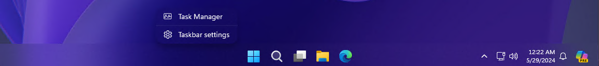](Themes/TranslucentTaskbar/screenshot.png)
| [DockLike](Themes/DockLike/README.md) | [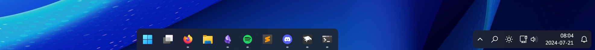](Themes/DockLike/screenshot.png)
| [SimplyTransparent](Themes/SimplyTransparent/README.md) | [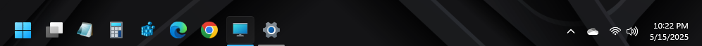](Themes/SimplyTransparent/screenshot.png)
| [Squircle](Themes/Squircle/README.md) | [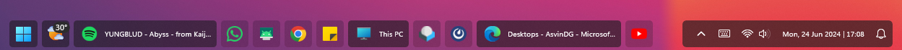](Themes/Squircle/screenshot.png)
| [Matter](Themes/Matter/README.md) | [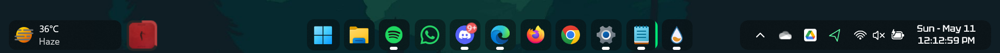](Themes/Matter/screenshot.png)
| [WinXP](Themes/WinXP/README.md) | [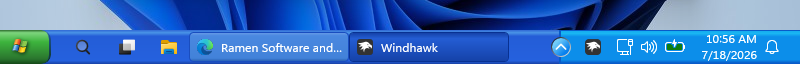](Themes/WinXP/screenshot.png)
| [Bubbles](Themes/Bubbles/README.md) | [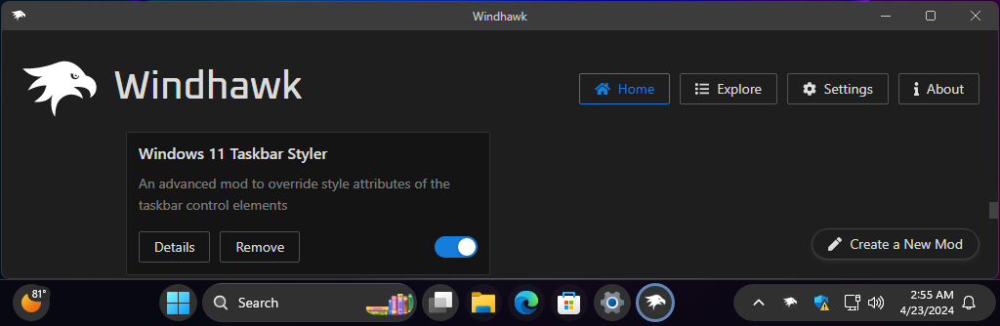](Themes/Bubbles/screenshot.png)
| [RosePine](Themes/RosePine/README.md) | [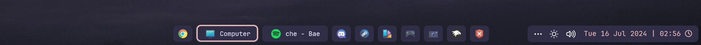](Themes/RosePine/screenshot.png)
| [WinVista](Themes/WinVista/README.md) | [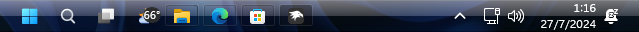](Themes/WinVista/screenshot.png)
| [CleanSlate](Themes/CleanSlate/README.md) | [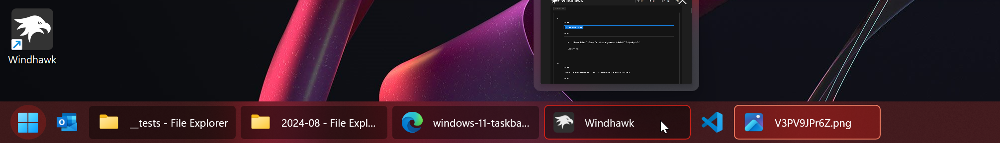](Themes/CleanSlate/screenshot.png)
| [Lucent](Themes/Lucent/README.md) | [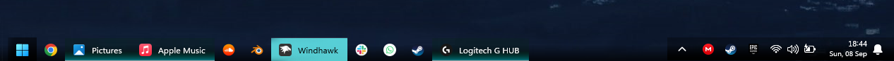](Themes/Lucent/screenshot.png)
| [SunValley](Themes/SunValley/README.md) | [](Themes/SunValley/screenshot.png)
| [SunValley (Legacy)](Themes/21996Taskbar/README.md) | [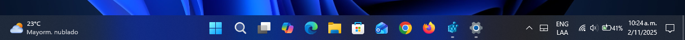](Themes/21996Taskbar/screenshot.png)
| [BottomDensy](Themes/BottomDensy/README.md) | [](Themes/BottomDensy/screenshot.png)
| [TaskbarXII](Themes/TaskbarXII/README.md) | [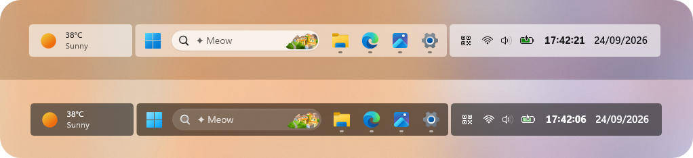](Themes/TaskbarXII/screenshot.png)
| [xdark](Themes/xdark/README.md) | [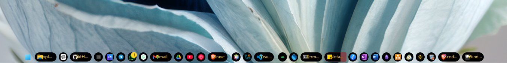](Themes/xdark/screenshot.png)
| [Windows7](Themes/Windows7/README.md) | [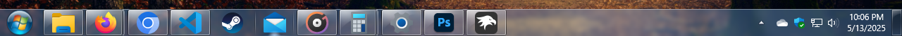](Themes/Windows7/screenshot.png)
| [Aeris](Themes/Aeris/README.md) | [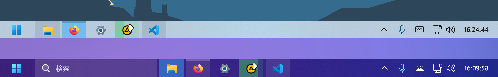](Themes/Aeris/screenshot.png)
| [Plasma](Themes/Plasma/README.md) | [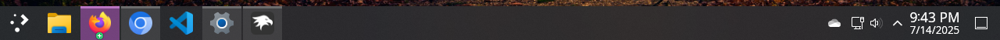](Themes/Plasma/screenshot.png)
| [WindowGlass](Themes/WindowGlass/README.md) | [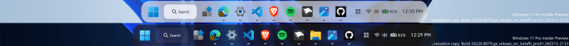](Themes/WindowGlass/screenshot.png)
| [Surface](Themes/Surface/README.md) | [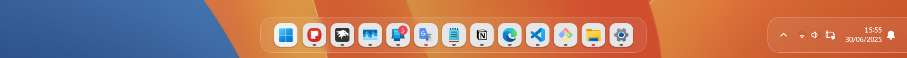](Themes/Surface/screenshot.png)
| [Oversimplified&Accentuated](Themes/Oversimplified&Accentuated/README.md) | [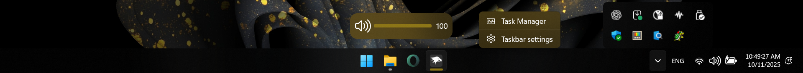](Themes/Oversimplified&Accentuated/screenshot.png)
| [Luminosity](Themes/Luminosity/README.md) | [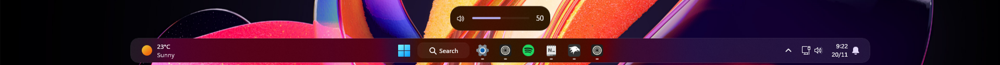](Themes/Luminosity/screenshot.png)
| [LayerMicaUI](Themes/LayerMicaUI/README.md) | [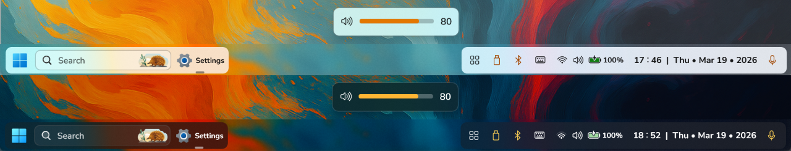](Themes/LayerMicaUI/screenshot.png)
| [Fluid](Themes/Fluid/README.md) | [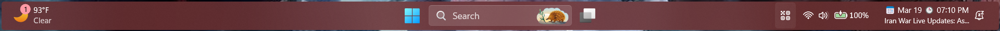](Themes/Fluid/screenshot.png)
| [TintedGlass](Themes/TintedGlass/README.md) | [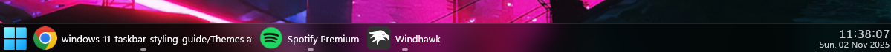](Themes/TintedGlass/screenshot.png)
| [TaskbarToStatusbar](Themes/TaskbarToStatusbar/README.md) | [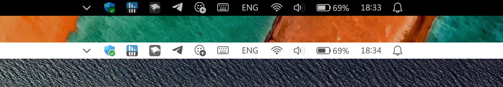](Themes/TaskbarToStatusbar/screenshot.png)
| [UltraWideFriendly](Themes/UltraWideFriendly/README.md) | [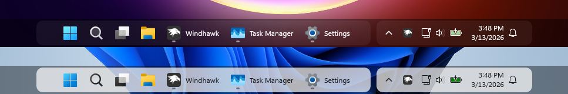](Themes/UltraWideFriendly/screenshot.png)
| [LiquidGlass](Themes/LiquidGlass2/README.md) | [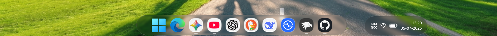](Themes/LiquidGlass2/screenshot.png)
| [LiquidGlass (Legacy)](Themes/LiquidGlass/README.md) | [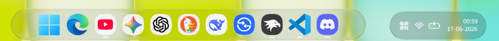](Themes/LiquidGlass/screenshot.png)
| [Borderless](Themes/Borderless/README.md) | [](Themes/Borderless/screenshot.png)
| [Command Center](Themes/Command%20Center/README.md) | [](Themes/Command%20Center/screenshot.png)
| [FluentGlass](Themes/FluentGlass/README.md) | [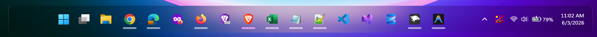](Themes/FluentGlass/screenshot.png)
| [OS26 Liquid Glass](Themes/OS26%20Liquid%20Glass/README.md) | [](Themes/OS26%20Liquid%20Glass/screenshot.png)
| [FrostyGlass](Themes/FrostyGlass/README.md) | [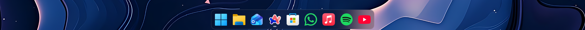](Themes/FrostyGlass/screenshot.png)
| [FrostedAcrylic](Themes/FrostedAcrylic/README.md) | [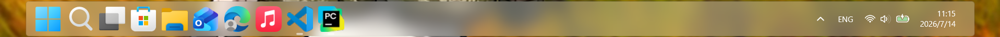](Themes/FrostedAcrylic/screenshot.png)
| [Pills](Themes/Pills/README.md) | [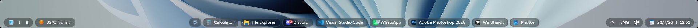](Themes/Pills/screenshot.png)
| [Blob](Themes/Blob/README.md) | [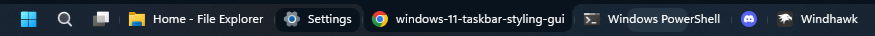](Themes/Blob/screenshot.png)
| [Minecraft Hotbar](Themes/Minecraft%20Hotbar/README.md) | [](Themes/Minecraft%20Hotbar/screenshot.png)
| [One UI 8.5](Themes/One%20UI%208.5/README.md) | [](Themes/One%20UI%208.5/screenshot.png)

### Customizing a theme

A theme can be customized in the following ways:

* **Style constants**: Many themes define constants for values such as colors and
  sizes. Find them under `styleConstants` on the theme's page, and set the ones you
  want to change under **Style constants** in the mod's settings, for example
  `DockBackground=<SolidColorBrush Color="#80000000" />`.
* **Control styles**: Keep the theme selected and add your own targets and styles
  under **Control styles**. They're applied after the theme's styles, so they can
  override them. A theme might not use the targets listed in this guide, so check
  which targets it uses on its page.
* **Manual installation**: Follow the manual installation steps on the theme's
  page to import its styles into the mod's settings, then edit them directly.

## General

### Taskbar size

Use the [Taskbar height and icon
size](https://windhawk.net/mods/taskbar-icon-size) mod.

### Taskbar background

Target:
```
Taskbar.TaskbarFrame > Grid#RootGrid > Taskbar.TaskbarBackground > Grid > Rectangle#BackgroundFill
```

Style:
```
Fill=<color>
```

Replace `<color>` with the desired color. See [colors section](#colors) for all
options (e.g. if you want blurred background effect).

> [!NOTE]
> For some themes, a different approach has to be used to customize the taskbar
> background:
> * The [WinXP](Themes/WinXP/README.md) theme spans the taskbar border over the
>   full taskbar height. To customize the background, use the
>   `Rectangle#BackgroundStroke` target.
> * The following themes set the background with a [style
>   constant](#customizing-a-theme) that also applies to other parts of the theme:
>   * [DockLike](Themes/DockLike/README.md): `DockBackground`
>   * [Luminosity](Themes/Luminosity/README.md): `lumiBackground`
>   * [FrostyGlass](Themes/FrostyGlass/README.md): `Background`
>   * [LiquidGlass (Legacy)](Themes/LiquidGlass/README.md): `Background`

### Taskbar background for maximized windows

To fill the transparent parts of the taskbar when there's a maximized window, use
the [Taskbar Background
Helper](https://windhawk.net/mods/taskbar-background-helper) mod.

To let maximized windows extend under the taskbar, turn on taskbar auto-hide in the
Windows settings, and use the [Taskbar auto-hide when
maximized](https://windhawk.net/mods/taskbar-auto-hide-when-maximized) mod with its
mode set to **Never auto-hide**.

### Taskbar border

Target:
```
Rectangle#BackgroundStroke
```

It can be customized in the same way as the background, see [Taskbar
background](#taskbar-background).

To remove the border, use the following style:
```
Visibility=Collapsed
```

### Click-through taskbar

To make the empty parts of the taskbar click-through, enable the **Click-through
taskbar** option in the mod's settings. This is mainly useful for dock themes such
as [DockLike](Themes/DockLike/README.md).

### Thumbnail preview background

Target:
```
Taskbar.TaskbarBackground#HoverFlyoutBackgroundControl > Grid > Rectangle#BackgroundFill
```

Style:
```
Fill=<color>
```

### Thumbnail preview frame

To also set the corner radius and the border of the thumbnail preview, make its
default background transparent and style the frame instead.

Target:
```
Taskbar.TaskbarBackground#HoverFlyoutBackgroundControl > Grid > Rectangle#BackgroundFill
```
Style:
```
Fill=Transparent
```
Target:
```
Border#HoverFlyoutBackground
```
Styles:
```
Background=<color>
```
```
BorderBrush=<color>
```
```
BorderThickness=<thickness>
```
```
CornerRadius=<radius>
```

### Thumbnail preview items

The highlight of a window's thumbnail in the thumbnail preview.

Target:
```
Taskbar.TaskItemThumbnailView > Grid@CommonStates > Border#BackgroundBorder
```
Styles:
```
Background@PointerOver=<color>
```
```
CornerRadius=<radius>
```

### Text color

Targets:
* Task list labels: `TextBlock#LabelControl`
* Clock: `TextBlock#TimeInnerTextBlock`, `TextBlock#DateInnerTextBlock`
* System tray icons: `SystemTray.AdaptiveTextBlock#Base > TextBlock#InnerTextBlock`
* Language indicator: `SystemTray.AdaptiveTextBlock#LanguageInnerTextBlock > TextBlock#InnerTextBlock`
* Battery level: `TextBlock#BatteryTextBlock`
* Search box: `TextBlock#SearchBoxTextBlock`
* Thumbnail preview titles: `TextBlock#DisplayNameTextBlock`
* Alt+Tab window titles: `TextBlock#DisplayName`
* Volume popup level: `TextBlock#volumeLevelText`

Style:
```
Foreground=<color>
```

### Context menus

Target:
```
MenuFlyoutPresenter
```
Style:
```
CornerRadius=<radius>
```
Target:
```
MenuFlyoutPresenter > Border
```
Styles:
```
Background=<color>
```
```
BorderBrush=<color>
```
```
BorderThickness=<thickness>
```
```
CornerRadius=<radius>
```

### Tooltips

Target:
```
ToolTip > ContentPresenter#LayoutRoot
```
Styles:
```
Background=<color>
```
```
BorderBrush=<color>
```
```
BorderThickness=<thickness>
```
```
CornerRadius=<radius>
```

### Tasklist + System tray grouped alignment
**Original Author**: [CryptoProgenitor](https://github.com/CryptoProgenitor)

> [!NOTE]
> Useful for dock-like layouts to ensure the task list and system tray share the same alignment no matter the size or position of the taskbar, examples could be seen in the [UltraWideFriendly](Themes/UltraWideFriendly/README.md) theme and the [Borderless](Themes/Borderless/README.md) theme.

Target:
```
ScrollViewer > ScrollContentPresenter > Border > Grid
```
Style:
```
ColumnDefinitions:=<ColumnDefinitionCollection><ColumnDefinition Width="*"/><ColumnDefinition Width="Auto"/><ColumnDefinition Width="Auto"/><ColumnDefinition Width="*"/></ColumnDefinitionCollection>
```
Target:
```
Taskbar.TaskbarFrame
```
Style:
```
Grid.Column=1
```
Target:
```
SystemTray.SystemTrayFrame
```
Style:
```
Grid.Column=1
```

## Task list

### Start button image

Target:
```
Taskbar.ExperienceToggleButton#LaunchListButton[AutomationProperties.AutomationId=StartButton] > Taskbar.TaskListButtonPanel > Grid > Border#BackgroundElement, Taskbar.ExperienceToggleButton#LaunchListButton[AutomationProperties.AutomationId=StartButton] > Taskbar.TaskListButtonPanel > Border#BackgroundElement
```
Style:
```
Background:=<ImageBrush Stretch="Uniform" ImageSource="<image>" />
```
Target:
```
Taskbar.ExperienceToggleButton#LaunchListButton[AutomationProperties.AutomationId=StartButton] > Taskbar.TaskListButtonPanel > Grid > Microsoft.UI.Xaml.Controls.AnimatedVisualPlayer#Icon, Taskbar.ExperienceToggleButton#LaunchListButton[AutomationProperties.AutomationId=StartButton] > Taskbar.TaskListButtonPanel > Microsoft.UI.Xaml.Controls.AnimatedVisualPlayer#Icon
```
Style:
```
Visibility=Collapsed
```

Replace `<image>` with your own image, a local file path or a URL, for example:
* Windows 10:
  `https://raw.githubusercontent.com/ramensoftware/windows-11-taskbar-styling-guide/refs/heads/main/Assets/OrbWin10.png`.
* Windows XP:
  `https://raw.githubusercontent.com/ramensoftware/windows-11-taskbar-styling-guide/refs/heads/main/Assets/OrbWinXP.png`
  (use with `Stretch="None"`).

To set a different image for each Start button state, replace the first target
above with the following target and styles. The `Active` states apply while the
Start menu is open. For an example, see the
[Windows7](Themes/Windows7/README.md) theme.

Target:
```
Taskbar.ExperienceToggleButton#LaunchListButton[AutomationProperties.AutomationId=StartButton] > Taskbar.TaskListButtonPanel@CommonStates > Grid > Border#BackgroundElement, Taskbar.ExperienceToggleButton#LaunchListButton[AutomationProperties.AutomationId=StartButton] > Taskbar.TaskListButtonPanel@CommonStates > Border#BackgroundElement
```
Styles:
```
Background@InactiveNormal:=<ImageBrush Stretch="Uniform" ImageSource="<image>" />
```
```
Background@InactivePointerOver:=<ImageBrush Stretch="Uniform" ImageSource="<image>" />
```
```
Background@InactivePressed:=<ImageBrush Stretch="Uniform" ImageSource="<image>" />
```
```
Background@ActiveNormal:=<ImageBrush Stretch="Uniform" ImageSource="<image>" />
```
```
Background@ActivePointerOver:=<ImageBrush Stretch="Uniform" ImageSource="<image>" />
```
```
Background@ActivePressed:=<ImageBrush Stretch="Uniform" ImageSource="<image>" />
```

### Hide the start button

Target:
```
Taskbar.ExperienceToggleButton#LaunchListButton[AutomationProperties.AutomationId=StartButton]
```
Style:
```
Visibility=Collapsed
```

### Start button position

To keep the Start button on the left while the taskbar icons are centered, use the
[Start button always on the
left](https://windhawk.net/mods/taskbar-start-button-position) mod.

### Task list buttons size

Use the [Taskbar height and icon
size](https://windhawk.net/mods/taskbar-icon-size) mod.

### Task list buttons background

Target for running apps:
```
Grid#IconPanel@CommonStates > Border#BackgroundElement, Taskbar.TaskListLabeledButtonPanel@CommonStates > Border#BackgroundElement
```
Target for the Start, Task view and Widgets buttons:
```
Taskbar.TaskListButtonPanel@CommonStates > Grid > Border#BackgroundElement, Taskbar.TaskListButtonPanel@CommonStates > Border#BackgroundElement
```
Styles:
```
Background=<color>
```
```
Background@InactivePointerOver=<color>
```
```
Background@ActiveNormal=<color>
```
```
CornerRadius=<radius>
```

See [colors section](#colors) for all color options.

The following visual states[^1] can be used:
* `InactiveNormal`
* `InactivePointerOver`
* `InactivePressed`
* `ActiveNormal`
* `ActivePointerOver`
* `ActivePressed`

The following visual states can only be used for running apps:
* `MultiWindowNormal`
* `MultiWindowActive`
* `MultiWindowPointerOver`
* `MultiWindowPressed`
* `RequestingAttention`
* `RequestingAttentionPointerOver`
* `RequestingAttentionPressed`

### Task list buttons corner radius

Targets:
```
Taskbar.ExperienceToggleButton
```
```
Taskbar.TaskListButton
```
```
SearchUx.SearchUI.SearchButtonRootGrid#SearchBoxButtonRootPanel > Grid > Border#BackgroundElement, SearchUx.SearchUI.SearchButtonRootGrid#SearchBoxButtonRootPanel > Border#BackgroundElement
```
Style:
```
CornerRadius=<radius>
```

Replace `<radius>` with the desired radius. A larger value will make the corners
more rounded. Default: 4.

### Task list labels

Various task list label customizations are available in the [Taskbar Labels for
Windows 11](https://windhawk.net/mods/taskbar-labels) mod.

### Task list labels font and color

Target:
```
TextBlock#LabelControl
```
Styles:
```
FontFamily=<font>
```
```
FontWeight=<weight>
```
```
Foreground=<color>
```

Replace `<font>` with the desired font. For a list of fonts that are shipped
with Windows 11, refer to [this page](
https://learn.microsoft.com/en-us/typography/fonts/windows_11_font_list).

### Task list running indicator

Target:
```
Grid#IconPanel@RunningIndicatorStates > Rectangle#RunningIndicator, Taskbar.TaskListLabeledButtonPanel@RunningIndicatorStates > Rectangle#RunningIndicator
```

Various styles can be applied to the running indicator. Here are some examples:

Styles:
```
Fill=#FFED7014
```
```
Height=2
```
```
Width=12
```
```
Fill@ActiveRunningIndicator=Red
```
```
Width@ActiveRunningIndicator=20
```

The following visual states[^1] can be used:
* `ActiveRunningIndicator`
* `InactiveRunningIndicator`
* `RequestingAttentionRunningIndicator`
* `NoRunningIndicator`

To move the running indicator, use a [transform](#transforms), for example:
```
RenderTransform:=<TranslateTransform Y="1" />
```

Don't use `Margin` for this, since the taskbar adjusts the indicator's margin to
position it.

Some customizations for the running indicator are available in the [Taskbar
Labels for Windows 11](https://windhawk.net/mods/taskbar-labels) mod.

### Multi-window indicator

The second plate behind a task list button of an app that has multiple windows.

Target:
```
Border#MultiWindowElement
```
Styles:
```
Visibility=Collapsed
```
```
Background=<color>
```

### Progress bar

The progress bar of a task list button, for example during a file copy.

Targets:
```
Rectangle#DeterminateProgressBarIndicator
```
```
Rectangle#IndeterminateProgressBarIndicator, Rectangle#IndeterminateProgressBarIndicator2
```
```
Rectangle#ProgressBarTrack
```
Style:
```
Fill=<color>
```

> [!WARNING]
> Don't use `AcrylicBrush` with `Rectangle#DeterminateProgressBarIndicator`.
> Explorer can crash when the progress of a grouped button switches to the paused
> or error state.

To change the size of the progress bar, use the following target:
```
Microsoft.UI.Xaml.Controls.ProgressBar#ProgressIndicator
```
Styles:
```
Width=<width>
```
```
MinHeight=<height>
```

## Search box

### Search box background

Target:
```
SearchUx.SearchUI.SearchButtonRootGrid#SearchBoxButtonRootPanel@CommonStates > Grid > Border#BackgroundElement, SearchUx.SearchUI.SearchButtonRootGrid#SearchBoxButtonRootPanel@CommonStates > Border#BackgroundElement
```
Styles:
```
Background=<color>
```
```
Background@InactivePointerOver=<color>
```
```
CornerRadius=<radius>
```

The following visual states[^1] can be used:
* `InactiveNormal`
* `InactivePointerOver`
* `InactivePressed`
* `ActiveNormal`
* `ActivePointerOver`
* `ActivePressed`

The pill-shaped search button has a separate background element:
```
Border#SearchPillBackgroundElement
```
Styles:
```
Background=<color>
```
```
BorderBrush=<color>
```
```
BorderThickness=<thickness>
```
```
CornerRadius=<radius>
```

### Search box text

Target:
```
TextBlock#SearchBoxTextBlock
```
Styles:
```
Text=<text>
```
```
Foreground=<color>
```
```
FontFamily=<font>
```
```
FontSize=<size>
```

### Hide the search box image

Target:
```
Grid#DynamicSearchBoxGleamContainer
```
Style:
```
Visibility=Collapsed
```

## Widgets

The Widgets button also shows the weather.

### Widgets button background

Target:
```
Taskbar.AugmentedEntryPointButton > Taskbar.TaskListButtonPanel@CommonStates > Grid > Border#BackgroundElement, Taskbar.AugmentedEntryPointButton > Taskbar.TaskListButtonPanel@CommonStates > Border#BackgroundElement
```
Styles:
```
Background=<color>
```
```
Background@InactivePointerOver=<color>
```
```
CornerRadius=<radius>
```

The visual states[^1] are the same as for the [search box
background](#search-box-background).

### Widgets button size and content

Target:
```
Taskbar.AugmentedEntryPointButton > Taskbar.TaskListButtonPanel
```
Style:
```
MaxWidth=<width>
```
Target:
```
Grid#AugmentedEntryPointContentGrid
```
Styles:
```
HorizontalAlignment=Left
```
```
Margin=<margin>
```

## Notification area (system tray)

The [Taskbar tray system icon
tweaks](https://windhawk.net/mods/taskbar-tray-system-icon-tweaks) mod can also
hide system icons such as volume, network, battery, microphone, location and the
language bar.

### System tray background

Target:
```
StackPanel#SystemTrayFrameGrid, Grid#SystemTrayFrameGrid
```
Styles:
```
Background=<color>
```
```
CornerRadius=<radius>
```

### Tray buttons hover background

Target for the network, volume and battery button, and for the clock and
notifications button:
```
SystemTray.OmniButton > Grid@CommonStates > Border#BackgroundBorder
```
The following visual states[^1] can be used:
* `PointerOver`
* `Pressed`
* `Checked`
* `CheckedPointerOver`
* `CheckedPressed`

Target for the other tray icons:
```
SystemTray.NotifyIconView > Grid#ContainerGrid@ > Border#BackgroundBorder, SystemTray.IconView > Grid#ContainerGrid@ > Border#BackgroundBorder, SystemTray.ChevronIconView > Grid#ContainerGrid@ > Border#BackgroundBorder
```
The visual state group of these icons has no name, so nothing follows the `@`.
The following visual states[^1] can be used:
* `PointerOver`
* `Pressed`
* `CheckedNormal`
* `CheckedPointerOver`
* `CheckedPressed`

Styles:
```
Background@PointerOver=<color>
```
```
Background@Pressed=<color>
```
```
CornerRadius=<radius>
```

### Tray overflow background

Target:
```
Border#OverflowFlyoutBackgroundBorder
```

Style:
```
Background=<color>
```

### Tray icons size

Target:
```
SystemTray.ImageIconContent > Grid#ContainerGrid > Image
```
Styles:
```
Width=<size>
```
```
Height=<size>
```

Replace `<size>` with the desired size. Default: 16.

### Tray icons size (system icons)

Target:
```
SystemTray.TextIconContent > Grid#ContainerGrid > SystemTray.AdaptiveTextBlock#Base > TextBlock#InnerTextBlock
```
Style:
```
FontSize=<size>
```

Replace `<size>` with the desired size. Default: 16.

### Tray icons spacing

Targets:
```
SystemTray.NotifyIconView#NotifyItemIcon
```
```
SystemTray.ChevronIconView
```
Style:
```
MinWidth=<width>
```

Replace `<width>` with the desired width for the icon and the spacing. Default:
32.

To reduce the spacing even more, use the following targets for tray icons and
system icons, respectively:
```
SystemTray.ImageIconContent > Grid#ContainerGrid
```
```
SystemTray.TextIconContent > Grid#ContainerGrid
```
Style:
```
Padding=<padding>
```

Replace `<padding>` with the desired padding. Default: `4,4,4,4` on recent
Windows 11 builds, older builds use smaller values.

### Hide the network icon

Target:
```
SystemTray.OmniButton#ControlCenterButton > Grid > ContentPresenter > ItemsPresenter > StackPanel > ContentPresenter[1] > SystemTray.IconView > Grid > Grid, SystemTray.OmniButton#ControlCenterButton > Grid > ContentPresenter > ItemsPresenter > WrapGrid > ContentPresenter[1] > SystemTray.IconView > Grid > Grid
```
Style:
```
Visibility=Collapsed
```

The `StackPanel` part of the target applies to a horizontal taskbar, and the
`WrapGrid` part applies to a vertical taskbar.

### Hide the volume icon

Target:
```
SystemTray.OmniButton#ControlCenterButton > Grid > ContentPresenter > ItemsPresenter > StackPanel > ContentPresenter[2] > SystemTray.IconView > Grid > Grid, SystemTray.OmniButton#ControlCenterButton > Grid > ContentPresenter > ItemsPresenter > WrapGrid > ContentPresenter[2] > SystemTray.IconView > Grid > Grid
```
Style:
```
Visibility=Collapsed
```

### Hide the battery icon

Target:
```
SystemTray.OmniButton#ControlCenterButton > Grid > ContentPresenter > ItemsPresenter > StackPanel > ContentPresenter[3] > SystemTray.IconView > Grid > Grid, SystemTray.OmniButton#ControlCenterButton > Grid > ContentPresenter > ItemsPresenter > WrapGrid > ContentPresenter[3] > SystemTray.IconView > Grid > Grid
```
Style:
```
Visibility=Collapsed
```

### Hide the microphone and location icons

Target:
```
SystemTray.Stack#MainStack
```
Style:
```
Visibility=Collapsed
```

### Hide the language indicator

Target:
```
SystemTray.Stack#NonActivatableStack
```
Style:
```
Visibility=Collapsed
```

### Hide the chevron icon

Target:
```
SystemTray.Stack#NotifyIconStack
```
Style:
```
Visibility=Collapsed
```

### Chevron icon

Target:
```
SystemTray.ChevronIconView > Grid#ContainerGrid > ContentPresenter#ContentPresenter > Grid#ContentGrid > SystemTray.TextIconContent > Grid#ContainerGrid > SystemTray.AdaptiveTextBlock#Base > TextBlock#InnerTextBlock
```
Style:
```
Text:=&#xED14;
```

Replace `ED14` with the code of the desired glyph from the [Segoe Fluent
Icons](https://learn.microsoft.com/en-us/windows/apps/design/style/segoe-fluent-icons-font)
font. To change the chevron's width, see [Tray icons
spacing](#tray-icons-spacing).

### Clock

Clock customizations are available in the [Taskbar Clock
Customization](https://windhawk.net/mods/taskbar-clock-customization) mod.

The time and the date can also be styled directly.

Targets:
```
TextBlock#TimeInnerTextBlock
```
```
TextBlock#DateInnerTextBlock
```
Styles:
```
Foreground=<color>
```
```
FontFamily=<font>
```
```
FontSize=<size>
```

To hide the date, use the following target:
```
TextBlock#DateInnerTextBlock
```
Style:
```
Visibility=Collapsed
```

### Language indicator

Target:
```
SystemTray.AdaptiveTextBlock#LanguageInnerTextBlock > TextBlock#InnerTextBlock
```
Styles:
```
Foreground=<color>
```
```
FontFamily=<font>
```
```
FontSize=<size>
```
```
FontWeight=<weight>
```

### Hide the notification bell icon

Target:
```
SystemTray.OmniButton#NotificationCenterButton > Grid > ContentPresenter > ItemsPresenter > StackPanel > ContentPresenter > SystemTray.IconView#SystemTrayIcon > Grid > Grid > SystemTray.TextIconContent
```
Style:
```
Visibility=Collapsed
```

### "Show Desktop" line

The thin line of the "Show Desktop" button, which is visible when hovering over
the button.

Target:
```
Grid#ContainerGrid@ > Rectangle#ShowDesktopPipe
```
Styles:
```
Fill@PointerOver=<color>
```
```
Width=<width>
```
```
Height=<height>
```

To let the line take up the whole button, add the following styles:
```
Grid.Row=0
```
```
Grid.RowSpan=3
```
```
Grid.Column=0
```
```
Grid.ColumnSpan=3
```

The "Show Desktop" button can't be moved outside of the system tray. If a theme
leaves a gap between the button and the corner of the screen, extend the system
tray to the edge of the screen instead.

### Hide the "Show Desktop" button

Target:
```
SystemTray.Stack#ShowDesktopStack
```
Style:
```
Visibility=Collapsed
```

### Hide the entire system tray

Target:
```
StackPanel#SystemTrayFrameGrid, Grid#SystemTrayFrameGrid
```
Style:
```
MaxWidth=0
```

> [!NOTE]
> `Visibility=Collapsed` isn't used here because on recent Windows 11 versions it crashes Explorer if it's applied when Explorer starts.

### Notification Center and quick settings position

Use the [Shell Flyout Positions](https://windhawk.net/mods/shell-flyout-positions)
mod.

## Alt+Tab

### Alt+Tab background

Target:
```
WindowsInternal.ComposableShell.Experiences.Switcher.AltTab > Grid#ModalRootGrid > Border#BackgroundElement
```
Style:
```
Background=Transparent
```

Target:
```
WindowsInternal.ComposableShell.Experiences.Switcher.AltTab > Grid#ModalRootGrid > Border#BackgroundElement > WindowsInternal.ComposableShell.Experiences.Switcher.SwitchItemList
```
Style:
```
Background=<color>
```

> [!NOTE]
> The inner element background is customized, and the outer element background is made transparent. Without this, Alt+Tab loses mouse interactivity and becomes unclickable.

## Task view

### Task view background

Target:
```
Windows.UI.Xaml.Controls.Border#BackgroundDimmingLayer
```
Style:
```
Background=<color>
```

### Virtual desktops bar

Targets:
```
Border#VirtualDesktopBarBackground
```
```
WindowsInternal.ComposableShell.Experiences.Switcher.VirtualDesktopBarElement > Grid#GridElement > Border#VirtualDesktopSwitcherBackground
```
Styles:
```
Background=<color>
```
```
BorderBrush=<color>
```
```
BorderThickness=<thickness>
```
```
CornerRadius=<radius>
```

To style the desktops in the bar, use the following target:
```
WindowsInternal.ComposableShell.Experiences.Switcher.VirtualDesktopElementThemed > Grid#MainGrid > Border#MainBorder
```
Styles:
```
Background=<color>
```
```
CornerRadius=<radius>
```

### Hide virtual desktops

Target:
```
WindowsInternal.ComposableShell.Experiences.Switcher.VirtualDesktopBarElement#VirtualDesktopBar
```
Style:
```
Visibility=Collapsed
```

## Volume popup

### Volume popup background

The brightness popup uses the same element.

Target:
```
Grid#ConfirmatorMainGrid
```
Styles:
```
Background=<color>
```
```
BorderBrush=<color>
```
```
BorderThickness=<thickness>
```
```
CornerRadius=<radius>
```

### Slider thickness

Target:
```
Windows.UI.Xaml.Shapes.Rectangle#HorizontalTrackRect
```
Style:
```
Height=<value>
```

## Language popup

### Language popup background

Target:
```
WindowsInternal.ComposableShell.Experiences.TextInput.Common.InputSwitcher > ContentControl > ContentPresenter > Grid
```
Styles:
```
Background=<color>
```
```
BorderBrush=<color>
```
```
BorderThickness=<thickness>
```
```
CornerRadius=<radius>
```
Target:
```
WindowsInternal.ComposableShell.Experiences.TextInput.Common.InputSwitcher > ContentControl > ContentPresenter > Grid > Grid
```
Styles:
```
Background=Transparent
```
```
BorderBrush=Transparent
```

## Snap layout popups

### Snap layout popups background

The first target is for the popup that appears when hovering over a window's
maximize button, and the second target is for the popup that appears when moving
a window to the top of the screen.

Targets:
```
Border#SnapPickerBorder
```
```
Border#SnapBarBorder
```
Styles:
```
Background=<color>
```
```
BorderBrush=<color>
```
```
BorderThickness=<thickness>
```
```
CornerRadius=<radius>
```

## Transforms

You can use transformation styles to translate, rotate, scale, or skew elements.

> [!TIP]
> **Should I use `RenderTransform` or `Transform3D`?**
>
> For 2D transformations, it is best to stick to `RenderTransform` in most cases. Using `Transform3D` for 2D transformations can cause elements to become blurry. For 3D transformations, you must use `Transform3D`.

> [!TIP]
> You can mix and match transformations when using `Transform3D`! You can also use `RenderTransform` and `Transform3D` together.
>
> For example: `Transform3D:=<CompositeTransform3D ScaleX="1.5" TranslateY="-15" RotationZ="15" />`

### Translate

```
RenderTransform:=<TranslateTransform X="15" Y="-15" />
```

-- or --

```
Transform3D:=<CompositeTransform3D TranslateX="15" TranslateY="-15" TranslateZ="-15" />
```

### Rotate

```
RenderTransform:=<RotateTransform Angle="15" />
```

-- or --

```
Transform3D:=<CompositeTransform3D RotationX="-15" RotationY="15" RotationZ="-15" />
```

- `X`: 3D vertical rotation.
- `Y`: 3D horizontal rotation.
- `Z`: 2D rotation.

### Scale

```
RenderTransform:=<ScaleTransform ScaleX="1.5" ScaleY="-1.5" />
```

-- or --

```
Transform3D:=<CompositeTransform3D ScaleX="-1.5" ScaleY="1.5" ScaleZ="-1.5" />
```

### Skew

```
RenderTransform:=<SkewTransform AngleX="-15" AngleY="15" />
```

### Other properties and attributes
- Applies to Rotate, Scale and Skew:
  - `CenterX`: Offsets the transform's origin on the X axis.
  - `CenterY`: Offsets the transform's origin on the Y axis.
  - `CenterZ`: Offsets the transform's origin on the Z axis. (Only for `Transform3D`)

  Example:
  ```
  RenderTransform:=<RotateTransform Angle="15" CenterX="10" CenterY="20" />
  ```
- `RenderTransformOrigin`
  - Applies to `RenderTransform` only, `Transform3D` does not support this attribute. It is a separate attribute and is not set inside of the `RenderTransform` like `CenterX/Y/Z`.
  - Sets the transform origin relative to its target's width and height. Format is `X,Y` and both numbers range from 0-1.

  Example:

  ```
  RenderTransformOrigin=0.5,0.5
  ```
  This centers the transform's origin.
- `TransformGroup`
  - Applies to `RenderTransform` only, `Transform3D` does not support this attribute. It is a separate attribute and is not set inside of the `RenderTransform` like `CenterX/Y/Z`.
  - Allows you to combine RenderTransforms together into one style, mimicking Transform3D's functionality.

  Example:
  ```
  RenderTransform:=<TransformGroup><RotateTransform Angle="15" /><TranslateTransform X="15" Y="-15" /></TransformGroup>
  ```
## Colors

In the following examples, we're going to use `Fill` as an example, but this
also works for other properties that accept colors, like `Background`.

### Solid color

```
Fill=<color>
```

Replace `<color>` with the desired color.

A color can be a name (e.g. `Red`) or a hex code (e.g. `#FF0000`).

The color can be semi-transparent (e.g. `#80FF0000`). To have a fully
transparent background, use `Transparent`.

### Accent colors

A color can also be a `ThemeResource` or `StaticResource`. There are many such
styles built into Windows.

```
Fill:=<SolidColorBrush Color="{ThemeResource SystemAccentColor}" Opacity="0.8" />
```

Accent colors have different lightness available, like `SystemAccentColorLight2`
or `SystemAccentColorDark1`. The word `Light` or `Dark` is appended at the end
with a number ranging from 1 to 3. Check out [the official Microsoft
docs](https://learn.microsoft.com/en-us/windows/apps/design/style/color#accent-color-palette)
for all variations.

```
Fill:=<SolidColorBrush Color="{ThemeResource SystemAccentColorDark2}" Opacity="0.5" />
```

### Light and dark mode colors

To use different colors in light and dark mode, define a theme-aware resource under
**Resource variables** in the mod's settings:

```
MyColor@Dark=#18181B
```
```
MyColor@Light=#E5E7EB
```

Then use it in a style:

```
Fill:=<SolidColorBrush Color="{ThemeResource MyColor}" />
```

### Transparent color

To have a fully transparent background, use the following style:

```
Fill=Transparent
```

### Acrylic effect as color

In order to have an acrylic effect (a blurred background), you can use
`AcrylicBrush`. It comes with `TintOpacity`, which defines how much of the color
needs to be applied.

```
Fill:=<AcrylicBrush TintColor="Black" TintOpacity="0.8" />
```

You can also mix acrylic with a variation of an accent color for a more dynamic
look that fits the current theme.

```
Fill:=<AcrylicBrush TintColor="{ThemeResource SystemAccentColorDark2}" TintOpacity="0.3" />
```

> [!NOTE]
> Acrylic requires transparency effects to be turned on in the Windows settings,
> under Personalization > Colors, and doesn't apply when battery saver is on. In
> these cases `FallbackColor` is used instead, and without it the element is
> invisible:
> ```
> Fill:=<AcrylicBrush TintColor="Black" TintOpacity="0.8" FallbackColor="#202020" />
> ```

### WindhawkBlur effect as color

An alternative to Acrylic is the mod's own blur implementation called `WindhawkBlur`. It differs from Acrylic in that its blur radius, saturation and noise are customizable, and it keeps blurring when battery saver is on or transparency effects are off, unless `FallbackColor` is set.

> [!NOTE]
> WindhawkBlur does not currently support color names (e.g. `Red`).

- `BlurAmount`: Radius of blur effect (set to 30 to mimic Acrylic).
- `TintLuminosityOpacity`: Shifts pixel luminance towards the tint color's luminance. Range: 0.0 to 1.0.
- `TintSaturation`: Controls the saturation of the blurred content. 1.0 is unchanged, 0.0 is fully desaturated (grayscale).
- `NoiseOpacity`: Adds a procedural noise texture overlay. Controls how visible the noise is (0.0 to 1.0).
- `NoiseDensity`: Controls the granularity of the noise texture (defaults to 1.0).
- `FallbackColor`: Color used in place of the blur effect when battery saver is on or when transparency effects are disabled in the system settings. Accepts a hex color or a `ThemeResource`. If omitted, the blur effect is used regardless of those settings.

#### Hex color

```
Fill:=<WindhawkBlur BlurAmount="10" TintColor="#80ff0000" />
```
```
Fill:=<WindhawkBlur BlurAmount="10" TintColor="#ff0000" TintOpacity="0.5" />
```
_These examples set a blur that is tinted with red at 50% opacity. Both versions have the same effect._

- `TintColor`: Hex color in `#AARRGGBB` or `#RRGGBB` format that is applied to the blur.
- `TintOpacity`: Opacity of the color that overrides the alpha of `TintColor`.

> [!TIP]
> There is no need to specify a `TintOpacity` value if your `TintColor` has an alpha value.

#### ThemeResource color

```
<WindhawkBlur BlurAmount="10" TintColor="{ThemeResource SystemAccentColor}" TintOpacity="0.5"/>
```

- `TintColor`: ThemeResource color, such as `SystemAccentColor`.
- `TintOpacity`: Overrides the opacity of the ThemeResource color.

### Mica effect as color

> [!NOTE]
> Unfortunately, it is not possible to set a Mica effect at this time with any of Windhawk's styler mods.

### Gradient as color

The background can also be a gradient. For example, to have a gradient from
yellow to red to blue to lime green, use the following style:

```
Fill:=<LinearGradientBrush StartPoint="0,0.5" EndPoint="1,0.5"><GradientStop Color="Yellow" Offset="0.0" /><GradientStop Color="Red" Offset="0.25" /><GradientStop Color="Blue" Offset="0.75" /><GradientStop Color="LimeGreen" Offset="1.0" /></LinearGradientBrush>
```

### Image as color

The background can also be an image:

```
Fill:=<ImageBrush Stretch="UniformToFill" ImageSource="<image>" />
```

Replace `<image>` with your own image, a URL or a local file path.

> [!NOTE]
> An image URL needs an internet connection when the image is loaded, for example
> when Explorer starts. To avoid this, download the image and use a local file
> path. For a theme that uses online images, follow the manual installation steps
> on its page, then replace the URLs with local paths in the mod's settings.

[^1]: See [Finding targets](#finding-targets) on how to use UWPSpy to find all of the available visual states for an element
