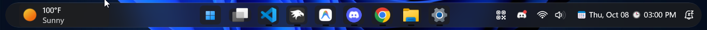

# Command Center for Windows 11 Taskbar Styler

Command Center theme inspired by the command centers from various mobile operating systems. It features a completely transparent background to allow for a floating widget styled appearance.

**Author**: [PhantomNimbi](https://github.com/PhantomNimbi)



> [!IMPORTANT]
> If for any reason some elements don't load, simply refresh explorer by restarting the `explorer.exe` process.


## Notes
- This theme consists of the following backgrounds:
  - Translucent
  - Glass
  - Frosted
  - Acrylic

  In order to switch between these backgrounds, set the value `Background=$Translucent`, `Background=$Glass`, `Background=$Frosted` or `Background=$Acrylic` in the "Style constants" section of the mod's settings.

## Additional Extras

- This theme goes great with various other Windhawk Mods. To see some pre-made configurations, check out my [`GitHub Pages`](https://helix-origin.github.io/Windhawk-Themes/catalogue/command-center/) site.

## Theme selection

The theme is integrated into the mod and can be selected directly from the mod's
settings:

* Open the Windows 11 Taskbar Styler mod in Windhawk.
* Go to the "Settings" tab.
* Select the theme and save the settings.

## Manual installation

The theme styles can also be imported manually. To do that, follow these steps:

* Open the Windows 11 Taskbar Styler mod in Windhawk.
* Go to the "Settings" tab and select "Textual mode".
* Copy the content below to the text box and click "Save settings".

<details>
<summary>Content to import (click to expand)</summary>

```yaml
styleConstants:
  - Translucent=<WindhawkBlur BlurAmount="15" TintColor="#10808080"/>
  - Glass=<WindhawkBlur BlurAmount="5" TintColor="{ThemeResource SystemChromeMediumColor}" TintOpacity="0.7" />
  - Frosted=<WindhawkBlur BlurAmount="20" TintColor="{ThemeResource SystemChromeMediumColor}" TintOpacity="0.7" />
  - Acrylic=<WindhawkBlur BlurAmount="30" TintColor="{ThemeResource SystemChromeMediumColor}" TintOpacity="0.8" />
  - Background=$Frosted
  - OverlayColor=<AcrylicBrush TintColor="{ThemeResource SystemAltLowColor}" TintOpacity="1" TintLuminosityOpacity="0.8" FallbackColor="{ThemeResource CardStrokeColorDefaultSolid}" />
  - OverlayColorAlt=<AcrylicBrush TintColor="{ThemeResource SystemAltLowColor}" TintOpacity="1" TintLuminosityOpacity="0.5" FallbackColor="{ThemeResource CardStrokeColorDefaultSolid}" />
  - AccentColor=<AcrylicBrush TintColor="{ThemeResource SystemAccentColor}" TintOpacity="1" TintLuminosityOpacity="0.5" FallbackColor="{ThemeResource CardStrokeColorDefaultSolid}" />
  - ActiveColor=<AcrylicBrush TintColor="{ThemeResource SystemAltLowColor}" TintOpacity="1" TintLuminosityOpacity="1" FallbackColor="{ThemeResource CardStrokeColorDefaultSolid}" />
  - BorderBrush=<LinearGradientBrush StartPoint="0,0" EndPoint="0,1"><GradientStop Color="#60808080" Offset="0.0" /><GradientStop Color="#50404040" Offset="0.25" /><GradientStop Color="#40808080" Offset="1" /></LinearGradientBrush>
  - BorderThickness=0.3,1,0.3,1
  - CornerRadius=6
  - CornerRadiusAlt1=20
  - BaseHeight=32
  - BaseWidth=34
controlStyles:
  - target: Taskbar.TaskbarFrame > Grid#RootGrid > Taskbar.TaskbarBackground > Grid, Taskbar.TaskbarBackground > Grid, Taskbar.TaskbarBackground#BackgroundControl > Grid
    styles:
      - Margin=8,4,8,4
      - Background:=$Background
      - BorderBrush:=$BorderBrush
      - BorderThickness=$BorderThickness
      - CornerRadius=$CornerRadiusAlt1
  - target: Taskbar.TaskbarFrame > Grid#RootGrid > Taskbar.TaskbarBackground > Grid > Rectangle#BackgroundFill, Taskbar.TaskbarBackground > Grid > Rectangle#BackgroundFill
    styles:
      - Visibility=1
  - target: Rectangle#BackgroundStroke
    styles:
      - Visibility=1
  - target: Taskbar.TaskbarBackground#HoverFlyoutBackgroundControl, Taskbar.TaskbarBackground#HoverFlyoutBackgroundControl > Grid
    styles:
      - Background:=Transparent
      - BorderBrush:=Transparent
      - BorderThickness=0
  - target: Taskbar.TaskListButtonPanel@CommonStates > Grid > Border#BackgroundElement, Taskbar.TaskListButtonPanel@CommonStates > Border#BackgroundElement
    styles:
      - Padding=6,4,6,4
      - Margin=2,1,2,1
      - Background@ActiveNormal:=$Background
      - Background@ActivePointerOver:=$OverlayColor
      - Background@ActivePressed:=$OverlayColor
      - Background@InactiveNormal:=$Background
      - Background@InactivePointerOver:=$OverlayColorAlt
      - Background@InactivePressed:=$OverlayColor
      - Background@MultiWindowNormal:=$Background
      - Background@MultiWindowPointerOver:=$OverlayColorAlt
      - Background@MultiWindowActive:=$Background
      - Background@MultiWindowPressed:=$OverlayColor
      - CornerRadius=$CornerRadius
  - target: SearchUx.SearchUI.SearchIconButton > SearchUx.SearchUI.SearchButtonRootGrid#SearchBoxButtonRootPanel
    styles:
      - Background:=$Background
      - BorderBrush:=$BorderBrush
      - BorderThickness=$BorderThickness
      - CornerRadius=$CornerRadius
      - Width=$BaseWidth
      - Height=$BaseHeight
  - target: SearchUx.SearchUI.SearchIconButton > SearchUx.SearchUI.SearchButtonRootGrid#SearchBoxButtonRootPanel > Grid > Border#BackgroundElement, SearchUx.SearchUI.SearchIconButton > SearchUx.SearchUI.SearchButtonRootGrid#SearchBoxButtonRootPanel > Border#BackgroundElement
    styles:
      - Visibility=1
  - target: Grid#IconPanel@CommonStates > Border#BackgroundElement, Taskbar.TaskListLabeledButtonPanel@CommonStates > Border#BackgroundElement
    styles:
      - Width=$BaseWidth
      - Height=$BaseHeight
      - Background@ActiveNormal:=$Background
      - Background@ActivePointerOver:=$OverlayColor
      - Background@ActivePressed:=$OverlayColor
      - Background@InactiveNormal:=$Background
      - Background@InactivePointerOver:=$OverlayColorAlt
      - Background@InactivePressed:=$OverlayColor
      - Background@MultiWindowNormal:=$Background
      - Background@MultiWindowPointerOver:=$OverlayColorAlt
      - Background@MultiWindowActive:=$Background
      - Background@MultiWindowPressed:=$OverlayColor
      - CornerRadius=$CornerRadius
  - target: Taskbar.ExperienceToggleButton#LaunchListButton[AutomationProperties.AutomationId=StartButton]
    styles:
      - VerticalAlignment=Center
      - Margin=2,0,2,0
  - target: Taskbar.ExperienceToggleButton#LaunchListButton[AutomationProperties.AutomationId=StartButton] > Taskbar.TaskListButtonPanel > Grid > Border#BackgroundElement, Taskbar.ExperienceToggleButton#LaunchListButton[AutomationProperties.AutomationId=StartButton] > Taskbar.TaskListButtonPanel > Border#BackgroundElement
    styles:
      - Width=$BaseWidth
      - Height=$BaseHeight
      - VerticalAlignment=Center
      - HorizontalAlignment=Center
      - Margin=0
      - Padding=0
      - CornerRadius=$CornerRadius
  - target: Taskbar.ExperienceToggleButton#LaunchListButton[AutomationProperties.AutomationId=StartButton] > Taskbar.TaskListButtonPanel@CommonStates > Grid > Border#BackgroundElement, Taskbar.ExperienceToggleButton#LaunchListButton[AutomationProperties.AutomationId=StartButton] > Taskbar.TaskListButtonPanel@CommonStates > Border#BackgroundElement
    styles:
      - Width=$BaseWidth
      - Height=$BaseHeight
      - VerticalAlignment=Center
      - HorizontalAlignment=Center
      - Margin=0
      - Padding=0
      - CornerRadius=$CornerRadius
      - Background@ActiveNormal:=$Background
      - Background@ActivePointerOver:=$OverlayColor
      - Background@ActivePressed:=$OverlayColor
      - Background@InactiveNormal:=$Background
      - Background@InactivePointerOver:=$OverlayColorAlt
      - Background@InactivePressed:=$OverlayColor
  - target: Taskbar.ExperienceToggleButton#LaunchListButton[AutomationProperties.AutomationId=StartButton] > Taskbar.TaskListButtonPanel > Grid > Microsoft.UI.Xaml.Controls.AnimatedVisualPlayer#Icon, Taskbar.ExperienceToggleButton#LaunchListButton[AutomationProperties.AutomationId=StartButton] > Taskbar.TaskListButtonPanel > Grid > AnimatedVisualPlayer#Icon, Taskbar.ExperienceToggleButton#LaunchListButton[AutomationProperties.AutomationId=StartButton] > Taskbar.TaskListButtonPanel > Microsoft.UI.Xaml.Controls.AnimatedVisualPlayer#Icon, Taskbar.ExperienceToggleButton#LaunchListButton[AutomationProperties.AutomationId=StartButton] > Taskbar.TaskListButtonPanel > AnimatedVisualPlayer#Icon
    styles:
      - RenderTransform:=<ScaleTransform ScaleX="0.8" ScaleY="0.8" />
      - RenderTransformOrigin=0.5,0.5
      - Width=18
      - Height=18
  - target: Grid#IconPanel@RunningIndicatorStates > Rectangle#RunningIndicator, Taskbar.TaskListLabeledButtonPanel@RunningIndicatorStates > Rectangle#RunningIndicator
    styles:
      - RadiusX=1.5
      - RadiusY=1.5
      - Height=2.5
      - Width=10
      - Fill:=$OverlayColor
      - Fill@ActiveRunningIndicator:=$AccentColor
      - Width@ActiveRunningIndicator=18
      - VerticalAlignment=Bottom
      - Margin=0,0,0,2
  - target: StackPanel#SystemTrayFrameGrid, Grid#SystemTrayFrameGrid
    styles:
      - Height=$BaseHeight
      - Background:=Transparent
      - BorderBrush:=Transparent
      - BorderThickness=0
      - Shadow:=
      - Padding=0
      - VerticalAlignment=Center
      - Margin=0,0,4,0
  - target: Grid#OverflowRootGrid > Border
    styles:
      - Padding=6
      - Background:=$Background
      - BorderBrush:=$BorderBrush
      - BorderThickness=$BorderThickness
      - CornerRadius=$CornerRadius
      - Shadow:=
  - target: Windows.UI.Xaml.Shapes.Rectangle#HorizontalTrackRect
    styles:
      - Height=8
      - Margin=0
      - Fill:=$Background
  - target: Windows.UI.Xaml.Shapes.Rectangle#HorizontalDecreaseRect
    styles:
      - Height=8
      - Fill:=$AccentColor
  - target: Windows.UI.Xaml.Controls.TextBlock#volumeLevelText
    styles:
      - Margin=0,-2,0,0
  - target: Windows.UI.Xaml.Controls.Grid#VolumeConfirmator
    styles:
      - Padding=8,0,3,0
      - CornerRadius=$CornerRadiusAlt1
  - target: Windows.UI.Xaml.Controls.Grid#ConfirmatorMainGrid
    styles:
      - Background:=Transparent
      - BorderBrush:=Transparent
      - BorderThickness=0
      - Shadow:=
  - target: Windows.UI.Xaml.Controls.Grid#BrightnessConfirmator
    styles:
      - Padding=25,0,17,0
      - CornerRadius=$CornerRadiusAlt1
  - target: Microsoft.UI.Xaml.Controls.AnimatedIcon#BrightnessIcon
    styles:
      - Margin=0,-1,12,0
  - target: Microsoft.UI.Xaml.Controls.ProgressBar#ProgressIndicator
    styles:
      - Margin=0,0,0,1
  - target: Windows.UI.Xaml.Shapes.Rectangle#ProgressBarTrack
    styles:
      - Fill:=$OverlayColor
      - RadiusX=1.5
      - RadiusY=1.5
  - target: Windows.UI.Xaml.Shapes.Rectangle#DeterminateProgressBarIndicator
    styles:
      - Fill:=$AccentColor
  - target: Taskbar.TaskListButton#TaskListButton > Grid#IconPanel > Microsoft.UI.Xaml.Controls.ProgressBar#ProgressIndicator, Taskbar.TaskListButton#TaskListButton > Taskbar.TaskListLabeledButtonPanel#IconPanel > Microsoft.UI.Xaml.Controls.ProgressBar#ProgressIndicator
    styles:
      - MinHeight=4
      - Width=26
  - target: Taskbar.Badge#BadgeControl
    styles:
      - Height=14
      - MinWidth=14
      - Margin=0,0,0,0
      - CornerRadius=$CornerRadiusAlt1
  - target: Windows.UI.Xaml.Shapes.Rectangle#BackgroundRect
    styles:
      - RadiusX=4
      - RadiusY=4
  - target: FlyoutPresenter > Border#BackgroundElement, FlyoutPresenter > Border, FlyoutPresenter
    styles:
      - Background:=$Background
      - BorderBrush:=$BorderBrush
      - BorderThickness=$BorderThickness
      - CornerRadius=$CornerRadius
  - target: MenuFlyoutPresenter > Border
    styles:
      - Background:=$Background
      - BorderBrush:=$BorderBrush
      - BorderThickness=$BorderThickness
      - CornerRadius=$CornerRadius
  - target: MenuFlyoutSubItem
    styles:
      - Background:=$Background
      - BorderBrush:=$BorderBrush
      - BorderThickness=$BorderThickness
      - CornerRadius=$CornerRadius
  - target: Grid#HoverFlyoutGrid > Border#HoverFlyoutBackground
    styles:
      - Background:=$Background
      - BorderBrush:=$BorderBrush
      - BorderThickness=$BorderThickness
      - CornerRadius=$CornerRadius
  - target: Taskbar.TaskbarExtensionElement
    styles:
      - RenderTransform:=<TranslateTransform X="0" Y="0" />
  - target: Windows.UI.Xaml.Controls.Border#SnapBarBorder, Border#SnapBarBorder
    styles:
      - Background:=$Background
      - BorderBrush:=$BorderBrush
      - BorderThickness=$BorderThickness
      - CornerRadius=$CornerRadius
  - target: SnapLayout.SnapLayoutPickerControl, SnapLayout.SnapLayoutPickerControl > Grid, Windows.UI.Xaml.Controls.Border#SnapPickerBorder, Border#SnapPickerBorder
    styles:
      - Background:=$Background
      - BorderBrush:=$BorderBrush
      - BorderThickness=$BorderThickness
      - CornerRadius=$CornerRadius
  - target: SnapLayout.SnapLayoutControl
    styles:
      - Background:=$Background
      - BorderBrush:=$BorderBrush
      - BorderThickness=$BorderThickness
      - CornerRadius=$CornerRadius
  - target: SnapLayout.SnapLayoutControl@CommonStates > Windows.UI.Xaml.Controls.Border#LayoutBorder
    styles:
      - Background@PointerOver:=$AccentColor
      - Background@Pressed:=$OverlayColor
  - target: SystemTray.DateTimeIconContent
    styles:
      - FontSize=9
  - target: TextBlock#DateInnerTextBlock
    styles:
      - Visibility=1
  - target: Border#VirtualDesktopBarBackground
    styles:
      - Background:=$Background
      - BorderThickness=$BorderThickness
      - BorderBrush:=$BorderBrush
      - CornerRadius=$CornerRadius
  - target: WindowsInternal.ComposableShell.Experiences.Switcher.VirtualDesktopElementThemed
    styles:
      - CornerRadius=$CornerRadius
  - target: WindowsInternal.ComposableShell.Experiences.Switcher.NewVirtualDesktopElementThemed
    styles:
      - CornerRadius=$CornerRadius
  - target: Grid#ConfirmatorMainGrid
    styles:
      - Background:=$Background
      - BorderThickness=$BorderThickness
      - BorderBrush:=$BorderBrush
      - CornerRadius=$CornerRadius
      - Height=20
  - target: SearchUx.SearchUI.SearchButtonRootGrid#SearchBoxButtonRootPanel
    styles:
      - Background:=$Background
      - BorderThickness=$BorderThickness
      - BorderBrush:=$BorderBrush
      - CornerRadius=$CornerRadius
      - Margin=2,0,2,0
      - MaxHeight=$BaseHeight
      - VerticalAlignment=Center
  - target: SearchUx.SearchUI.SearchButtonRootGrid#SearchBoxButtonRootPanel > Grid > Border#BackgroundElement, SearchUx.SearchUI.SearchButtonRootGrid#SearchBoxButtonRootPanel > Border#BackgroundElement
    styles:
      - Background:=Transparent
      - BorderBrush:=Transparent
      - BorderThickness=0
      - CornerRadius=$CornerRadius
      - Margin=0
  - target: Taskbar.AugmentedEntryPointButton#AugmentedEntryPointButton
    styles:
      - Margin=12,2,6,2
      - VerticalAlignment=Center
  - target: Taskbar.AugmentedEntryPointButton#AugmentedEntryPointButton > Taskbar.TaskListButtonPanel#ExperienceToggleButtonRootPanel
    styles:
      - Padding=8,2,10,2
      - Width=Auto
      - CornerRadius=$CornerRadius
      - VerticalAlignment=Center
  - target: Windows.UI.Xaml.Controls.Grid#AugmentedEntryPointContentGrid
    styles:
      - Margin=4,0,4,0
      - VerticalAlignment=Center
  - target: Taskbar.TaskListButtonPanel#ExperienceToggleButtonRootPanel
    styles:
      - VerticalAlignment=Center
      - RenderTransform:=<TranslateTransform X="0" Y="0" />
  - target: SearchUx.SearchUI.SearchPillButton#SearchPill > SearchUx.SearchUI.SearchButtonRootGrid#SearchBoxButtonRootPanel
    styles:
      - BorderBrush:=Transparent
      - BorderThickness=0
      - CornerRadius=$CornerRadius
      - MaxWidth=150
      - MaxHeight=$BaseHeight
      - Width=Auto
      - Height=Auto
  - target: SearchUx.SearchUI.SearchButtonRootGrid#SearchBoxButtonRootPanel > Grid > Border#SearchPillBackgroundElement, SearchUx.SearchUI.SearchButtonRootGrid#SearchBoxButtonRootPanel > Border#SearchPillBackgroundElement
    styles:
      - BorderBrush:=$BorderBrush
      - CornerRadius=$CornerRadius
      - BorderThickness=$BorderThickness
      - MaxWidth=150
      - MaxHeight=$BaseHeight
      - Width=Auto
      - Height=Auto
      - Margin=0
  - target: Button#GleamEntryPointButton > Border > ContentPresenter#ContentPresenter
    styles:
      - Background:=Transparent
      - BorderBrush:=Transparent
      - BorderThickness=0
  - target: Grid#DynamicSearchBoxGleamContainer
    styles:
      - Visibility=1
  - target: TextBlock#InnerTextBlock[Text=], TextBlock#InnerTextBlock[Text=]
    styles:
      - Text=

```
</details>
