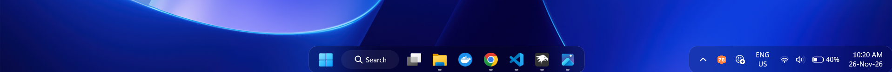
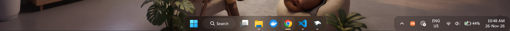
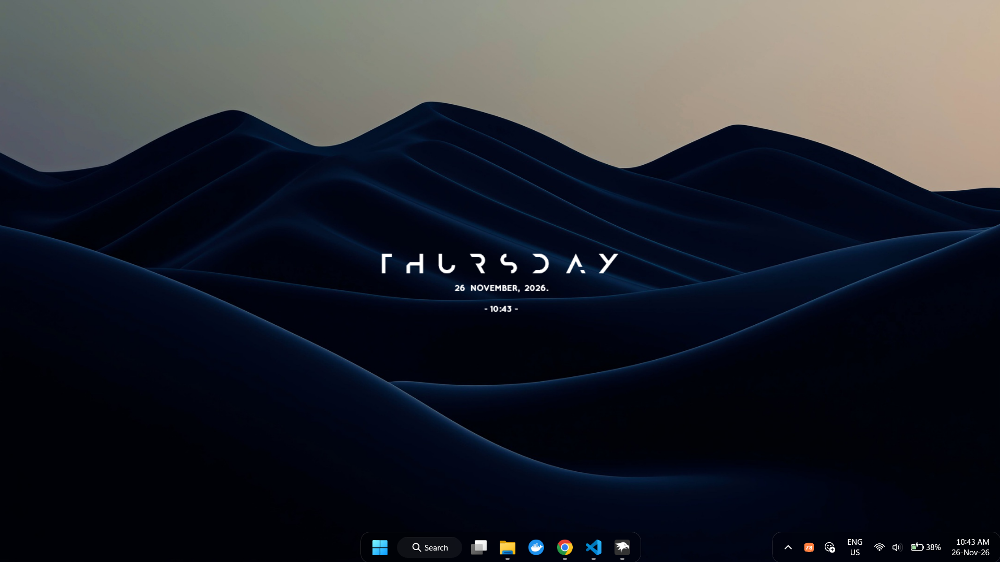
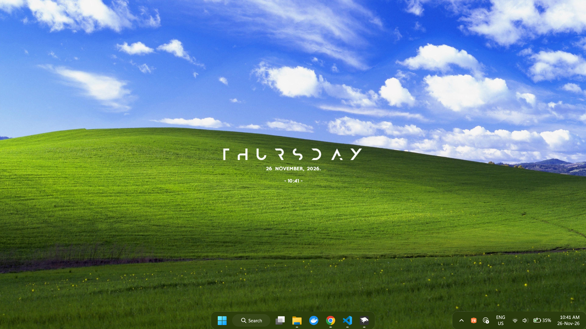
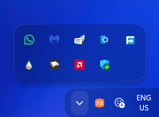
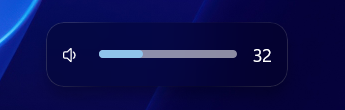
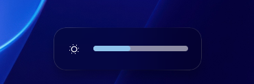
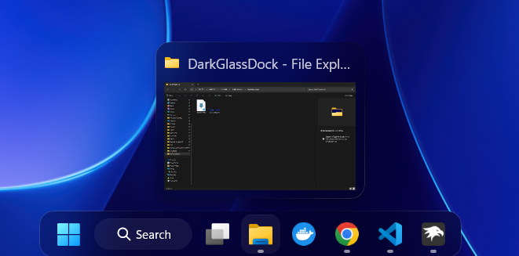
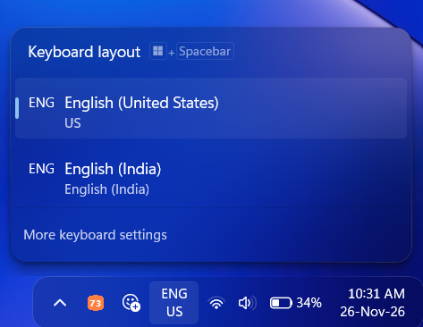

# DarkGlassDock theme for Windows 11 Taskbar Styler

**Author**: [nkswalih](https://github.com/nkswalih)

A dark Liquid Glass floating dock and separated system tray theme for Windows 11 Taskbar Styler, with muted gradient glass borders and matching styling for the hidden icons menu, volume and brightness OSD, hover thumbnails, and language switcher.







## Features

* **Floating Center Dock & Separated System Tray:** Cleanly splits the app dock and system tray into matching floating glass islands.
* **Windows 11 Update-Proof (`TrayInFrame` Support):** Automatically handles both classic Windows 11 taskbars and newer 25H2/26H2 builds where the system tray is merged inside `TaskbarFrameRepeater`.
* **Dark Liquid Glass Blur:** Uses `WindhawkBlur` (`BlurAmount="24"`, `TintColor="#30000000"`) with Windows' default opaque background fill and top border line removed.
* **Muted Specular Gradient Borders:** Uses a toned-down angled gradient border (`$DockBorder`) across the dock, tray, and flyouts for crisp edge shading without excessive brightness.
* **Proper Show Desktop Corner Button:** Cleanly removes excess right-side tray padding and aligns the **Show Desktop (`|`)** button snugly inside the far-right rounded corner, keeping it easily accessible without breaking the rounded pill aesthetic.
* **Dock Hover Zoom Animation:** Smooth `1.12x` scale-up animation on taskbar app icons with transparent hover plates.
* **Fully Styled Taskbar Popups:**
  * **Tray Overflow Menu (Hidden Icons)** & rounded chevron button (`^`)
  * **Hardware Volume Popup (OSD)** with rounded track bars
  * **App Hover Thumbnail Previews**
  * **Language / Keyboard Layout Switcher (`Win + Space`)**

## Previews

| Tray & Overflow Menu | Volume OSD | Brightness OSD
| :---: | :---: | :---: |
|  |  | 

| App Hover Thumbnail | Language Switcher |
| :---: | :---: |
|  |  |

## Requirements & Recommended Settings

* **Windows 11 Taskbar Styler v1.11.2+** (required for `TrayInFrame` expression captures).
* Set Windows Taskbar alignment to **Center** (*Settings > Personalization > Taskbar > Taskbar behaviors > Taskbar alignment*).

## Manual installation

To import the theme styles manually, follow these steps:

* Open the **Windows 11 Taskbar Styler** mod in Windhawk.
* Go to the **Settings** tab and select **Textual mode**.
* Copy the content below into the text box and click **Save settings**.
* If the layout does not snap immediately after saving, restart **Windows Explorer** in Task Manager.

<details>
<summary>Content to import (click to expand)</summary>

```yaml
theme: ''
styleConstants:
  - DockBackground=<WindhawkBlur BlurAmount="24" TintColor="#30000000" />
  - DockBorder=<LinearGradientBrush EndPoint="1.04,1.11" StartPoint="-0.02,-0.12"><GradientStop Color="#45878787" Offset="0.13"/><GradientStop Color="#251C1C1C" Offset="0.3"/><GradientStop Color="#2D1C1C1C" Offset="0.67"/><GradientStop Color="#45878787" Offset="0.9"/></LinearGradientBrush>
  - TrayInFrame=(TrayInFrameWidth==``?0:taskbarDock!=`vertical`)
  - DockWidth=(DockRepeaterWidth-TrayInFrameWidth+16)
  - DockOffset=max((containerGridWidth-$DockWidth)/2,0)
controlStyles:
  - target: ':root > ScrollViewer > ScrollContentPresenter > Border'
    styles:
      - ActualWidth=>containerGridWidth
  - target: Taskbar.TaskbarFrame > Grid#RootGrid@DockingStates
    styles:
      - Tag=horizontal
      - Tag@DockedLeft=vertical
      - Tag@DockedRight=vertical
      - Tag=>taskbarDock
  - target: Taskbar.TaskbarFrame
    styles:
      - Margin=0,0,0,0
      - Width={{taskbarDock==`vertical`?skip():`Auto`}}
      - HorizontalAlignment={{$TrayInFrame?`Left`:`Center`}}
      - MinWidth={{$TrayInFrame?$DockOffset+$DockWidth:skip()}}
  - target: Taskbar.TaskbarFrame > Grid#RootGrid
    styles:
      - Background:={{$TrayInFrame?`Transparent`:`$DockBackground`}}
      - BorderBrush:={{$TrayInFrame?skip():`$DockBorder`}}
      - BorderThickness={{$TrayInFrame?0:1}}
      - CornerRadius={{$TrayInFrame?0:14}}
      - Height=48
      - Margin=0,0,0,0
      - Padding={{$TrayInFrame?0:`6,0,6,0`}}
      - HorizontalAlignment={{$TrayInFrame?`Stretch`:`Center`}}
      - Width=Auto
  - target: Taskbar.TaskbarFrame > Grid#RootGrid > Taskbar.TaskbarBackground > Grid > Rectangle#BackgroundFill
    styles:
      - Visibility=Collapsed
  - target: Taskbar.TaskbarFrame > Grid#RootGrid > Taskbar.TaskbarBackground > Grid > Rectangle#BackgroundStroke
    styles:
      - Visibility=Collapsed
  - target: Taskbar.TaskbarFrame > Grid#RootGrid > Taskbar.TaskbarBackground
    styles:
      - Margin={{$TrayInFrame?$DockOffset:0}},0,{{$TrayInFrame?max(DockRepeaterWidth-$DockOffset-$DockWidth,0):0}},0
  - target: Taskbar.TaskbarFrame > Grid#RootGrid > Taskbar.TaskbarBackground > Grid
    styles:
      - Background:={{$TrayInFrame?`$DockBackground`:skip()}}
      - BorderBrush:={{$TrayInFrame?`$DockBorder`:skip()}}
      - BorderThickness={{$TrayInFrame?1:skip()}}
      - CornerRadius={{$TrayInFrame?14:skip()}}
      - Height=48
  - target: Taskbar.TaskbarFrame > Grid#RootGrid > Microsoft.UI.Xaml.Controls.ItemsRepeater#TaskbarFrameRepeater
    styles:
      - HorizontalAlignment={{$TrayInFrame?`Left`:skip()}}
      - MaxWidth={{$TrayInFrame?containerGridWidth-16:skip()}}
      - ActualWidth=>DockRepeaterWidth
  - target: Microsoft.UI.Xaml.Controls.ItemsRepeater#TaskbarFrameRepeater > Taskbar.ExperienceToggleButton, Microsoft.UI.Xaml.Controls.ItemsRepeater#TaskbarFrameRepeater > Taskbar.TaskListButton, Microsoft.UI.Xaml.Controls.ItemsRepeater#TaskbarFrameRepeater > Taskbar.SearchBoxButton, Microsoft.UI.Xaml.Controls.ItemsRepeater#TaskbarFrameRepeater > SearchUx.SearchUI.SearchButtonControl, Microsoft.UI.Xaml.Controls.ItemsRepeater#TaskbarFrameRepeater > Taskbar.AugmentedEntryPointButton, Microsoft.UI.Xaml.Controls.ItemsRepeater#TaskbarFrameRepeater > Taskbar.TaskbarExtensionElement, Microsoft.UI.Xaml.Controls.ItemsRepeater#TaskbarFrameRepeater > Taskbar.OverflowToggleButton
    styles:
      - Margin={{$TrayInFrame?8+$DockOffset:skip()}},0,{{$TrayInFrame?-(8+$DockOffset):skip()}},0
  - target: Taskbar.TaskbarExtensionElement > ContentPresenter > SystemTray.SystemTrayFrame
    styles:
      - ActualWidth=>TrayInFrameWidth
      - Margin={{$TrayInFrame?(containerGridWidth-8-$DockOffset-DockRepeaterWidth):skip()}},0,{{$TrayInFrame?-(containerGridWidth-8-$DockOffset-DockRepeaterWidth):skip()}},0
  - target: SystemTray.SystemTrayFrame
    styles:
      - Background=Transparent
  - target: StackPanel#SystemTrayFrameGrid, Grid#SystemTrayFrameGrid
    styles:
      - Background:=$DockBackground
      - CornerRadius=14
      - BorderBrush:=$DockBorder
      - BorderThickness=1
      - Height=48
      - Margin=0,0,0,0
      - Padding=8,0,-2,0
  - target: Border#OverflowFlyoutBackgroundBorder
    styles:
      - Background:=$DockBackground
      - BorderBrush:=$DockBorder
      - BorderThickness=1
      - CornerRadius=16
  - target: SystemTray.ChevronIconView
    styles:
      - CornerRadius=10
  - target: SystemTray.ChevronIconView > Grid#ContainerGrid > Border#BackgroundBorder
    styles:
      - CornerRadius=10
      - Margin=2,4,2,4
  - target: Windows.UI.Xaml.Controls.Grid#ConfirmatorMainGrid
    styles:
      - Background:=$DockBackground
      - BorderBrush:=$DockBorder
      - BorderThickness=1
      - CornerRadius=14
      - Margin=0,0,0,12
  - target: Windows.UI.Xaml.Shapes.Rectangle#HorizontalTrackRect
    styles:
      - RadiusX=3
      - RadiusY=3
      - Height=6
  - target: Windows.UI.Xaml.Shapes.Rectangle#HorizontalDecreaseRect
    styles:
      - RadiusX=3
      - RadiusY=3
      - Height=6
  - target: Windows.UI.Xaml.Controls.TextBlock#volumeLevelText
    styles:
      - Foreground=White
  - target: Border#HoverFlyoutBackground
    styles:
      - Background:=$DockBackground
      - BorderBrush:=$DockBorder
      - BorderThickness=1
      - CornerRadius=14
  - target: Windows.UI.Xaml.Controls.Grid#HoverFlyoutGrid > Windows.UI.Xaml.Controls.Border#HoverFlyoutBackground
    styles:
      - Background:=$DockBackground
      - BorderBrush:=$DockBorder
      - BorderThickness=1
      - CornerRadius=14
  - target: Taskbar.TaskbarBackground#HoverFlyoutBackgroundControl > Grid > Rectangle#BackgroundFill
    styles:
      - Fill:=Transparent
  - target: WindowsInternal.ComposableShell.Experiences.TextInput.Common.InputSwitcher > ContentControl > ContentPresenter > Grid
    styles:
      - Background:=$DockBackground
      - BorderBrush:=$DockBorder
      - BorderThickness=1
      - CornerRadius=14
  - target: WindowsInternal.ComposableShell.Experiences.TextInput.Common.InputSwitcher > ContentControl > ContentPresenter > Grid > Grid
    styles:
      - Background:=Transparent
  - target: Taskbar.TaskListButton
    styles:
      - CornerRadius=10
  - target: Taskbar.ExperienceToggleButton
    styles:
      - CornerRadius=10
  - target: Taskbar.SearchBoxButton
    styles:
      - CornerRadius=0
  - target: Taskbar.TaskListButtonPanel > Border#BackgroundElement@CommonStates
    styles:
      - Background@PointerOver=Transparent
      - Background@Pressed=Transparent
  - target: Taskbar.TaskListButton@CommonStates
    styles:
      - RenderTransform@PointerOver:=<ScaleTransform ScaleX="1.12" ScaleY="1.12" />
      - RenderTransformOrigin=0.5,1
themeResourceVariables:
  - ''
clickThroughTaskbar: 0
xamlDiagnosticsHandling: ''

```

</details>

## Customizing

* **Blur & Tint (`DockBackground`):** Adjust `BlurAmount` or `TintColor` in `styleConstants` to make the glass lighter or darker.
* **Border Brightness (`DockBorder`):** Adjust the alpha hex values (`#45` / `#25` / `#2D`) in `styleConstants` if you want a stronger or softer glass edge.
* **Flush Screen-Corner "Show Desktop" Button:** If you want the Show Desktop button flush against the absolute bottom-right pixel with zero right rounding, update `StackPanel#SystemTrayFrameGrid, Grid#SystemTrayFrameGrid` to:
  * `CornerRadius=14,0,0,14`
  * `BorderThickness=1,1,0,1`
  * `Padding=8,0,0,0`