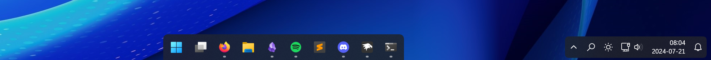
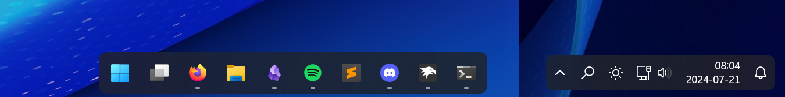

# DockLike theme for Windows 11 Taskbar Styler

**Author**: [Amber](https://github.com/AmberWat)



## Notes

This theme is meant as a fairly vanilla implementation of a dock-like taskbar. It works great out of the box, but there are several tweaks that can be made.

### Suggested Windows settings

- Choose Left or Center for taskbar icon alignment in Windows settings; the dock follows that setting automatically
- Hide the widgets button
- If you have another clock, for example from a Rainmeter skin or an application like ElevenClock, you can hide the taskbar clock in Windows date & time settings

### Taskbar alignment

Change **Taskbar icon alignment** in Windows settings to switch the dock between Left and Center. With Left alignment, the widgets button is placed next to the system tray, as in the default Windows layout.

The theme detects alignment from the Start button's native padding, which has extra space on the left when icons are left-aligned. This has been tested with the default and small taskbar sizes. Known limitations:

- On some Windows builds, Explorer doesn't add this padding when switching from Center to Left if it was started with Center, so the dock stays centered. Restart Explorer after changing the setting.
- If the Start button is hidden, the dock stays centered. Use the tweak below to left-align it.
- The [Start button always on the left](https://windhawk.net/mods/taskbar-start-button-position) mod adds this padding in both modes, so the dock is always left-aligned with it.
- Other customizations that replace the Start button template or override its width or padding can also interfere with detection.

### Force left alignment (tweak)

To keep the dock on the left regardless of the Windows setting, add the following control styles:

Target:
```
Taskbar.TaskbarFrame
```
Styles:
```
HorizontalAlignment={{taskbarDock==`vertical`?skip():`Left`}}
Margin={{taskbarDock==`vertical`?skip():`0,0,250,0`}}
```

Target:
```
Taskbar.TaskbarFrame > Grid#RootGrid > Taskbar.TaskbarBackground > Grid
```
Style:
```
CornerRadius={{taskbarDock==`vertical`?`8,8,0,0`:`0,8,0,0`}}
```

### Make the taskbar float (tweak)

This gives it an appearance closer to the MacOS dock.



1. Use the mod [Taskbar height and icon size](https://windhawk.net/mods/taskbar-icon-size) to increase the height of the taskbar by 4 (usually from 48 to 52). This compensates for the added spacing.

2. Add the following control styles:

Target:
```
Taskbar.TaskbarFrame > Grid#RootGrid
```
Style:
```
Margin=0,1,0,3
```

Target:
```
Taskbar.TaskbarFrame > Grid#RootGrid > Taskbar.TaskbarBackground > Grid
```
Style:
```
CornerRadius=8
```

Target:
```
StackPanel#SystemTrayFrameGrid, Grid#SystemTrayFrameGrid
```
Style:
```
Margin=8,1,8,3
```

### Add a border (tweak)

1. Add the following control styles:

Target:
```
Taskbar.TaskbarFrame > Grid#RootGrid > Taskbar.TaskbarBackground > Grid
```
Styles:
```
BorderThickness=1
```
```
BorderBrush:=<SolidColorBrush Color="{ThemeResource SurfaceStrokeColorDefault}" />
```

Target:
```
StackPanel#SystemTrayFrameGrid, Grid#SystemTrayFrameGrid
```
Styles:
```
BorderThickness=1
```
```
BorderBrush:=<SolidColorBrush Color="{ThemeResource SurfaceStrokeColorDefault}" />
```

Target:
```
Taskbar.AugmentedEntryPointButton#AugmentedEntryPointButton > Taskbar.TaskListButtonPanel#ExperienceToggleButtonRootPanel
```
Styles:
```
BorderThickness={{DockNativeAlignment==`Left`?1:skip()}}
```
```
BorderBrush:=<SolidColorBrush Color="{ThemeResource SurfaceStrokeColorDefault}" />
```

2. If you haven't applied the floating taskbar tweak, use `BorderThickness=1,1,1,0` instead of `BorderThickness=1` for the `Taskbar.TaskbarBackground > Grid` target, so that the border isn't drawn along the screen edge.

## Theme selection

The theme is integrated into the mod and can be selected directly from the mod's
settings:

* Open the Windows 11 Taskbar Styler mod in Windhawk.
* Go to the "Settings" tab.
* Select the theme and save the settings.

## Manual installation

The theme styles can also be imported manually. To do that, follow these steps:

* Open the Windows 11 Taskbar Styler mod in Windhawk.
* Go to the "Settings" tab and select "Textual mode".
* Copy the content below to the text box and click "Save settings".

<details>
<summary>Content to import (click to expand)</summary>

```yaml
styleConstants:
  - DockBackground=<AcrylicBrush TintColor="{ThemeResource SystemChromeAltHighColor}" TintOpacity="0.8" FallbackColor="{ThemeResource SystemChromeLowColor}" />
controlStyles:
  - target: Taskbar.TaskbarFrame > Grid#RootGrid@DockingStates
    styles:
      - Tag=horizontal
      - Tag@DockedLeft=vertical
      - Tag@DockedRight=vertical
      - Tag=>taskbarDock
  - target: Taskbar.TaskbarFrame
    styles:
      - Width={{taskbarDock==`vertical`?skip():`Auto`}}
      - HorizontalAlignment={{taskbarDock==`vertical`?skip():DockNativeAlignment==`Left`?`Left`:`Center`}}
      - Margin={{taskbarDock==`vertical`?skip():DockNativeAlignment==`Left`?0:250}},0,250,0
      - ActualWidth=>DockFrameWidth
  - target: :root > ScrollViewer > ScrollContentPresenter > Border > Grid
    styles:
      - ActualWidth=>DockContainerWidth
  - target: Taskbar.AugmentedEntryPointButton#AugmentedEntryPointButton
    styles:
      - Margin={{DockNativeAlignment==`Left`?-DockWidgetsWidth:skip()}},0,0,0
      - RenderTransform:=<TranslateTransform X="{{DockNativeAlignment==`Left`?DockContainerWidth-DockFrameWidth:skip()}}" />
  - target: Taskbar.AugmentedEntryPointButton#AugmentedEntryPointButton > Taskbar.TaskListButtonPanel#ExperienceToggleButtonRootPanel
    styles:
      - ActualWidth=>DockWidgetsWidth
      - Margin={{DockNativeAlignment==`Left`?`0,4,0,4`:0}}
      - Padding={{DockNativeAlignment==`Left`?`6,0,2,0`:skip()}}
      - Background:={{DockNativeAlignment==`Left`?`$DockBackground`:skip()}}
      - CornerRadius={{DockNativeAlignment==`Left`?8:skip()}}
  - target: Taskbar.ExperienceToggleButton#LaunchListButton[AutomationProperties.AutomationId=StartButton] > Taskbar.TaskListButtonPanel#ExperienceToggleButtonRootPanel
    styles:
      - Width=>DockStartWidth
      - Tag={{taskbarDock==`vertical`?`Center`:DockStartWidth==``?`Center`:DockStartInnerWidth==``?`Center`:DockStartInnerWidth<=0?`Center`:DockStartWidth-DockStartInnerWidth>8?`Left`:`Center`}}
      - Tag=>DockNativeAlignment
  - target: Taskbar.ExperienceToggleButton#LaunchListButton[AutomationProperties.AutomationId=StartButton] > Taskbar.TaskListButtonPanel#ExperienceToggleButtonRootPanel > Grid > Border#BackgroundElement, Taskbar.ExperienceToggleButton#LaunchListButton[AutomationProperties.AutomationId=StartButton] > Taskbar.TaskListButtonPanel#ExperienceToggleButtonRootPanel > Border#BackgroundElement
    styles:
      - ActualWidth=>DockStartInnerWidth
  - target: Taskbar.TaskbarFrame > Grid#RootGrid
    styles:
      - Padding=6,0,6,0
  - target: Taskbar.TaskbarFrame > Grid#RootGrid > Taskbar.TaskbarBackground > Grid
    styles:
      - Background:=$DockBackground
      - Margin=-6,0,-6,0
      - CornerRadius={{DockNativeAlignment==`Left`?`0,8,0,0`:`8,8,0,0`}}
      - BorderBrush:=<SolidColorBrush Color="{ThemeResource SurfaceStrokeColorDefault}" />
  - target: Taskbar.TaskbarFrame > Grid#RootGrid > Taskbar.TaskbarBackground > Grid > Rectangle#BackgroundFill
    styles:
      - Visibility=Collapsed
  - target: Rectangle#BackgroundStroke
    styles:
      - Visibility=Collapsed
  - target: StackPanel#SystemTrayFrameGrid, Grid#SystemTrayFrameGrid
    styles:
      - Background:=$DockBackground
      - Margin=-4,-8,-4,-8
      - CornerRadius=10
      - BorderThickness=12,12,12,12
      - BackgroundSizing=InnerBorderEdge
  - target: SystemTray.ChevronIconView
    styles:
      - Padding=0
  - target: SystemTray.NotifyIconView#NotifyItemIcon
    styles:
      - Padding=0
  - target: SystemTray.OmniButton
    styles:
      - Padding=0
  - target: SystemTray.CopilotIcon
    styles:
      - Padding=0
  - target: SystemTray.OmniButton#NotificationCenterButton > Grid > ContentPresenter > ItemsPresenter > StackPanel > ContentPresenter > SystemTray.IconView#SystemTrayIcon > Grid
    styles:
      - Padding=4,0,4,0
  - target: SystemTray.IconView#SystemTrayIcon > Grid#ContainerGrid > ContentPresenter#ContentPresenter > Grid#ContentGrid > SystemTray.TextIconContent > Grid#ContainerGrid
    styles:
      - Padding=0
  - target: SystemTray.StackListView#IconStack > ItemsPresenter > StackPanel > ContentPresenter > SystemTray.IconView#SystemTrayIcon
    styles:
      - Padding=0
  - target: SystemTray.Stack#ShowDesktopStack
    styles:
      - Margin=0,-4,-12,-4
  - target: Taskbar.Gripper#GripperControl
    styles:
      - Width=Auto
      - MinWidth=24
```
</details>
