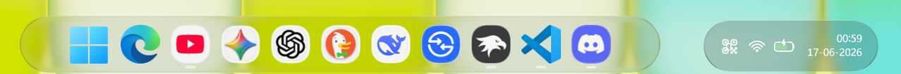
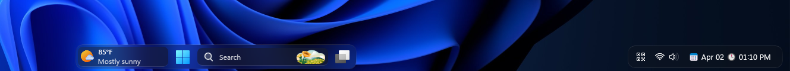

# LiquidGlass (Legacy) theme for Windows 11 Taskbar Styler

**Author**: [PhantomNimbi](https://github.com/PhantomNimbi)

> [!NOTE]
> Support for the LiquidGlass (Legacy) theme is being dropped in favor of [a new Fluid Glass theme](https://github.com/ramensoftware/windows-11-taskbar-styling-guide/blob/main/Themes/LiquidGlass2/README.md) by another author. Their theme is going in the direction this one was aimed and does a lot better than this one does. So, there won't be any future updates to the LiquidGlass (Legacy) theme going forward.



## Taskbar Clock Customization (Optional)

The get the clock to show up like it does in the screenshot, follow these steps:

* Open the Taskbar Clock Customization mod in Windhawk.
* Go to the "Settings" tab and select "Textual mode".
* Copy the content below to the text box and click "Save settings".

<details>
<summary>Content to import (click to expand)</summary>

```yaml
ShowSeconds: 1
TimeFormat: hh':'mm tt;hh':'mm':'ss tt
DateFormat: MMMM dd;dddd - MMMM dd, yyyy
WeekdayFormat: dddd
WeekdayFormatCustom: Sun, Mon, Tue, Wed, Thu, Fri, Sat
TopLine: 📅 %date% 🕒 %time%
BottomLine: 🌐 %web1%
MiddleLine: '%weekday%'
TooltipLine: 📅 %date2%%n%🕒 %time2%%n%%n%🌐 %web1_full%%n%%n%📻 %media_info%
TooltipLineMode: replace
Width: 180
Height: 60
MaxWidth: 0
TextSpacing: 0
DataCollection:
  NetworkMetricsFormat: mbsDynamic
  NetworkMetricsFixedDecimals: -1
  PercentageFormat: spacePaddingAndSymbol
  UpdateInterval: 1
  NetworkAdapterName: ''
  GpuAdapterName: ''
MediaPlayer:
  IgnoredPlayers:
    - ''
  MaxLength: 28
  NoMediaText: No media
  RemoveBrackets: 1
WebContentWeatherLocation: ''
WebContentWeatherFormat: '%c 🌡️%t 🌬️%w'
WebContentWeatherUnits: autoDetect
WebContentsItems:
  - Url: https://rss.nytimes.com/services/xml/rss/nyt/World.xml
    BlockStart: <item>
    Start: <title>
    End: </title>
    ContentMode: xmlHtml
    SearchReplace:
      - Search: ''
        Replace: ''
    MaxLength: 28
WebContentsUpdateInterval: 10
TimeZones:
  - ''
TimeStyle:
  Hidden: 0
  TextColor: ''
  TextAlignment: Center
  FontSize: 0
  FontFamily: ''
  FontWeight: ''
  FontStyle: ''
  FontStretch: ''
  CharacterSpacing: 0
DateStyle:
  Hidden: 1
  TextColor: ''
  TextAlignment: Center
  FontSize: 0
  FontFamily: ''
  FontWeight: ''
  FontStyle: ''
  FontStretch: ''
  CharacterSpacing: 0
oldTaskbarOnWin11: 0
```
</details>

## Theme selection

The theme is integrated into the mod and can be selected directly from the mod's
settings:

* Open the Windows 11 Taskbar Styler mod in Windhawk.
* Go to the "Settings" tab.
* Select the theme and save the settings.

## Manual installation

The theme styles can also be imported manually. To do that, follow these steps:

* Open the Windows 11 Taskbar Styler mod in Windhawk.
* Go to the "Settings" tab and select "Textual mode".
* Copy the content below to the text box and click "Save settings".

<details>
<summary>Content to import (click to expand)</summary>

```yaml
styleConstants:
  - Background=<WindhawkBlur BlurAmount="15" TintColor="{ThemeResource SystemAltLowColor}" TintOpacity="0.2" />
  - ElementBackground=<WindhawkBlur BlurAmount="20" TintColor="{ThemeResource SystemAltLowColor}" TintOpacity="0.4" />
  - ElementBackground2=<WindhawkBlur BlurAmount="20" TintColor="{ThemeResource SystemAltLowColor}" TintOpacity="0.2" />
  - AccentBackground=<WindhawkBlur BlurAmount="15" TintColor="{ThemeResource SystemAccentColorLight1}" TintOpacity="0.2" />
  - BorderBrush=<LinearGradientBrush StartPoint="0,0" EndPoint="0,1"><GradientStop Color="#50808080" Offset="0.0" /><GradientStop Color="#50404040" Offset="0.25" /><GradientStop Color="#50808080" Offset="1" /></LinearGradientBrush>
  - ElementBorderBrush=<LinearGradientBrush StartPoint="0,0" EndPoint="0,1"><GradientStop Color="#50808080" Offset="1" /><GradientStop Color="#50606060" Offset="0.15" /></LinearGradientBrush>
  - BorderThickness=0.3,1,0.3,0.3
  - ElementBorderThickness=0.3,0.3,0.3,1
  - CornerRadius=12
  - ElementCornerRadius=8
controlStyles:
  - target: Taskbar.TaskbarFrame > Grid#RootGrid
    styles:
      - BorderThickness=$BorderThickness
      - BorderBrush:=$BorderBrush
      - Background:=$Background
  - target: Rectangle#BackgroundFill
    styles:
      - Visibility=1
  - target: Rectangle#BackgroundStroke
    styles:
      - Visibility=1
  - target: Taskbar.AugmentedEntryPointButton#AugmentedEntryPointButton > Taskbar.TaskListButtonPanel#ExperienceToggleButtonRootPanel
    styles:
      - Margin=-3,0
  - target: StackPanel#SystemTrayFrameGrid, Grid#SystemTrayFrameGrid
    styles:
      - Background:=$ElementBackground
      - BorderBrush:=$ElementBorderBrush
      - BorderThickness=$ElementBorderThickness
      - CornerRadius=$ElementCornerRadius
      - Margin=6
  - target: SystemTray.ChevronIconView
    styles:
      - CornerRadius=$ElementCornerRadius
  - target: SystemTray.NotifyIconView#NotifyItemIcon
    styles:
      - CornerRadius=$ElementCornerRadius
  - target: SystemTray.OmniButton
    styles:
      - CornerRadius=$ElementCornerRadius
  - target: SystemTray.IconView#SystemTrayIcon > Grid#ContainerGrid > ContentPresenter#ContentPresenter > Grid#ContentGrid > SystemTray.TextIconContent > Grid#ContainerGrid
    styles:
      - CornerRadius=$ElementCornerRadius
  - target: Taskbar.Gripper#GripperControl
    styles:
      - Width=Auto
      - MinWidth=24
      - HorizontalAlignment=Left
  - target: TextBlock#TimeInnerTextBlock
    styles:
      - FontSize=13
      - Margin=0
      - Padding=0
      - RenderTransform:=<TranslateTransform X="0" Y="0" />
  - target: TextBlock#DateInnerTextBlock
    styles:
      - Visibility=1
  - target: TextBlock#InnerTextBlock[Text=], TextBlock#InnerTextBlock[Text=]
    styles:
      - Text=
  - target: TextBlock#SearchBoxTextBlock
    styles:
      - Text=Search This PC
      - FontSize=10
  - target: SystemTray.OmniButton#NotificationCenterButton > Grid > ContentPresenter > ItemsPresenter > StackPanel > ContentPresenter > SystemTray.IconView#SystemTrayIcon > Grid > Grid > SystemTray.TextIconContent
    styles:
      - Visibility=1
  - target: Border#OverflowFlyoutBackgroundBorder
    styles:
      - BorderThickness=$BorderThickness
      - BorderBrush:=$BorderBrush
      - Background:=$Background
      - CornerRadius=$CornerRadius
  - target: WindowsInternal.ComposableShell.Experiences.Switcher.AltTab > Windows.UI.Xaml.Controls.Grid#ModalRootGrid > Windows.UI.Xaml.Controls.Border#BackgroundElement
    styles:
      - BorderThickness=0
      - Background=Transparent
      - CornerRadius=$CornerRadius
  - target: WindowsInternal.ComposableShell.Experiences.Switcher.AltTab > Windows.UI.Xaml.Controls.Grid#ModalRootGrid > Windows.UI.Xaml.Controls.Border#BackgroundElement > WindowsInternal.ComposableShell.Experiences.Switcher.SwitchItemList
    styles:
      - Background:=$Background
      - BorderThickness=$BorderThickness
      - BorderBrush:=$BorderBrush
      - CornerRadius=$CornerRadius
  - target: WindowsInternal.ComposableShell.Experiences.Switcher.VirtualDesktopBarElement#VirtualDesktopBar
    styles:
      - CornerRadius=$CornerRadius
      - Background:=$Background
  - target: Border#BackgroundDimmingLayer
    styles:
      - Background:=$Background
      - CornerRadius=$CornerRadius
  - target: Taskbar.TaskListButtonPanel#ExperienceToggleButtonRootPanel > Grid > Border#BackgroundElement, Taskbar.TaskListButtonPanel#ExperienceToggleButtonRootPanel > Border#BackgroundElement
    styles:
      - CornerRadius=$CornerRadius
      - BorderThickness=$ElementBorderThickness
  - target: Taskbar.TaskListButton#TaskListButton
    styles:
      - CornerRadius=$ElementCornerRadius
      - BorderThickness=$ElementBorderThickness
  - target: Border#SnapBarBorder
    styles:
      - Background:=$Background
      - BorderBrush:=$BorderBrush
      - CornerRadius=$CornerRadius
      - BorderThickness=$BorderThickness
      - Margin=2
  - target: Grid#IconPanel@CommonStates > Border#BackgroundElement, Taskbar.TaskListLabeledButtonPanel@CommonStates > Border#BackgroundElement
    styles:
      - CornerRadius=$ElementCornerRadius
      - BorderThickness=$ElementBorderThickness
      - Background@ActiveNormal:=$ElementBackground
      - Background@ActivePointerOver:=$AccentBackground
      - Background@ActivePressed:=$ElementBackground2
      - Background@InactivePointerOver:=$AccentBackground
      - Background@InactivePressed:=$ElementBackground2
      - BorderBrush@ActiveNormal:=$ElementBorderBrush
      - BorderBrush@ActivePointerOver:=$ElementBorderBrush
      - BorderBrush@ActivePressed:=$ElementBorderBrush
      - BorderBrush@InactivePointerOver:=$ElementBorderBrush
      - BorderBrush@InactivePressed:=$ElementBorderBrush
      - Margin=1
  - target: ContentPresenter#ContentPresenter@CommonStates
    styles:
      - CornerRadius=$ElementCornerRadius
      - BorderThickness=$ElementBorderThickness
      - Background@ActiveNormal:=$ElementBackground
      - Background@ActivePointerOver:=$AccentBackground
      - Background@ActivePressed:=$ElementBackground2
      - Background@InactivePointerOver:=$AccentBackground
      - Background@InactivePressed:=$ElementBackground2
      - BorderBrush@ActiveNormal:=$ElementBorderBrush
      - BorderBrush@ActivePointerOver:=$ElementBorderBrush
      - BorderBrush@ActivePressed:=$ElementBorderBrush
      - BorderBrush@InactivePointerOver:=$ElementBorderBrush
      - BorderBrush@InactivePressed:=$ElementBorderBrush
      - Margin=1
  - target: Border#SnapPickerBorder
    styles:
      - Background:=$Background
      - BorderBrush:=$BorderBrush
      - CornerRadius=$CornerRadius
      - BorderThickness=$BorderThickness
      - Margin=2
  - target: Taskbar.TaskListButtonPanel#ExperienceToggleButtonRootPanel
    styles:
      - Background:=Transparent
  - target: ToolTip > ContentPresenter#LayoutRoot
    styles:
      - Background:=$Background
      - BorderBrush:=$BorderBrush
      - BorderThickness:=$BorderThickness
      - CornerRadius=$CornerRadius
  - target: WindowsInternal.ComposableShell.Experiences.Switcher.VirtualDesktopBarElement > Grid#GridElement > Border#VirtualDesktopSwitcherBackground
    styles:
      - BorderBrush:=$BorderBrush
      - BorderThickness=$BorderThickness
      - CornerRadius=$CornerRadius
      - Background:=$Background
  - target: WindowsInternal.ComposableShell.Experiences.Switcher.SwitchItemListViewItem > Grid > Border
    styles:
      - CornerRadius=$CornerRadius
  - target: Border#VirtualDesktopBarBackground
    styles:
      - Background:=$Background
      - BorderBrush:=$BorderBrush
      - BorderThickness=$BorderThickness
      - CornerRadius=$CornerRadius
  - target: Rectangle#RunningIndicator
    styles:
      - Fill:=$AccentBackground
      - Width=14
  - target: Rectangle#ShowDesktopPipe
    styles:
      - Visibility=1
  - target: Rectangle#RightOverflowButtonDivider
    styles:
      - Visibility=1
  - target: SearchUx.SearchUI.SearchIconButton > SearchUx.SearchUI.SearchButtonRootGrid@CommonStates > Grid > Border#BackgroundElement, SearchUx.SearchUI.SearchIconButton > SearchUx.SearchUI.SearchButtonRootGrid@CommonStates > Border#BackgroundElement
    styles:
      - Background:=Transparent
      - BorderBrush:=Transparent
  - target: SearchUx.SearchUI.SearchButtonRootGrid
    styles:
      - Background:=Transparent
      - BorderBrush:=Transparent
  - target: Border#SearchPillBackgroundElement
    styles:
      - BorderBrush:=$ElementBorderBrush
      - BorderThickness=$ElementBorderThickness
      - CornerRadius=$ElementCornerRadius
      - Margin=0,1
  - target: SearchUx.SearchUI.SearchBoxButton > SearchUx.SearchUI.SearchButtonRootGrid@CommonStates > Grid > Border#BackgroundElement, SearchUx.SearchUI.SearchBoxButton > SearchUx.SearchUI.SearchButtonRootGrid@CommonStates > Border#BackgroundElement
    styles:
      - CornerRadius=$ElementCornerRadius
      - BorderThickness=$ElementBorderThickness
      - BorderBrush:=$ElementBorderBrush
      - Background:=$ElementBackground
      - Margin=0,-4
  - target: Canvas#HoverFlyoutCanvas > Grid#HoverFlyoutGrid > Border#HoverFlyoutBackground
    styles:
      - Shadow:=
      - Background:=$Background
      - BorderBrush:=$BorderBrush
      - BorderThickness=$BorderThickness
      - CornerRadius=$CornerRadius
  - target: SystemTray.SystemTrayFrame
    styles:
      - HorizontalAlignment=Right
  - target: Grid#AugmentedEntryPointContentGrid
    styles:
      - HorizontalAlignment=Left
```
</details>

### Alternate variant



<details>
<summary>Content to import (click to expand)</summary>

```yaml
styleConstants:
  - Background=<WindhawkBlur BlurAmount="15" TintColor="{ThemeResource SystemAltLowColor}" TintOpacity="0.2" />
  - ElementBackground=<WindhawkBlur BlurAmount="20" TintColor="{ThemeResource SystemAltLowColor}" TintOpacity="0.4" />
  - ElementBackground2=<WindhawkBlur BlurAmount="20" TintColor="{ThemeResource SystemAltLowColor}" TintOpacity="0.2" />
  - AccentBackground=<WindhawkBlur BlurAmount="15" TintColor="{ThemeResource SystemAccentColorLight1}" TintOpacity="0.2" />
  - BorderBrush=<LinearGradientBrush StartPoint="0,0" EndPoint="0,1"><GradientStop Color="#50808080" Offset="0.0" /><GradientStop Color="#50404040" Offset="0.25" /><GradientStop Color="#50808080" Offset="1" /></LinearGradientBrush>
  - ElementBorderBrush=<LinearGradientBrush StartPoint="0,0" EndPoint="0,1"><GradientStop Color="#50808080" Offset="1" /><GradientStop Color="#50606060" Offset="0.15" /></LinearGradientBrush>
  - BorderThickness=0.3,1,0.3,0.3
  - ElementBorderThickness=0.3,0.3,0.3,1
  - CornerRadius=12
  - ElementCornerRadius=8
  - // Builds where the tray is an item of the taskbar frame, with a horizontal taskbar. The frame and the repeater stay at the left edge there, since Explorer positions the tray, its flyouts and the jump lists from item positions within the repeater as if it started there. The dock is moved by margins on the items instead.
  - TrayInFrame=(TrayInFrameWidth==``?0:taskbarDock!=`vertical`)
  - // Where TrayInFrame is set, the dock's width and its distance from the screen's left edge.
  - DockWidth=(DockRepeaterWidth-TrayInFrameWidth-13+2.6)
  - DockOffset=max((containerGridWidth-$DockWidth-12)/2,0)
controlStyles:
  - target: Taskbar.TaskbarFrame > Grid#RootGrid@DockingStates
    styles:
      - Tag=horizontal
      - Tag@DockedLeft=vertical
      - Tag@DockedRight=vertical
      - Tag=>taskbarDock
  - target: Taskbar.TaskbarFrame
    styles:
      - Width={{taskbarDock==`vertical`?skip():`Auto`}}
      - MaxWidth={{$TrayInFrame?skip():1200}}
      - HorizontalAlignment={{$TrayInFrame?`Left`:`Center`}}
      - MinWidth={{$TrayInFrame?$DockOffset+$DockWidth:skip()}}
      - // Makes room for the dock background, since the item offset below isn't part of the repeater's width.
  - target: Taskbar.TaskbarFrame > Grid#RootGrid
    styles:
      - Margin=0,3,{{$TrayInFrame?0:12}},3
      - BorderThickness={{$TrayInFrame?0:`$BorderThickness`}}
      - BorderBrush:={{$TrayInFrame?skip():`$BorderBrush`}}
      - CornerRadius={{$TrayInFrame?0:$CornerRadius}}
      - Background:={{$TrayInFrame?skip():`$Background`}}
      - Padding={{$TrayInFrame?0:1}}
  - target: Taskbar.TaskbarFrame > Grid#RootGrid > Taskbar.TaskbarBackground > Grid
    styles:
      - BorderThickness={{$TrayInFrame?`$BorderThickness`:skip()}}
      - BorderBrush:={{$TrayInFrame?`$BorderBrush`:skip()}}
      - CornerRadius={{$TrayInFrame?$CornerRadius:skip()}}
      - Background:={{$TrayInFrame?`$Background`:skip()}}
      - Margin={{$TrayInFrame?$DockOffset:skip()}},0,{{$TrayInFrame?max(DockRepeaterWidth-$DockOffset-$DockWidth,0):skip()}},0
  - target: Rectangle#BackgroundFill
    styles:
      - Visibility=1
  - target: Rectangle#BackgroundStroke
    styles:
      - Visibility=1
  - target: Taskbar.AugmentedEntryPointButton#AugmentedEntryPointButton > Taskbar.TaskListButtonPanel#ExperienceToggleButtonRootPanel
    styles:
      - Margin=-3,0
  - target: StackPanel#SystemTrayFrameGrid, Grid#SystemTrayFrameGrid
    styles:
      - Background:=$ElementBackground
      - BorderBrush:=$ElementBorderBrush
      - BorderThickness=$ElementBorderThickness
      - CornerRadius=$ElementCornerRadius
      - Margin=6
  - target: SystemTray.ChevronIconView
    styles:
      - CornerRadius=$ElementCornerRadius
  - target: SystemTray.NotifyIconView#NotifyItemIcon
    styles:
      - CornerRadius=$ElementCornerRadius
  - target: SystemTray.OmniButton
    styles:
      - CornerRadius=$ElementCornerRadius
  - target: SystemTray.IconView#SystemTrayIcon > Grid#ContainerGrid > ContentPresenter#ContentPresenter > Grid#ContentGrid > SystemTray.TextIconContent > Grid#ContainerGrid
    styles:
      - CornerRadius=$ElementCornerRadius
  - target: Taskbar.Gripper#GripperControl
    styles:
      - Width=Auto
      - MinWidth=24
      - HorizontalAlignment=Left
  - target: TextBlock#TimeInnerTextBlock
    styles:
      - FontSize=13
      - Margin=0
      - Padding=0
      - RenderTransform:=<TranslateTransform X="0" Y="0" />
  - target: TextBlock#DateInnerTextBlock
    styles:
      - Visibility=1
  - target: TextBlock#InnerTextBlock[Text=], TextBlock#InnerTextBlock[Text=]
    styles:
      - Text=
  - target: TextBlock#SearchBoxTextBlock
    styles:
      - Text=Search This PC
      - FontSize=10
  - target: SystemTray.OmniButton#NotificationCenterButton > Grid > ContentPresenter > ItemsPresenter > StackPanel > ContentPresenter > SystemTray.IconView#SystemTrayIcon > Grid > Grid > SystemTray.TextIconContent
    styles:
      - Visibility=1
  - target: Border#OverflowFlyoutBackgroundBorder
    styles:
      - BorderThickness=$BorderThickness
      - BorderBrush:=$BorderBrush
      - Background:=$Background
      - CornerRadius=$CornerRadius
  - target: WindowsInternal.ComposableShell.Experiences.Switcher.AltTab > Windows.UI.Xaml.Controls.Grid#ModalRootGrid > Windows.UI.Xaml.Controls.Border#BackgroundElement
    styles:
      - BorderThickness=0
      - Background=Transparent
      - CornerRadius=$CornerRadius
  - target: WindowsInternal.ComposableShell.Experiences.Switcher.AltTab > Windows.UI.Xaml.Controls.Grid#ModalRootGrid > Windows.UI.Xaml.Controls.Border#BackgroundElement > WindowsInternal.ComposableShell.Experiences.Switcher.SwitchItemList
    styles:
      - Background:=$Background
      - BorderThickness=$BorderThickness
      - BorderBrush:=$BorderBrush
      - CornerRadius=$CornerRadius
  - target: WindowsInternal.ComposableShell.Experiences.Switcher.VirtualDesktopBarElement#VirtualDesktopBar
    styles:
      - CornerRadius=$CornerRadius
      - Background:=$Background
  - target: Border#BackgroundDimmingLayer
    styles:
      - Background:=$Background
      - CornerRadius=$CornerRadius
  - target: Taskbar.AugmentedEntryPointButton#AugmentedEntryPointButton > Taskbar.TaskListButtonPanel#ExperienceToggleButtonRootPanel
    styles:
      - Margin=2
      - Background:=$ElementBackground
      - CornerRadius=$ElementCornerRadius
      - BorderThickness=$ElementBorderThickness
      - BorderBrush:=$ElementBorderBrush
      - Padding=0,-6
      - MaxWidth:=200
      - MaxHeight=46
  - target: Taskbar.TaskListButtonPanel#ExperienceToggleButtonRootPanel > Grid > Border#BackgroundElement, Taskbar.TaskListButtonPanel#ExperienceToggleButtonRootPanel > Border#BackgroundElement
    styles:
      - CornerRadius=$ElementCornerRadius
      - BorderThickness=$ElementBorderThickness
  - target: Taskbar.TaskListButton#TaskListButton
    styles:
      - CornerRadius=$ElementCornerRadius
      - BorderThickness=$ElementBorderThickness
  - target: Border#SnapBarBorder
    styles:
      - Background:=$Background
      - BorderBrush:=$BorderBrush
      - CornerRadius=$CornerRadius
      - BorderThickness=$BorderThickness
      - Margin=2
  - target: Grid#IconPanel@CommonStates > Border#BackgroundElement, Taskbar.TaskListLabeledButtonPanel@CommonStates > Border#BackgroundElement
    styles:
      - CornerRadius=$ElementCornerRadius
      - BorderThickness=$ElementBorderThickness
      - Background@ActiveNormal:=$ElementBackground
      - Background@ActivePointerOver:=$AccentBackground
      - Background@ActivePressed:=$ElementBackground2
      - Background@InactivePointerOver:=$AccentBackground
      - Background@InactivePressed:=$ElementBackground2
      - BorderBrush@ActiveNormal:=$ElementBorderBrush
      - BorderBrush@ActivePointerOver:=$ElementBorderBrush
      - BorderBrush@ActivePressed:=$ElementBorderBrush
      - BorderBrush@InactivePointerOver:=$ElementBorderBrush
      - BorderBrush@InactivePressed:=$ElementBorderBrush
      - Margin=1
  - target: ContentPresenter#ContentPresenter@CommonStates
    styles:
      - CornerRadius=$ElementCornerRadius
      - BorderThickness=$ElementBorderThickness
      - Background@ActiveNormal:=$ElementBackground
      - Background@ActivePointerOver:=$AccentBackground
      - Background@ActivePressed:=$ElementBackground2
      - Background@InactivePointerOver:=$AccentBackground
      - Background@InactivePressed:=$ElementBackground2
      - BorderBrush@ActiveNormal:=$ElementBorderBrush
      - BorderBrush@ActivePointerOver:=$ElementBorderBrush
      - BorderBrush@ActivePressed:=$ElementBorderBrush
      - BorderBrush@InactivePointerOver:=$ElementBorderBrush
      - BorderBrush@InactivePressed:=$ElementBorderBrush
      - Margin=1
  - target: Border#SnapPickerBorder
    styles:
      - Background:=$Background
      - BorderBrush:=$BorderBrush
      - CornerRadius=$CornerRadius
      - BorderThickness=$BorderThickness
      - Margin=2
  - target: ToolTip > ContentPresenter#LayoutRoot
    styles:
      - Background:=$Background
      - BorderBrush:=$BorderBrush
      - BorderThickness:=$BorderThickness
      - CornerRadius=$CornerRadius
  - target: WindowsInternal.ComposableShell.Experiences.Switcher.VirtualDesktopBarElement > Grid#GridElement > Border#VirtualDesktopSwitcherBackground
    styles:
      - BorderBrush:=$BorderBrush
      - BorderThickness=$BorderThickness
      - CornerRadius=$CornerRadius
      - Background:=$Background
  - target: WindowsInternal.ComposableShell.Experiences.Switcher.SwitchItemListViewItem > Grid > Border
    styles:
      - CornerRadius=$CornerRadius
  - target: Border#VirtualDesktopBarBackground
    styles:
      - Background:=$Background
      - BorderBrush:=$BorderBrush
      - BorderThickness=$BorderThickness
      - CornerRadius=$CornerRadius
  - target: Rectangle#RunningIndicator
    styles:
      - Fill:=$AccentBackground
      - Width=14
  - target: Rectangle#ShowDesktopPipe
    styles:
      - Visibility=1
  - target: Rectangle#RightOverflowButtonDivider
    styles:
      - Visibility=1
  - target: SearchUx.SearchUI.SearchIconButton > SearchUx.SearchUI.SearchButtonRootGrid@CommonStates > Grid > Border#BackgroundElement, SearchUx.SearchUI.SearchIconButton > SearchUx.SearchUI.SearchButtonRootGrid@CommonStates > Border#BackgroundElement
    styles:
      - Background:=Transparent
      - BorderBrush:=Transparent
  - target: SearchUx.SearchUI.SearchButtonRootGrid
    styles:
      - Background:=Transparent
      - BorderBrush:=Transparent
  - target: Border#SearchPillBackgroundElement
    styles:
      - BorderBrush:=$ElementBorderBrush
      - BorderThickness=$ElementBorderThickness
      - CornerRadius=$ElementCornerRadius
      - Margin=0,1
  - target: SearchUx.SearchUI.SearchBoxButton > SearchUx.SearchUI.SearchButtonRootGrid@CommonStates > Grid > Border#BackgroundElement, SearchUx.SearchUI.SearchBoxButton > SearchUx.SearchUI.SearchButtonRootGrid@CommonStates > Border#BackgroundElement
    styles:
      - CornerRadius=$ElementCornerRadius
      - BorderThickness=$ElementBorderThickness
      - BorderBrush:=$ElementBorderBrush
      - Background:=$ElementBackground
      - Margin=0,-4
  - target: Canvas#HoverFlyoutCanvas > Grid#HoverFlyoutGrid > Border#HoverFlyoutBackground
    styles:
      - Shadow:=
      - Background:=$Background
      - BorderBrush:=$BorderBrush
      - BorderThickness=$BorderThickness
      - CornerRadius=$CornerRadius
  - target: SystemTray.SystemTrayFrame
    styles:
      - HorizontalAlignment=Right
  - target: Grid#AugmentedEntryPointContentGrid
    styles:
      - HorizontalAlignment=Left
  - target: Taskbar.TaskbarExtensionElement > ContentPresenter > SystemTray.SystemTrayFrame
    styles:
      - ActualWidth=>TrayInFrameWidth
      - Margin={{$TrayInFrame?(containerGridWidth-TrayInFrameWidth-(1.3+$DockOffset)-(DockRepeaterWidth-TrayInFrameWidth-13)):skip()}},-4,{{$TrayInFrame?-((containerGridWidth-TrayInFrameWidth-(1.3+$DockOffset)-(DockRepeaterWidth-TrayInFrameWidth-13))-13):skip()}},-4
      - // Moves the tray to the screen edge. The negative right margin keeps the tray item's width, and so the repeater's, independent of the move.
  - target: Taskbar.TaskbarFrame > Grid#RootGrid > Microsoft.UI.Xaml.Controls.ItemsRepeater#TaskbarFrameRepeater
    styles:
      - HorizontalAlignment={{$TrayInFrame?`Left`:skip()}}
      - MaxWidth={{$TrayInFrame?min(1200,containerGridWidth-2*TrayInFrameWidth)+TrayInFrameWidth-1.6:skip()}}
      - ActualWidth=>DockRepeaterWidth
  - target: Microsoft.UI.Xaml.Controls.ItemsRepeater#TaskbarFrameRepeater > Taskbar.ExperienceToggleButton, Microsoft.UI.Xaml.Controls.ItemsRepeater#TaskbarFrameRepeater > Taskbar.TaskListButton, Microsoft.UI.Xaml.Controls.ItemsRepeater#TaskbarFrameRepeater > Taskbar.AugmentedEntryPointButton, Microsoft.UI.Xaml.Controls.ItemsRepeater#TaskbarFrameRepeater > Taskbar.TaskbarExtensionElement
    styles:
      - Margin={{$TrayInFrame?(1.3+$DockOffset):skip()}},0,{{$TrayInFrame?-(1.3+$DockOffset):skip()}},0
      - // Moves each item by the dock offset. The negative right margin keeps the item's width, and so the repeater's, independent of the offset. Also replaces the gap Explorer adds before the tray.
  - target: :root > ScrollViewer > ScrollContentPresenter > Border
    styles:
      - ActualWidth=>containerGridWidth
```
</details>
