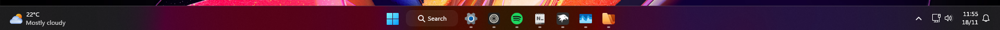
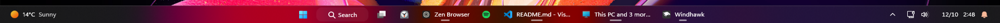
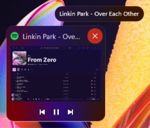
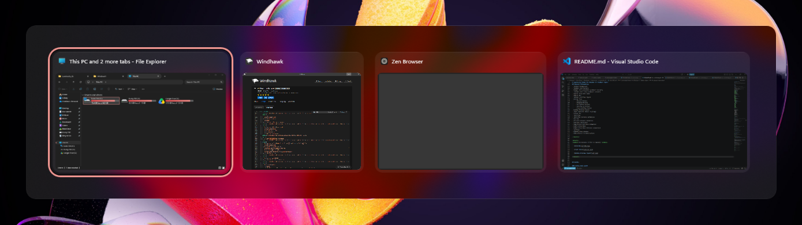
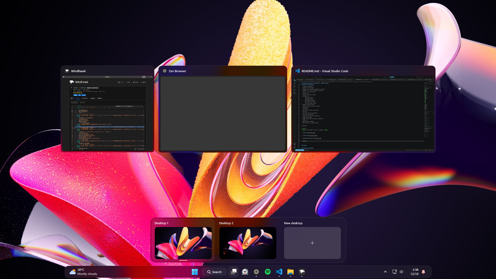

# Luminosity theme for Windows 11 Taskbar Styler

**Author**: [mendes.image](https://github.com/mendesimage)


## Intro

**Luminosity** is inspired on native Acrylic, using the maximum **TintLuminosityOpacity** value as its backdrop.

It's meant to be used with **Mica** or **MicaAlt** backdrops, with or without the **Translucent Windows** mod.

<br>

## Variants

### Dock


- Docks are cool.

<br>

### Normal



- Meant to cause minimal disruption for users who prefer the normal Taskbar layout.

<br>

### Compact



- Meant to be used with **Taskbar Labels for Windows 11**, using the **Centered Running Indicator** style, and **Taskbar Clock Customization**. Otherwise, you will experience visual issues.

<br>

---

### Mods Guide

To apply the same settings as mine, follow these steps:

* Open the **Taskbar Labels for Windows 11** and **Taskbar Clock Customization** mods in Windhawk.
* Go to the "Settings" tab and select "Textual mode".
* Copy the content below to the text box and click "Save settings".

<br>

**Taskbar Labels for Windows 11**
<details>
<summary>Click to expand mod settings</summary>

```yaml
mode: labelsWithoutCombining
taskbarItemWidth: 0
runningIndicatorStyle: centerDynamic
progressIndicatorStyle: centerDynamic
excludedPrograms:
  - excluded1.exe
minimumTaskbarItemWidth: 44
maximumTaskbarItemWidth: 150
fontSize: 12
fontFamily: ''
textTrimming: characterEllipsis
leftAndRightPaddingSize: 10
spaceBetweenIconAndLabel: 8
runningIndicatorHeight: 0
runningIndicatorVerticalOffset: 0
alwaysShowThumbnailLabels: 0
labelForSingleItem: '%name%'
labelForMultipleItems: '[%amount%] %name%'
```
</details>

<br>
<br>

**Taskbar Clock Customization**
<details>
<summary>Click to expand mod settings</summary>

Set `Top line` to `%date%  %time%`.

Leave `Bottom line` blank.

</details>

<br>

## General Information

The theme changes the following things:

<Details>
<summary>List (Click to expand)</summary>

- Taskbar background
- Taskbar icon borders
- Widget text placement (compact variant)
- Taskbar icon sizes (compact variant)
- Search icon with label
- Search box
- Taskbar Overflow Flyout
- System Tray
    - Chevron button
    - Program buttons
    - Microphone buttons
    - Spacing on buttons
    - Tray Overflow Flyout
- Window Preview Flyout
- Input Switcher (basic styling)
- Volume bar
- Task View
- Task View Entrance animation
- Alt+Tab
- Alt+Tab Entrance animation
- Snap Bar and Picker
- Snap Picker Entrance animation
- Adds effects to many buttons
- Right-Click Menu
- Right-Click Menu Entrance animations
- Tooltips
- Removes drop shadows

</details>

<details>
<summary>Screenshots (Click to expand)</summary>

  

  

  

</details>

<br>

## Guides

### Clear Background Guide

<details>
<summary>(Click to expand guide)</summary>

To customize the background, locate one of these lines depending on your version:

Locate this style constant:

```yaml
  - lumiBackground=<WindhawkBlur BlurAmount="30" TintColor="{ThemeResource CardStrokeColorDefaultSolid}" TintOpacity="0.0" TintLuminosityOpacity="1.0" TintSaturation="1.0" NoiseDensity="1.0" NoiseOpacity="0.1" />
```

`TintLuminosityOpacity`: Lowering this value makes it clearer. Range: `0.0` to `1.0`.

**Or** simply replace the full constant with:

```
  - lumiBackground=<WindhawkBlur BlurAmount="30" TintColor="{ThemeResource CardStrokeColorDefaultSolid}" TintOpacity="0.0" TintLuminosityOpacity="0.0" TintSaturation="1.0" NoiseDensity="1.0" NoiseOpacity="0.1" />
```

</details>

<br>

### Custom Dock Width

<details>
<summary>(Click to expand guide)</summary>

The dock's width changes depending on your **screen resolution** using **horizontal margins**. If you want a custom width, follow this guide.

Locate and edit this `styleConstants` value:

`DockMargin=250`

This controls the main dock width. The system tray uses the same value, so it
stays aligned with the dock's right edge.

- Smaller value = wider dock
- Larger value = narrower dock

Example: `DockMargin=5` for a **full length dock** (corner to corner).
</details>

<br>

### Disabling Dock Top Gap

<details>
<summary>(Click to expand guide)</summary>

Set the following style constants to these values:

```yaml
  - DockHeight=53
  - DockTopGap=0
```
</details>

<br>

### Left Taskbar Alignment Fix

<details>
<summary>Click to expand guide</summary>

When using **Left Taskbar Alignment** with Widget, remove the **minus sign** (`-`) from `WidgetGap=-`.

Like this: `WidgetGap=`

**Note:** The **Normal** variant is compatible by default.

</details>

<br>

### Taskbar height and icon size Compatibility

<details>
<summary>Click to expand guide</summary>

You can edit the `DockHeight` constant's value.

Default value: `58`

Removing the last target allows external mods to change the height:

```yaml
  - target: Taskbar.TaskbarFrame
    styles:
      - Height={{taskbarDock==`vertical`?skip():$DockHeight}}
```

</details>

<br>

### Faster Right-Click Menu (Disable Animation)

Set style constant `MenuAnimation` from `True` to `False`.

<br>

### Change Button Fade Speed

<details>
<summary>(Click to expand guide)</summary>

You can edit the `FadeSpeed` constant's value. Its value is in milliseconds.

Default value: `200`

</details>

<br>

### Disable Alt+Tab Animations

<details>
<summary>(Click to expand guide)</summary>

Remove target below to remove Alt+Tab entrance animation:

```yaml
# Alt+Tab Entrance Animation
  - target: WindowsInternal.ComposableShell.Experiences.Switcher.AltTab
    styles:
      - Transitions:=<TransitionCollection><AddDeleteThemeTransition /><EntranceThemeTransition FromHorizontalOffset="0" FromVerticalOffset="0" /></TransitionCollection>
```
[a](#disable-alttab-animations)
</details> 

<br>

## Known Issues

I didn't know how to fix these. I couldn't find the correct target names, or I'm not sure if they can even be changed/fixed.

- **Native Vertical Taskbar:** Luminosity is currently **incompatible** with vertical taskbar placements.
- **Native Windows' Small Taskbar:** **Dock** and **Compact** have the most issues with it; **Normal** have Microsoft's weird spacings. Compact does a better job on spacings (in my opinion) :p
- **Left Taskbar Alignment (Dock/Compact):** **Left Taskbar Alignment** is not compatible by default. Refer to the [Left Taskbar Alignment Fix Guide](#left-taskbar-alignment-fix).
- **Taskbar height and icon size Mod (Dock):** The dock pins its own height, so `Taskbar height and icon size` has no effect until that is removed. Refer to [Taskbar height and icon size Compatibility Guide](#taskbar-height-and-icon-size-compatibility).
- **Search Box (Dock/Compact):** Have **incorrect look and position** when typing.
- **Widget/Weather (Compact):** Long text might not render fully.
- Virtual Desktop Right-Click Menu items doesn't match the theme.

<br>

## Theme selection

The theme is integrated into the mod and can be selected directly from the mod's settings:

* Open the Windows 11 Taskbar Styler mod in Windhawk.
* Go to the "Settings" tab.
* Select the theme and save the settings.

## Manual installation

The theme styles can also be imported manually. To do that, follow these steps:

* Open the Windows 11 Taskbar Styler mod in Windhawk.
* Go to the "Settings" tab and select "Textual mode".
* Copy the content below to the text box and click "Save settings".

---

### Dock


<details>
<summary>Content to import (click to expand)</summary>

```yaml
styleConstants:
# Variant Settings
  - DockMargin=250
  - DockHeight=58
  - DockTopGap=5
  - DockBottomGap=5
  - WidgetGap=-
# General Settings
  - MenuAnimation=True
  - FadeSpeed=200
  - lumiBackground=<WindhawkBlur BlurAmount="30" TintColor="{ThemeResource CardStrokeColorDefaultSolid}" TintOpacity="0.0" TintLuminosityOpacity="1.0" TintSaturation="1.0" NoiseDensity="1.0" NoiseOpacity="0.1" />
  - lumiAccentColor=<SolidColorBrush Color="{ThemeResource LumiAccent}" />
  - wcr=20
  - mcr=15
  - bcr=10
  - t=Transparent
  - bb=#20FFFFFF
  - bt=1
  - bbb=<LinearGradientBrush x:Key="ShellTaskbarItemGradientStrokeColorSecondaryBrush" MappingMode="Absolute" StartPoint="0,0" EndPoint="0,3"><LinearGradientBrush.GradientStops><GradientStop Offset="0.33" Color="#1AFFFFFF" /><GradientStop Offset="1" Color="#0FFFFFFF" /></LinearGradientBrush.GradientStops></LinearGradientBrush>
  - bbt=2
  - bso=<SolidColorBrush Color="{ThemeResource ControlFillColorDefault}" />
  - bn=Transparent
  - bh=<SolidColorBrush Color="{ThemeResource ControlFillColorSecondary}" />
  - bp=<SolidColorBrush Color="{ThemeResource ControlFillColorTertiary}" />
controlStyles:
# =====================================
# HOW TO NAVIGATE THIS FILE           |
#                                     |
# 1. # Target Name / Description      |
# 2. # NOTE: Additional Information   |
# 3. Target and Styling               |
# (Target always below Name and Note) |
#                                     |
# That's all! :3                      |
# =====================================
# Taskbar Background
  - target: Taskbar.TaskbarFrame > Grid#RootGrid > Taskbar.TaskbarBackground > Grid > Rectangle#BackgroundFill
    styles:
      - Fill:=$lumiBackground
# Widget Button
  - target: Taskbar.AugmentedEntryPointButton#AugmentedEntryPointButton > Taskbar.TaskListButtonPanel#ExperienceToggleButtonRootPanel > Grid > Border#BackgroundElement, Taskbar.AugmentedEntryPointButton#AugmentedEntryPointButton > Taskbar.TaskListButtonPanel#ExperienceToggleButtonRootPanel > Border#BackgroundElement
    styles:
      - CornerRadius=$bcr
      - BorderThickness=$bbt
      - BackgroundSizing=InnerBorderEdge
      - BackgroundTransition:=<BrushTransition Duration="0:0:0.$FadeSpeed" />
# Start Button / Task View Button
  - target: Taskbar.ExperienceToggleButton#LaunchListButton > Taskbar.TaskListButtonPanel > Grid > Border, Taskbar.ExperienceToggleButton#LaunchListButton > Taskbar.TaskListButtonPanel > Border
    styles:
      - CornerRadius=$bcr
      - BorderThickness=$bbt
      - BackgroundSizing=InnerBorderEdge
      - BackgroundTransition:=<BrushTransition Duration="0:0:0.$FadeSpeed" />
# Search Button
# NOTE: Must come before the Search Bar, otherwise it'll override this (they're the same target)
  - target: SearchUx.SearchUI.SearchButtonRootGrid > Grid > Border, SearchUx.SearchUI.SearchButtonRootGrid > Border
    styles:
      - CornerRadius=$bcr
      - BorderThickness=$bbt
      - BackgroundSizing=InnerBorderEdge
      - BackgroundTransition:=<BrushTransition Duration="0:0:0.$FadeSpeed" />
# Search Pill / Search Button With Label
  - target: SearchUx.SearchUI.SearchButtonRootGrid > Grid > Border#SearchPillBackgroundElement, SearchUx.SearchUI.SearchButtonRootGrid > Border#SearchPillBackgroundElement
    styles:
      - CornerRadius=$bcr
# Search Pill / Search Button With Label Icon Fix
# NOTE: Moves it left, separating it from its label; First target is a guess just in case
  - target: SearchUx.SearchUI.SearchPillButton > SearchUx.SearchUI.SearchButtonRootGrid > Grid > Grid > FontIcon > Grid > TextBlock, SearchUx.SearchUI.SearchPillButton > SearchUx.SearchUI.SearchButtonRootGrid > Grid > FontIcon > Grid > TextBlock
    styles:
      - Margin=-2,0,8,0
# Search Bar / Search Box Border
# NOTE: Must come after the Search Button, otherwise it'll override it (they're the same target) 
  - target: SearchUx.SearchUI.SearchButtonRootGrid[Width=220] > Grid > Border, SearchUx.SearchUI.SearchButtonRootGrid[Width=220] > Border
    styles:
      - CornerRadius=$bcr
# Search Bar Background and Border / Search Box Background and Border / ThemeColorStates
# NOTE: When search is active, the search bar that appears is from SearchHost.exe
  - target: SearchUx.SearchUI.SearchButtonRootGrid@ThemeColorStates > Grid > Border, SearchUx.SearchUI.SearchButtonRootGrid@ThemeColorStates > Border
    styles:
      - Background@Wave3_InactiveNormal:=$bso
      - Background@Wave3_InactivePointerOver:=$bh
      - Background@Wave3_Focused:=$bp
      - Background@CustomTheme_InactiveNormal:=$bso
      - Background@CustomTheme_InactivePointerOver:=$bh
      - Background@CustomTheme_InactivePointerOver_BrighterBackground:=$bh
      - Background@CustomTheme_Focused:=$bp
      - Background@SearchActive_Transparent:=$t
      - BorderThickness=$bbt
      - BorderBrush@Wave3_InactiveNormal:=$bbb
      - BorderBrush@Wave3_InactivePointerOver:=$bbb
      - BorderBrush@Wave3_Focused:=$bbb
      - BorderBrush@CustomTheme_InactiveNormal:=$bbb
      - BorderBrush@CustomTheme_InactivePointerOver:=$bbb
      - BorderBrush@CustomTheme_InactivePointerOver_BrighterBackground:=$bbb
      - BorderBrush@CustomTheme_Focused:=$bbb
      - BorderBrush@SearchActive_Transparent:=$t
      - BackgroundSizing=InnerBorderEdge
      - BackgroundTransition:=<BrushTransition Duration="0:0:0.$FadeSpeed" />
# Program Window Button / Program Icon Button
  - target: Taskbar.TaskListButton#TaskListButton > Grid#IconPanel > Border#BackgroundElement, Taskbar.TaskListButton#TaskListButton > Taskbar.TaskListLabeledButtonPanel#IconPanel > Border#BackgroundElement
    styles:
      - CornerRadius=$bcr
      - BorderThickness=$bbt
      - BackgroundSizing=InnerBorderEdge
      - BackgroundTransition:=<BrushTransition Duration="0:0:0.$FadeSpeed" />
# Multi Window Element
  - target: Border#MultiWindowElement
    styles:
      - CornerRadius=$bcr
      - BackgroundSizing=InnerBorderEdge
      - BackgroundTransition:=<BrushTransition Duration="0:0:0.$FadeSpeed" />
# Taskbar Overflow Button / Taskbar Icons Overflow Button / Taskbar Programs Overflow Button
  - target: Taskbar.TaskListButtonPanel#OverflowToggleButtonRootPanel > Grid > Border#BackgroundElement, Taskbar.TaskListButtonPanel#OverflowToggleButtonRootPanel > Border#BackgroundElement
    styles:
      - CornerRadius=$bcr
      - BorderThickness=$bbt
      - BackgroundSizing=InnerBorderEdge
      - BackgroundTransition:=<BrushTransition Duration="0:0:0.$FadeSpeed" />
# Window Preview and Taskbar Overflow Flyout Original Background
  - target: Taskbar.TaskbarBackground#HoverFlyoutBackgroundControl > Grid > Rectangle#BackgroundFill
    styles:
      - Fill:=$t
# Window Preview and Taskbar Overflow Flyout Background and Border
  - target: Grid#HoverFlyoutGrid > Border#HoverFlyoutBackground
    styles:
      - Background:=$lumiBackground
      - CornerRadius=$mcr
      - BorderThickness=$bt
      - BorderBrush=$bb
      - Shadow:=
# Window Preview Flyout Custom Hover Look
  - target: Taskbar.TaskItemThumbnailView > Grid@CommonStates > Border#BackgroundBorder
    styles:
      - Background=$t
      - CornerRadius=$mcr
      - BorderThickness@Normal=0
      - BorderThickness@PointerOver=0.05,0,0.05,1
      - BorderBrush@Normal=$t
      - BorderBrush@PointerOver:=$lumiAccentColor
# Window Preview Close Button Flicker Fix
  - target: Taskbar.TaskItemThumbnailView > Grid > Button#CloseButton
    styles:
      - CornerRadius=$mcr
      - Background:=#00000000
# Window Preview Close Button Fade
  - target: Taskbar.TaskItemThumbnailView > Grid > Button#CloseButton > ContentPresenter
    styles:
      - BorderBrush=$t
      - BackgroundTransition:=<BrushTransition Duration="0:0:0.$FadeSpeed" />
# Window Preview Bottom Buttons
  - target: Taskbar.ThumbBarButton#ThumbBarButton > ContentPresenter#BorderElement@CommonStates
    styles:
      - CornerRadius=16
      - Margin=-1.5
      - Background@Normal:=$bn
      - Background@PointerOver:=$bh
      - Background@Pressed:=$bp
      - Background@Disabled:=$bn
      - BorderThickness=$bbt
      - BorderBrush@Normal:=$bn
      - BorderBrush@PointerOver:=$bbb
      - BorderBrush@Pressed:=$bbb
      - BorderBrush@Disabled:=$bn
      - BackgroundSizing=InnerBorderEdge
      - BackgroundTransition:=<BrushTransition Duration="0:0:0.$FadeSpeed" />
# System Tray Frame (Self Adjusts To Taskbar Height) Plus Animation
  - target: SystemTray.SystemTrayFrame
    styles:
      - Height=Auto
      - VerticalAlignment=Stretch
      - Transitions:=<TransitionCollection><RepositionThemeTransition /></TransitionCollection>
# Chevron Spacing / Hidden Apps Button Spacing
  - target: SystemTray.ChevronIconView > Grid#ContainerGrid
    styles:
      - Margin=2,0,2,0
# Chevron / Hidden Apps Button
  - target: SystemTray.ChevronIconView > Grid#ContainerGrid > Border#BackgroundBorder
    styles:
      - CornerRadius=$bcr
      - Margin=0,4,0,4
      - BorderThickness=$bbt
      - BackgroundSizing=InnerBorderEdge
      - BackgroundTransition:=<BrushTransition Duration="0:0:0.$FadeSpeed" />
# Tray Program Icon Buttons Spacing / Tray Notification Icon Buttons Spacing
  - target: SystemTray.NotifyIconView > Grid#ContainerGrid
    styles:
      - Margin=2,0,2,0
# Tray Program Icon Buttons / Tray Notification Icon Buttons
  - target: SystemTray.NotifyIconView > Grid#ContainerGrid > Border#BackgroundBorder
    styles:
      - CornerRadius=$bcr
      - Margin=0,4,0,4
      - CornerRadius=$bcr
      - Margin=0,4,0,4
      - BorderThickness=$bbt
      - BackgroundSizing=InnerBorderEdge
      - BackgroundTransition:=<BrushTransition Duration="0:0:0.$FadeSpeed" />
# Other System Buttons (e.g. Microphone, Touch Keyboard, etc.) Spacing
  - target: SystemTray.IconView#SystemTrayIcon > Grid#ContainerGrid
    styles:
      - Margin=2,0,2,0
# Other System Buttons (e.g. Microphone Touch Keyboard, etc.)
  - target: SystemTray.IconView#SystemTrayIcon > Grid#ContainerGrid > Border#BackgroundBorder
    styles:
      - CornerRadius=$bcr
      - Margin=0,4,0,4
      - BorderThickness=$bbt
      - BackgroundSizing=InnerBorderEdge
      - BackgroundTransition:=<BrushTransition Duration="0:0:0.$FadeSpeed" />
# Internet Button / Sound Button / Omni Button Spacing
  - target: SystemTray.OmniButton#ControlCenterButton > Grid
    styles:
      - Margin=2,0,2,0
# Internet Button / Sound Button / Omni Button Button
  - target: SystemTray.OmniButton#ControlCenterButton > Grid > Border#BackgroundBorder
    styles:
      - CornerRadius=$bcr
      - Margin=0,4,0,4
      - BorderThickness=$bbt
      - BackgroundSizing=InnerBorderEdge
      - BackgroundTransition:=<BrushTransition Duration="0:0:0.$FadeSpeed" />
# Clock Button / Calendar Button / Notification Center Button Spacing
  - target: SystemTray.OmniButton#NotificationCenterButton > Grid
    styles:
      - Margin=2,0,2,0
# Clock Button / Calendar Button / Notification Center Button
  - target: SystemTray.OmniButton#NotificationCenterButton > Grid > Border#BackgroundBorder
    styles:
      - CornerRadius=$bcr
      - Margin=0,4,0,4
      - BorderThickness=$bbt
      - BackgroundSizing=InnerBorderEdge
      - BackgroundTransition:=<BrushTransition Duration="0:0:0.$FadeSpeed" />
# System Tray Overflow Flyout Background and Border
  - target: Border#OverflowFlyoutBackgroundBorder
    styles:
      - Background:=$lumiBackground
      - CornerRadius:=$wcr
      - BorderThickness=$bt
      - BorderBrush=$bb
      - Shadow:=
# Volume Flyout Background and Border
  - target: Grid#ConfirmatorMainGrid
    styles:
      - Background:=$lumiBackground
      - CornerRadius=$wcr
      - BorderThickness=$bt
      - BorderBrush=$bb
      - Shadow:=
# Volume Bar / Volume Track
  - target: Windows.UI.Xaml.Shapes.Rectangle#HorizontalTrackRect
    styles:
      - Fill:=<SolidColorBrush Color="{ThemeResource TrackRect}" />
# Input Switcher Background and Border
  - target: WindowsInternal.ComposableShell.Experiences.TextInput.Common.InputSwitcher > ContentControl > ContentPresenter > Grid
    styles:
      - Background:=$lumiBackground
      - CornerRadius=$wcr
      - BorderThickness=$bt
      - BorderBrush=$bb
      - Shadow:=
# Input Switcher Background Overlay
  - target: WindowsInternal.ComposableShell.Experiences.TextInput.Common.InputSwitcher > ContentControl > ContentPresenter > Grid > Grid
    styles:
      - Background:=$t
      - BorderBrush=$t
# Virtual Desktops Bar Background and Drop Shadow
# NOTE: Background and Drop Shadow removal affects both taskbar's and Task View's bars.
  - target: WindowsInternal.ComposableShell.Experiences.Switcher.VirtualDesktopBarElement > Grid > Border
    styles:
      - Background:=$lumiBackground
      - Shadow:=
# Taskbar Virtual Desktops Bar Border
  - target: WindowsInternal.ComposableShell.Experiences.Switcher.VirtualDesktopBarElement > Grid#GridElement > Border#VirtualDesktopSwitcherBackground
    styles:
      - CornerRadius=$wcr
      - BorderThickness=$bt
      - BorderBrush=$bb
      - Margin=-2,1,-1,1
# Task View Background Blur
  - target: Border#BackgroundDimmingLayer
    styles:
      - Background:=$t
# Task View Virtual Desktops Bar Background and Border
  - target: WindowsInternal.ComposableShell.Experiences.Switcher.VirtualDesktopBarElement#VirtualDesktopBar > Grid > Border
    styles:
      - CornerRadius=$wcr
      - BorderThickness=$bt
      - BorderBrush=$bb
      - Margin=-1,2,1,-2
# Task View Virtual Desktops Width
  - target: WindowsInternal.ComposableShell.Experiences.Switcher.VirtualDesktopBarElement#VirtualDesktopBar
    styles:
      - Width=Auto
      - HorizontalAlignment=1
# Virtual Desktop Roundness
  - target: WindowsInternal.ComposableShell.Experiences.Switcher.VirtualDesktopListViewItem > Windows.UI.Xaml.Controls.Primitives.ListViewItemPresenter#Root
    styles:
      - CornerRadius=$mcr
# Selected Virtual Desktop and Hover Overlay
  - target: WindowsInternal.ComposableShell.Experiences.Switcher.VirtualDesktopElementThemed > Grid#MainGrid > Border#MainBorder
    styles:
      - CornerRadius=$mcr
# Virtual Desktop Border
  - target: WindowsInternal.ComposableShell.Experiences.Switcher.VirtualDesktopElementThemed > Grid#MainGrid > Border#BorderHighlight
    styles:
      - CornerRadius=$mcr
# Add Virtual Desktop Hover Overlay
  - target: WindowsInternal.ComposableShell.Experiences.Switcher.NewVirtualDesktopElementThemed#NewVirtualDesktopButtonThemed > Grid#MainGrid > Border#MainBorder
    styles:
      - CornerRadius=$mcr
# Add Virtual Desktop Border
  - target: WindowsInternal.ComposableShell.Experiences.Switcher.NewVirtualDesktopElementThemed#NewVirtualDesktopButtonThemed > Grid#MainGrid > Border#BorderHighlight
    styles:
      - CornerRadius=$mcr
# Virtual Desktop Thumbnail
  - target: WindowsInternal.ComposableShell.Experiences.Switcher.VirtualDesktopThumbnailButton#ThumbnailButtonElement
    styles:
      - CornerRadius=$bcr
# Virtual Desktop Close Button
  - target: Button#VirtualDesktopElementCloseButton
    styles:
      - CornerRadius=$bcr
      - Background:=#00000000
# Virtual Desktop Close Button Fade
  - target: Button#VirtualDesktopElementCloseButton > ContentPresenter
    styles:
      - BackgroundTransition:=<BrushTransition Duration="0:0:0.$FadeSpeed" />
# Task View Program Window / Task View Window Background and Border
  - target: WindowsInternal.ComposableShell.Experiences.Switcher.DynamicFlowPanel#DFCPanel > WindowsInternal.ComposableShell.Experiences.Switcher.SwitchItemListViewItem > Grid#Root@CommonStates > Border#BackgroundBorder
    styles:
      - Background:=$lumiBackground
      - CornerRadius=$mcr,$mcr,$bcr,$bcr
      - Margin:=-5,0,-5,-5
      - BorderThickness=$bt
      - BorderBrush@Normal:=$bb
      - BorderBrush@PointerOver:=$lumiAccentColor
# Task View Program Windows / Task View Windows Entrance Animation
  - target: WindowsInternal.ComposableShell.Experiences.Switcher.DynamicFlowPanel#DFCPanel
    styles:
      - Transitions:=<TransitionCollection><AddDeleteThemeTransition /><EntranceThemeTransition FromHorizontalOffset="0" FromVerticalOffset="0" /></TransitionCollection>
# Task View Window Icon
  - target: WindowsInternal.ComposableShell.Experiences.Switcher.SwitchItemElement > Grid#RootGrid > Grid#TitleGrid > Image#IconImage
    styles:
      - RenderTransform:=<TranslateTransform X="0" Y="1" />
# Task View Window Title
  - target: WindowsInternal.ComposableShell.Experiences.Switcher.SwitchItemElement > Grid#RootGrid > Grid#TitleGrid > TextBlock#DisplayName
    styles:
      - RenderTransform:=<TranslateTransform X="0" Y="1" />
# Task View Window Close Button
  - target: WindowsInternal.ComposableShell.Experiences.Switcher.DynamicFlowPanel#DFCPanel > WindowsInternal.ComposableShell.Experiences.Switcher.SwitchItemListViewItem > Grid#Root > ContentPresenter > WindowsInternal.ComposableShell.Experiences.Switcher.SwitchItemElement > Grid#RootGrid > Grid#TitleGrid > Button#SwitchItemElementCloseButton
    styles:
      - Background:=#00000000
      - RenderTransform:=<TranslateTransform X="5" Y="0" />
# Task View Window Close Button Fade 
  - target: WindowsInternal.ComposableShell.Experiences.Switcher.DynamicFlowPanel#DFCPanel > WindowsInternal.ComposableShell.Experiences.Switcher.SwitchItemListViewItem > Grid#Root > ContentPresenter > WindowsInternal.ComposableShell.Experiences.Switcher.SwitchItemElement > Grid#RootGrid > Grid#TitleGrid > Button#SwitchItemElementCloseButton > ContentPresenter#ContentPresenter
    styles:
      - CornerRadius=$mcr
      - Margin=5
      - BackgroundTransition:=<BrushTransition Duration="0:0:0.200" />
# Task View Window Close Button Symbol / Close Button Cross Position Fix
  - target: WindowsInternal.ComposableShell.Experiences.Switcher.DynamicFlowPanel#DFCPanel > WindowsInternal.ComposableShell.Experiences.Switcher.SwitchItemListViewItem > Grid#Root > ContentPresenter > WindowsInternal.ComposableShell.Experiences.Switcher.SwitchItemElement > Grid#RootGrid > Grid#TitleGrid > Button#SwitchItemElementCloseButton > ContentPresenter#ContentPresenter > TextBlock
    styles:
      - RenderTransform:=<TranslateTransform X="-0.8" Y="-0.6" />
# Task View Window Thumbnail
  - target: WindowsInternal.ComposableShell.Experiences.Switcher.SwitchItemElement > Grid#RootGrid > WindowsInternal.ComposableShell.Experiences.Switcher.SwitchItemThumbnailButton#ThumbnailHost > Grid#RootGrid
    styles:
      - CornerRadius=$bcr
# Alt+Tab Original Background
  - target: WindowsInternal.ComposableShell.Experiences.Switcher.AltTab > Grid#ModalRootGrid > Border#BackgroundElement
    styles:
      - Background=$t
      - CornerRadius=$wcr
      - BorderThickness=0
      - Shadow:=
# Alt+Tab Background and Border
  - target: WindowsInternal.ComposableShell.Experiences.Switcher.AltTab > Grid#ModalRootGrid > Border#BackgroundElement > WindowsInternal.ComposableShell.Experiences.Switcher.SwitchItemList
    styles:
      - Background:=$lumiBackground
      - CornerRadius=$wcr
      - BorderThickness=$bt
      - BorderBrush=$bb
# Alt+Tab Entrance Animation
  - target: WindowsInternal.ComposableShell.Experiences.Switcher.AltTab
    styles:
      - Transitions:=<TransitionCollection><AddDeleteThemeTransition /><EntranceThemeTransition FromHorizontalOffset="0" FromVerticalOffset="0" /></TransitionCollection>
# Alt+Tab Program Background and Border / Alt+Tab Window Background and Border
  - target: WindowsInternal.ComposableShell.Experiences.Switcher.AltTab > Grid#ModalRootGrid > Border#BackgroundElement > WindowsInternal.ComposableShell.Experiences.Switcher.SwitchItemList > Border > ScrollViewer > Border > Grid > ScrollContentPresenter > ItemsPresenter > WindowsInternal.ComposableShell.Experiences.Switcher.DynamicFlowPanel > WindowsInternal.ComposableShell.Experiences.Switcher.SwitchItemListViewItem > Grid#Root@CommonStates > Border#BackgroundBorder
    styles:
      - Background:=<SolidColorBrush Color="{ThemeResource SolidBg}" />
      - CornerRadius=$mcr
      - BorderThickness@Normal=$bbt
      - BorderThickness@PointerOver=$bt
      - BorderBrush@Normal:=$bbb
      - BorderBrush@PointerOver:=$lumiAccentColor
# Alt+Tab Program Close Button / Alt+Tab Window Close Button
  - target: WindowsInternal.ComposableShell.Experiences.Switcher.AltTab > Grid#ModalRootGrid > Border#BackgroundElement > WindowsInternal.ComposableShell.Experiences.Switcher.SwitchItemList > Border > ScrollViewer > Border > Grid > ScrollContentPresenter > ItemsPresenter > WindowsInternal.ComposableShell.Experiences.Switcher.DynamicFlowPanel > WindowsInternal.ComposableShell.Experiences.Switcher.SwitchItemListViewItem > Grid#Root > ContentPresenter > WindowsInternal.ComposableShell.Experiences.Switcher.SwitchItemControl > Grid#Root > Button#SwitchItemElementCloseButton
    styles:
      - Background:=#00000000
# Alt+Tab Program Close Button Margin / Alt+Tab Window Close Button Margin (fade was strange here, so not added)
  - target: WindowsInternal.ComposableShell.Experiences.Switcher.AltTab > Grid#ModalRootGrid > Border#BackgroundElement > WindowsInternal.ComposableShell.Experiences.Switcher.SwitchItemList > Border > ScrollViewer > Border > Grid > ScrollContentPresenter > ItemsPresenter > WindowsInternal.ComposableShell.Experiences.Switcher.DynamicFlowPanel > WindowsInternal.ComposableShell.Experiences.Switcher.SwitchItemListViewItem > Grid#Root > ContentPresenter > WindowsInternal.ComposableShell.Experiences.Switcher.SwitchItemControl > Grid#Root > Button#SwitchItemElementCloseButton > ContentPresenter#ContentPresenter
    styles:
      - CornerRadius=$mcr
      - Margin=5
# Alt+Tab Program Close Button Symbol / Alt+Tab Window Close Button Symbol / Close Button Cross Position Fix
  - target: WindowsInternal.ComposableShell.Experiences.Switcher.AltTab > Grid#ModalRootGrid > Border#BackgroundElement > WindowsInternal.ComposableShell.Experiences.Switcher.SwitchItemList > Border > ScrollViewer > Border > Grid > ScrollContentPresenter > ItemsPresenter > WindowsInternal.ComposableShell.Experiences.Switcher.DynamicFlowPanel > WindowsInternal.ComposableShell.Experiences.Switcher.SwitchItemListViewItem > Grid#Root > ContentPresenter > WindowsInternal.ComposableShell.Experiences.Switcher.SwitchItemControl > Grid#Root > Button#SwitchItemElementCloseButton > ContentPresenter#ContentPresenter > TextBlock
    styles:
      - RenderTransform:=<TranslateTransform X="-0.8" Y="-0.6" />
# Alt+Tab Program Thumbnail / Alt+Tab Window Thumbnail
  - target: WindowsInternal.ComposableShell.Experiences.Switcher.SwitchItemControl > Grid#Root > WindowsInternal.ComposableShell.Experiences.Switcher.SwitchItemThumbnailButton#ThumbnailHost > Grid#RootGrid
    styles:
      - CornerRadius=$bcr
      - Margin=5
# Snap Bar Background and Border
  - target: Border#SnapBarBorder
    styles:
      - Background:=$lumiBackground
      - CornerRadius=$mcr
      - BorderThickness=$bt
      - BorderBrush=$bb
      - Shadow:=
      - Transitions:=<TransitionCollection><AddDeleteThemeTransition /><EntranceThemeTransition FromHorizontalOffset="0" FromVerticalOffset="0" /></TransitionCollection>
# Snap Picker Drop Shadow
  - target: FlyoutPresenter > Border
    styles:
      - Shadow:=
# Snap Picker Background and Border Plus Entrance Animation
  - target: Border#SnapPickerBorder
    styles:
      - Background:=$lumiBackground
      - CornerRadius=$mcr
      - BorderThickness=$bt
      - BorderBrush=$bb
      - Shadow:=
      - Transitions:=<TransitionCollection><AddDeleteThemeTransition /><EntranceThemeTransition FromHorizontalOffset="0" FromVerticalOffset="0" /></TransitionCollection>
# Snap Assist Suggestions List Background and Border
  - target: WindowsInternal.ComposableShell.Experiences.Switcher.SnapAssistList > Grid > Border
    styles:
      - Background:=$lumiBackground
      - CornerRadius=$mcr
      - BorderThickness=$bt
      - BorderBrush=$bb
      - Shadow:=
# Scroll Bar Background
  - target: Windows.UI.Xaml.Controls.Primitives.ScrollBar#VerticalScrollBar > Grid#Root > Grid#VerticalRoot > Rectangle#VerticalTrackRect
    styles:
      - Fill:=$lumiBackground
# Right-Click Menu Drop Shadow
  - target: MenuFlyoutPresenter
    styles:
      - CornerRadius:=$wcr
      - Shadow:=
# Right-click Menu Background And Pop-up Animation
  - target: MenuFlyoutPresenter > Border
    styles:
      - Background:=$lumiBackground
      - CornerRadius=$mcr
      - BorderThickness=$bt
      - BorderBrush=$bb
      - Transitions:=<TransitionCollection><EntranceThemeTransition FromHorizontalOffset="0" FromVerticalOffset="0" /></TransitionCollection>
# Right-Click Menu Item Border
  - target: MenuFlyoutItem > Grid@CommonStates
    styles:
      - CornerRadius=$bcr
      - BackgroundTransition:=<BrushTransition Duration="0:0:0.$FadeSpeed" />
# Right-Click Menu Subitem Border
  - target: MenuFlyoutSubItem > Grid@CommonStates
    styles:
      - CornerRadius=$bcr
      - BackgroundTransition:=<BrushTransition Duration="0:0:0.$FadeSpeed" />
# Tooltip Background and Border
  - target: ToolTip > ContentPresenter#LayoutRoot
    styles:
      - Background:=$lumiBackground
      - CornerRadius=$mcr
      - BorderThickness=$bt
      - BorderBrush=$bb
      - Shadow:=
# Right-Click Menu Items Entrance Animation
  - target: ScrollViewer#MenuFlyoutPresenterScrollViewer > Border > Grid > ScrollContentPresenter > ItemsPresenter > StackPanel
    styles:
      - ChildrenTransitions:=<TransitionCollection><EntranceThemeTransition IsStaggeringEnabled="$MenuAnimation" FromHorizontalOffset="-50" FromVerticalOffset="50" /></TransitionCollection>
# Virtual Desktops Bar Right-Click Menu Items and Subitems / Task View Window Right-Click Menu Items and Subitems
  - target: ToggleMenuFlyoutItem > Grid@CommonStates
    styles:
      - CornerRadius=$bcr
      - BackgroundTransition:=<BrushTransition Duration="0:0:0.$FadeSpeed" />
# ==========================
# Dock Styling Begins Here |
# ==========================
# Taskbar Original Background
  - target: Taskbar.TaskbarFrame > Grid#RootGrid > Taskbar.TaskbarBackground > Grid > Rectangle#BackgroundFill
    styles:
      - Visibility=Collapsed
# Uh... I uh... I don't know how to explain this yet, not my fix xP (It avoids bigger issues with vertical taskbar, something like that, from what I understood)
  - target: Taskbar.TaskbarFrame > Grid#RootGrid@DockingStates
    styles:
      - Tag=horizontal
      - Tag@DockedLeft=vertical
      - Tag@DockedRight=vertical
      - Tag=>taskbarDock
# Taskbar Original Top Border
  - target: Windows.UI.Xaml.Shapes.Rectangle#BackgroundStroke
    styles:
      - Visibility=Collapsed
# Dock Width/Taskbar Width
  - target: Taskbar.TaskbarFrame
    styles:
      - Width={{taskbarDock==`vertical`?skip():`Auto`}}
      - HorizontalAlignment=Stretch
      - Margin=$DockMargin,0,$DockMargin,0
# Dock Top and Bottom Gap
  - target: Taskbar.TaskbarFrame > Grid#RootGrid
    styles:
      - Margin=0,$DockTopGap,0,$DockBottomGap
# Dock Background and Border
  - target: Taskbar.TaskbarFrame > Grid#RootGrid > Taskbar.TaskbarBackground > Grid
    styles:
      - Background:=$lumiBackground
      - BorderThickness=$bt
      - BorderBrush=$bb
      - CornerRadius=$mcr
# Widget To Program Window Buttons Gap Remove
  - target: Taskbar.AugmentedEntryPointButton#AugmentedEntryPointButton
    styles:
      - Margin=0,0,$WidgetGap57,0
# System Tray Dock Alignment
  - target: SystemTray.SystemTrayFrame
    styles:
     - Margin=0,$DockTopGap,$DockMargin,$DockBottomGap
# Matches Window Preview and Taskbar Overflow Flyout Height With Flyouts
  - target: Grid#HoverFlyoutGrid
    styles:
      - Margin=0,0,0,$DockTopGap
# Dock Height (Delete to Unlock Height)
  - target: Taskbar.TaskbarFrame
    styles:
      - Height={{taskbarDock==`vertical`?skip():$DockHeight}}
themeResourceVariables:
  - LumiAccent@Dark={ThemeResource SystemAccentColorLight2}
  - LumiAccent@Light={ThemeResource SystemAccentColorDark1}
  - TrackRect@Dark=#10FFFFFF
  - TrackRect@Light=#30202020
  - SolidBg@Dark=#10FFFFFF
  - SolidBg@Light=#90FFFFFF
```
</details>

<br>

### Normal


<details>
<summary>Content to import (click to expand)</summary>

```yaml
styleConstants:
  - MenuAnimation=True
  - FadeSpeed=200
  - lumiBackground=<WindhawkBlur BlurAmount="30" TintColor="{ThemeResource CardStrokeColorDefaultSolid}" TintOpacity="0.0" TintLuminosityOpacity="1.0" TintSaturation="1.0" NoiseDensity="1.0" NoiseOpacity="0.1" />
  - lumiAccentColor=<SolidColorBrush Color="{ThemeResource LumiAccent}" />
  - wcr=20
  - mcr=15
  - bcr=10
  - t=Transparent
  - bb=#20FFFFFF
  - bt=1
  - bbb=<LinearGradientBrush x:Key="ShellTaskbarItemGradientStrokeColorSecondaryBrush" MappingMode="Absolute" StartPoint="0,0" EndPoint="0,3"><LinearGradientBrush.GradientStops><GradientStop Offset="0.33" Color="#1AFFFFFF" /><GradientStop Offset="1" Color="#0FFFFFFF" /></LinearGradientBrush.GradientStops></LinearGradientBrush>
  - bbt=2
  - bso=<SolidColorBrush Color="{ThemeResource ControlFillColorDefault}" />
  - bn=Transparent
  - bh=<SolidColorBrush Color="{ThemeResource ControlFillColorSecondary}" />
  - bp=<SolidColorBrush Color="{ThemeResource ControlFillColorTertiary}" />
controlStyles:
# =====================================
# HOW TO NAVIGATE THIS FILE           |
#                                     |
# 1. # Target Name / Description      |
# 2. # NOTE: Additional Information   |
# 3. Target and Styling               |
# (Target always below Name and Note) |
#                                     |
# That's all! :3                      |
# =====================================
# Taskbar Background
  - target: Taskbar.TaskbarFrame > Grid#RootGrid > Taskbar.TaskbarBackground > Grid > Rectangle#BackgroundFill
    styles:
      - Fill:=$lumiBackground
# Widget Button
  - target: Taskbar.AugmentedEntryPointButton#AugmentedEntryPointButton > Taskbar.TaskListButtonPanel#ExperienceToggleButtonRootPanel > Grid > Border#BackgroundElement, Taskbar.AugmentedEntryPointButton#AugmentedEntryPointButton > Taskbar.TaskListButtonPanel#ExperienceToggleButtonRootPanel > Border#BackgroundElement
    styles:
      - CornerRadius=$bcr
      - BorderThickness=$bbt
      - BackgroundSizing=InnerBorderEdge
      - BackgroundTransition:=<BrushTransition Duration="0:0:0.$FadeSpeed" />
# Start Button / Task View Button
  - target: Taskbar.ExperienceToggleButton#LaunchListButton > Taskbar.TaskListButtonPanel > Grid > Border, Taskbar.ExperienceToggleButton#LaunchListButton > Taskbar.TaskListButtonPanel > Border
    styles:
      - CornerRadius=$bcr
      - BorderThickness=$bbt
      - BackgroundSizing=InnerBorderEdge
      - BackgroundTransition:=<BrushTransition Duration="0:0:0.$FadeSpeed" />
# Search Button
# NOTE: Must come before the Search Bar, otherwise it'll override this (they're the same target)
  - target: SearchUx.SearchUI.SearchButtonRootGrid > Grid > Border, SearchUx.SearchUI.SearchButtonRootGrid > Border
    styles:
      - CornerRadius=$bcr
      - BorderThickness=$bbt
      - BackgroundSizing=InnerBorderEdge
      - BackgroundTransition:=<BrushTransition Duration="0:0:0.$FadeSpeed" />
# Search Pill / Search Button With Label
  - target: SearchUx.SearchUI.SearchButtonRootGrid > Grid > Border#SearchPillBackgroundElement, SearchUx.SearchUI.SearchButtonRootGrid > Border#SearchPillBackgroundElement
    styles:
      - CornerRadius=$bcr
# Search Pill / Search Button With Label Icon Fix
# NOTE: Moves it left, separating it from its label; First target is a guess just in case
  - target: SearchUx.SearchUI.SearchPillButton > SearchUx.SearchUI.SearchButtonRootGrid > Grid > Grid > FontIcon > Grid > TextBlock, SearchUx.SearchUI.SearchPillButton > SearchUx.SearchUI.SearchButtonRootGrid > Grid > FontIcon > Grid > TextBlock
    styles:
      - Margin=-2,0,8,0
# Search Bar / Search Box Border
# NOTE: Must come after the Search Button, otherwise it'll override it (they're the same target) 
  - target: SearchUx.SearchUI.SearchButtonRootGrid[Width=220] > Grid > Border, SearchUx.SearchUI.SearchButtonRootGrid[Width=220] > Border
    styles:
      - CornerRadius=$bcr
# Search Bar Background and Border / Search Box Background and Border / ThemeColorStates
# NOTE: When search is active, the search bar that appears is from SearchHost.exe
  - target: SearchUx.SearchUI.SearchButtonRootGrid@ThemeColorStates > Grid > Border, SearchUx.SearchUI.SearchButtonRootGrid@ThemeColorStates > Border
    styles:
      - Background@Wave3_InactiveNormal:=$bso
      - Background@Wave3_InactivePointerOver:=$bh
      - Background@Wave3_Focused:=$bp
      - Background@CustomTheme_InactiveNormal:=$bso
      - Background@CustomTheme_InactivePointerOver:=$bh
      - Background@CustomTheme_InactivePointerOver_BrighterBackground:=$bh
      - Background@CustomTheme_Focused:=$bp
      - Background@SearchActive_Transparent:=$t
      - BorderThickness=$bbt
      - BorderBrush@Wave3_InactiveNormal:=$bbb
      - BorderBrush@Wave3_InactivePointerOver:=$bbb
      - BorderBrush@Wave3_Focused:=$bbb
      - BorderBrush@CustomTheme_InactiveNormal:=$bbb
      - BorderBrush@CustomTheme_InactivePointerOver:=$bbb
      - BorderBrush@CustomTheme_InactivePointerOver_BrighterBackground:=$bbb
      - BorderBrush@CustomTheme_Focused:=$bbb
      - BorderBrush@SearchActive_Transparent:=$t
      - BackgroundSizing=InnerBorderEdge
      - BackgroundTransition:=<BrushTransition Duration="0:0:0.$FadeSpeed" />
# Program Window Button / Program Icon Button
  - target: Taskbar.TaskListButton#TaskListButton > Grid#IconPanel > Border#BackgroundElement, Taskbar.TaskListButton#TaskListButton > Taskbar.TaskListLabeledButtonPanel#IconPanel > Border#BackgroundElement
    styles:
      - CornerRadius=$bcr
      - BorderThickness=$bbt
      - BackgroundSizing=InnerBorderEdge
      - BackgroundTransition:=<BrushTransition Duration="0:0:0.$FadeSpeed" />
# Multi Window Element
  - target: Border#MultiWindowElement
    styles:
      - CornerRadius=$bcr
      - BackgroundSizing=InnerBorderEdge
      - BackgroundTransition:=<BrushTransition Duration="0:0:0.$FadeSpeed" />
# Taskbar Overflow Button / Taskbar Icons Overflow Button / Taskbar Programs Overflow Button
  - target: Taskbar.TaskListButtonPanel#OverflowToggleButtonRootPanel > Grid > Border#BackgroundElement, Taskbar.TaskListButtonPanel#OverflowToggleButtonRootPanel > Border#BackgroundElement
    styles:
      - CornerRadius=$bcr
      - BorderThickness=$bbt
      - BackgroundSizing=InnerBorderEdge
      - BackgroundTransition:=<BrushTransition Duration="0:0:0.$FadeSpeed" />
# Window Preview and Taskbar Overflow Flyout Original Background
  - target: Taskbar.TaskbarBackground#HoverFlyoutBackgroundControl > Grid > Rectangle#BackgroundFill
    styles:
      - Fill:=$t
# Window Preview and Taskbar Overflow Flyout Background and Border
  - target: Grid#HoverFlyoutGrid > Border#HoverFlyoutBackground
    styles:
      - Background:=$lumiBackground
      - CornerRadius=$mcr
      - BorderThickness=$bt
      - BorderBrush=$bb
      - Shadow:=
# Window Preview Flyout Custom Hover Look
  - target: Taskbar.TaskItemThumbnailView > Grid@CommonStates > Border#BackgroundBorder
    styles:
      - Background=$t
      - CornerRadius=$mcr
      - BorderThickness@Normal=0
      - BorderThickness@PointerOver=0.05,0,0.05,1
      - BorderBrush@Normal=$t
      - BorderBrush@PointerOver:=$lumiAccentColor
# Window Preview Close Button Flicker Fix
  - target: Taskbar.TaskItemThumbnailView > Grid > Button#CloseButton
    styles:
      - CornerRadius=$mcr
      - Background:=#00000000
# Window Preview Close Button Fade
  - target: Taskbar.TaskItemThumbnailView > Grid > Button#CloseButton > ContentPresenter
    styles:
      - BorderBrush=$t
      - BackgroundTransition:=<BrushTransition Duration="0:0:0.$FadeSpeed" />
# Window Preview Bottom Buttons
  - target: Taskbar.ThumbBarButton#ThumbBarButton > ContentPresenter#BorderElement@CommonStates
    styles:
      - CornerRadius=16
      - Margin=-1.5
      - Background@Normal:=$bn
      - Background@PointerOver:=$bh
      - Background@Pressed:=$bp
      - Background@Disabled:=$bn
      - BorderThickness=$bbt
      - BorderBrush@Normal:=$bn
      - BorderBrush@PointerOver:=$bbb
      - BorderBrush@Pressed:=$bbb
      - BorderBrush@Disabled:=$bn
      - BackgroundSizing=InnerBorderEdge
      - BackgroundTransition:=<BrushTransition Duration="0:0:0.$FadeSpeed" />
# System Tray Frame (Self Adjusts To Taskbar Height) Plus Animation
  - target: SystemTray.SystemTrayFrame
    styles:
      - Height=Auto
      - VerticalAlignment=Stretch
      - Transitions:=<TransitionCollection><RepositionThemeTransition /></TransitionCollection>
# Chevron Spacing / Hidden Apps Button Spacing
  - target: SystemTray.ChevronIconView > Grid#ContainerGrid
    styles:
      - Margin=2,0,2,0
# Chevron / Hidden Apps Button
  - target: SystemTray.ChevronIconView > Grid#ContainerGrid > Border#BackgroundBorder
    styles:
      - CornerRadius=$bcr
      - Margin=0,4,0,4
      - BorderThickness=$bbt
      - BackgroundSizing=InnerBorderEdge
      - BackgroundTransition:=<BrushTransition Duration="0:0:0.$FadeSpeed" />
# Tray Program Icon Buttons Spacing / Tray Notification Icon Buttons Spacing
  - target: SystemTray.NotifyIconView > Grid#ContainerGrid
    styles:
      - Margin=2,0,2,0
# Tray Program Icon Buttons / Tray Notification Icon Buttons
  - target: SystemTray.NotifyIconView > Grid#ContainerGrid > Border#BackgroundBorder
    styles:
      - CornerRadius=$bcr
      - Margin=0,4,0,4
      - CornerRadius=$bcr
      - Margin=0,4,0,4
      - BorderThickness=$bbt
      - BackgroundSizing=InnerBorderEdge
      - BackgroundTransition:=<BrushTransition Duration="0:0:0.$FadeSpeed" />
# Other System Buttons (e.g. Microphone, Touch Keyboard, etc.) Spacing
  - target: SystemTray.IconView#SystemTrayIcon > Grid#ContainerGrid
    styles:
      - Margin=2,0,2,0
# Other System Buttons (e.g. Microphone Touch Keyboard, etc.)
  - target: SystemTray.IconView#SystemTrayIcon > Grid#ContainerGrid > Border#BackgroundBorder
    styles:
      - CornerRadius=$bcr
      - Margin=0,4,0,4
      - BorderThickness=$bbt
      - BackgroundSizing=InnerBorderEdge
      - BackgroundTransition:=<BrushTransition Duration="0:0:0.$FadeSpeed" />
# Internet Button / Sound Button / Omni Button Spacing
  - target: SystemTray.OmniButton#ControlCenterButton > Grid
    styles:
      - Margin=2,0,2,0
# Internet Button / Sound Button / Omni Button Button
  - target: SystemTray.OmniButton#ControlCenterButton > Grid > Border#BackgroundBorder
    styles:
      - CornerRadius=$bcr
      - Margin=0,4,0,4
      - BorderThickness=$bbt
      - BackgroundSizing=InnerBorderEdge
      - BackgroundTransition:=<BrushTransition Duration="0:0:0.$FadeSpeed" />
# Clock Button / Calendar Button / Notification Center Button Spacing
  - target: SystemTray.OmniButton#NotificationCenterButton > Grid
    styles:
      - Margin=2,0,2,0
# Clock Button / Calendar Button / Notification Center Button
  - target: SystemTray.OmniButton#NotificationCenterButton > Grid > Border#BackgroundBorder
    styles:
      - CornerRadius=$bcr
      - Margin=0,4,0,4
      - BorderThickness=$bbt
      - BackgroundSizing=InnerBorderEdge
      - BackgroundTransition:=<BrushTransition Duration="0:0:0.$FadeSpeed" />
# System Tray Overflow Flyout Background and Border
  - target: Border#OverflowFlyoutBackgroundBorder
    styles:
      - Background:=$lumiBackground
      - CornerRadius:=$wcr
      - BorderThickness=$bt
      - BorderBrush=$bb
      - Shadow:=
# Volume Flyout Background and Border
  - target: Grid#ConfirmatorMainGrid
    styles:
      - Background:=$lumiBackground
      - CornerRadius=$wcr
      - BorderThickness=$bt
      - BorderBrush=$bb
      - Shadow:=
# Volume Bar / Volume Track
  - target: Windows.UI.Xaml.Shapes.Rectangle#HorizontalTrackRect
    styles:
      - Fill:=<SolidColorBrush Color="{ThemeResource TrackRect}" />
# Input Switcher Background and Border
  - target: WindowsInternal.ComposableShell.Experiences.TextInput.Common.InputSwitcher > ContentControl > ContentPresenter > Grid
    styles:
      - Background:=$lumiBackground
      - CornerRadius=$wcr
      - BorderThickness=$bt
      - BorderBrush=$bb
      - Shadow:=
# Input Switcher Background Overlay
  - target: WindowsInternal.ComposableShell.Experiences.TextInput.Common.InputSwitcher > ContentControl > ContentPresenter > Grid > Grid
    styles:
      - Background:=$t
      - BorderBrush=$t
# Virtual Desktops Bar Background and Drop Shadow
# NOTE: Background and Drop Shadow removal affects both taskbar's and Task View's bars.
  - target: WindowsInternal.ComposableShell.Experiences.Switcher.VirtualDesktopBarElement > Grid > Border
    styles:
      - Background:=$lumiBackground
      - Shadow:=
# Taskbar Virtual Desktops Bar Border
  - target: WindowsInternal.ComposableShell.Experiences.Switcher.VirtualDesktopBarElement > Grid#GridElement > Border#VirtualDesktopSwitcherBackground
    styles:
      - CornerRadius=$wcr
      - BorderThickness=$bt
      - BorderBrush=$bb
      - Margin=-2,1,-1,1
# Task View Background Blur
  - target: Border#BackgroundDimmingLayer
    styles:
      - Background:=$t
# Task View Virtual Desktops Bar Background and Border
  - target: WindowsInternal.ComposableShell.Experiences.Switcher.VirtualDesktopBarElement#VirtualDesktopBar > Grid > Border
    styles:
      - CornerRadius=$wcr
      - BorderThickness=$bt
      - BorderBrush=$bb
      - Margin=-1,2,1,-2
# Task View Virtual Desktops Width
  - target: WindowsInternal.ComposableShell.Experiences.Switcher.VirtualDesktopBarElement#VirtualDesktopBar
    styles:
      - Width=Auto
      - HorizontalAlignment=1
# Virtual Desktop Roundness
  - target: WindowsInternal.ComposableShell.Experiences.Switcher.VirtualDesktopListViewItem > Windows.UI.Xaml.Controls.Primitives.ListViewItemPresenter#Root
    styles:
      - CornerRadius=$mcr
# Selected Virtual Desktop and Hover Overlay
  - target: WindowsInternal.ComposableShell.Experiences.Switcher.VirtualDesktopElementThemed > Grid#MainGrid > Border#MainBorder
    styles:
      - CornerRadius=$mcr
# Virtual Desktop Border
  - target: WindowsInternal.ComposableShell.Experiences.Switcher.VirtualDesktopElementThemed > Grid#MainGrid > Border#BorderHighlight
    styles:
      - CornerRadius=$mcr
# Add Virtual Desktop Hover Overlay
  - target: WindowsInternal.ComposableShell.Experiences.Switcher.NewVirtualDesktopElementThemed#NewVirtualDesktopButtonThemed > Grid#MainGrid > Border#MainBorder
    styles:
      - CornerRadius=$mcr
# Add Virtual Desktop Border
  - target: WindowsInternal.ComposableShell.Experiences.Switcher.NewVirtualDesktopElementThemed#NewVirtualDesktopButtonThemed > Grid#MainGrid > Border#BorderHighlight
    styles:
      - CornerRadius=$mcr
# Virtual Desktop Thumbnail
  - target: WindowsInternal.ComposableShell.Experiences.Switcher.VirtualDesktopThumbnailButton#ThumbnailButtonElement
    styles:
      - CornerRadius=$bcr
# Virtual Desktop Close Button
  - target: Button#VirtualDesktopElementCloseButton
    styles:
      - CornerRadius=$bcr
      - Background:=#00000000
# Virtual Desktop Close Button Fade
  - target: Button#VirtualDesktopElementCloseButton > ContentPresenter
    styles:
      - BackgroundTransition:=<BrushTransition Duration="0:0:0.$FadeSpeed" />
# Task View Program Window / Task View Window Background and Border
  - target: WindowsInternal.ComposableShell.Experiences.Switcher.DynamicFlowPanel#DFCPanel > WindowsInternal.ComposableShell.Experiences.Switcher.SwitchItemListViewItem > Grid#Root@CommonStates > Border#BackgroundBorder
    styles:
      - Background:=$lumiBackground
      - CornerRadius=$mcr,$mcr,$bcr,$bcr
      - Margin:=-5,0,-5,-5
      - BorderThickness=$bt
      - BorderBrush@Normal:=$bb
      - BorderBrush@PointerOver:=$lumiAccentColor
# Task View Program Windows / Task View Windows Entrance Animation
  - target: WindowsInternal.ComposableShell.Experiences.Switcher.DynamicFlowPanel#DFCPanel
    styles:
      - Transitions:=<TransitionCollection><AddDeleteThemeTransition /><EntranceThemeTransition FromHorizontalOffset="0" FromVerticalOffset="0" /></TransitionCollection>
# Task View Window Icon
  - target: WindowsInternal.ComposableShell.Experiences.Switcher.SwitchItemElement > Grid#RootGrid > Grid#TitleGrid > Image#IconImage
    styles:
      - RenderTransform:=<TranslateTransform X="0" Y="1" />
# Task View Window Title
  - target: WindowsInternal.ComposableShell.Experiences.Switcher.SwitchItemElement > Grid#RootGrid > Grid#TitleGrid > TextBlock#DisplayName
    styles:
      - RenderTransform:=<TranslateTransform X="0" Y="1" />
# Task View Window Close Button
  - target: WindowsInternal.ComposableShell.Experiences.Switcher.DynamicFlowPanel#DFCPanel > WindowsInternal.ComposableShell.Experiences.Switcher.SwitchItemListViewItem > Grid#Root > ContentPresenter > WindowsInternal.ComposableShell.Experiences.Switcher.SwitchItemElement > Grid#RootGrid > Grid#TitleGrid > Button#SwitchItemElementCloseButton
    styles:
      - Background:=#00000000
      - RenderTransform:=<TranslateTransform X="5" Y="0" />
# Task View Window Close Button Fade 
  - target: WindowsInternal.ComposableShell.Experiences.Switcher.DynamicFlowPanel#DFCPanel > WindowsInternal.ComposableShell.Experiences.Switcher.SwitchItemListViewItem > Grid#Root > ContentPresenter > WindowsInternal.ComposableShell.Experiences.Switcher.SwitchItemElement > Grid#RootGrid > Grid#TitleGrid > Button#SwitchItemElementCloseButton > ContentPresenter#ContentPresenter
    styles:
      - CornerRadius=$mcr
      - Margin=5
      - BackgroundTransition:=<BrushTransition Duration="0:0:0.200" />
# Task View Window Close Button Symbol / Close Button Cross Position Fix
  - target: WindowsInternal.ComposableShell.Experiences.Switcher.DynamicFlowPanel#DFCPanel > WindowsInternal.ComposableShell.Experiences.Switcher.SwitchItemListViewItem > Grid#Root > ContentPresenter > WindowsInternal.ComposableShell.Experiences.Switcher.SwitchItemElement > Grid#RootGrid > Grid#TitleGrid > Button#SwitchItemElementCloseButton > ContentPresenter#ContentPresenter > TextBlock
    styles:
      - RenderTransform:=<TranslateTransform X="-0.8" Y="-0.6" />
# Task View Window Thumbnail
  - target: WindowsInternal.ComposableShell.Experiences.Switcher.SwitchItemElement > Grid#RootGrid > WindowsInternal.ComposableShell.Experiences.Switcher.SwitchItemThumbnailButton#ThumbnailHost > Grid#RootGrid
    styles:
      - CornerRadius=$bcr
# Alt+Tab Original Background
  - target: WindowsInternal.ComposableShell.Experiences.Switcher.AltTab > Grid#ModalRootGrid > Border#BackgroundElement
    styles:
      - Background=$t
      - CornerRadius=$wcr
      - BorderThickness=0
      - Shadow:=
# Alt+Tab Background and Border
  - target: WindowsInternal.ComposableShell.Experiences.Switcher.AltTab > Grid#ModalRootGrid > Border#BackgroundElement > WindowsInternal.ComposableShell.Experiences.Switcher.SwitchItemList
    styles:
      - Background:=$lumiBackground
      - CornerRadius=$wcr
      - BorderThickness=$bt
      - BorderBrush=$bb
# Alt+Tab Entrance Animation
  - target: WindowsInternal.ComposableShell.Experiences.Switcher.AltTab
    styles:
      - Transitions:=<TransitionCollection><AddDeleteThemeTransition /><EntranceThemeTransition FromHorizontalOffset="0" FromVerticalOffset="0" /></TransitionCollection>
# Alt+Tab Program Background and Border / Alt+Tab Window Background and Border
  - target: WindowsInternal.ComposableShell.Experiences.Switcher.AltTab > Grid#ModalRootGrid > Border#BackgroundElement > WindowsInternal.ComposableShell.Experiences.Switcher.SwitchItemList > Border > ScrollViewer > Border > Grid > ScrollContentPresenter > ItemsPresenter > WindowsInternal.ComposableShell.Experiences.Switcher.DynamicFlowPanel > WindowsInternal.ComposableShell.Experiences.Switcher.SwitchItemListViewItem > Grid#Root@CommonStates > Border#BackgroundBorder
    styles:
      - Background:=<SolidColorBrush Color="{ThemeResource SolidBg}" />
      - CornerRadius=$mcr
      - BorderThickness@Normal=$bbt
      - BorderThickness@PointerOver=$bt
      - BorderBrush@Normal:=$bbb
      - BorderBrush@PointerOver:=$lumiAccentColor
# Alt+Tab Program Close Button / Alt+Tab Window Close Button
  - target: WindowsInternal.ComposableShell.Experiences.Switcher.AltTab > Grid#ModalRootGrid > Border#BackgroundElement > WindowsInternal.ComposableShell.Experiences.Switcher.SwitchItemList > Border > ScrollViewer > Border > Grid > ScrollContentPresenter > ItemsPresenter > WindowsInternal.ComposableShell.Experiences.Switcher.DynamicFlowPanel > WindowsInternal.ComposableShell.Experiences.Switcher.SwitchItemListViewItem > Grid#Root > ContentPresenter > WindowsInternal.ComposableShell.Experiences.Switcher.SwitchItemControl > Grid#Root > Button#SwitchItemElementCloseButton
    styles:
      - Background:=#00000000
# Alt+Tab Program Close Button Margin / Alt+Tab Window Close Button Margin (fade was strange here, so not added)
  - target: WindowsInternal.ComposableShell.Experiences.Switcher.AltTab > Grid#ModalRootGrid > Border#BackgroundElement > WindowsInternal.ComposableShell.Experiences.Switcher.SwitchItemList > Border > ScrollViewer > Border > Grid > ScrollContentPresenter > ItemsPresenter > WindowsInternal.ComposableShell.Experiences.Switcher.DynamicFlowPanel > WindowsInternal.ComposableShell.Experiences.Switcher.SwitchItemListViewItem > Grid#Root > ContentPresenter > WindowsInternal.ComposableShell.Experiences.Switcher.SwitchItemControl > Grid#Root > Button#SwitchItemElementCloseButton > ContentPresenter#ContentPresenter
    styles:
      - CornerRadius=$mcr
      - Margin=5
# Alt+Tab Program Close Button Symbol / Alt+Tab Window Close Button Symbol / Close Button Cross Position Fix
  - target: WindowsInternal.ComposableShell.Experiences.Switcher.AltTab > Grid#ModalRootGrid > Border#BackgroundElement > WindowsInternal.ComposableShell.Experiences.Switcher.SwitchItemList > Border > ScrollViewer > Border > Grid > ScrollContentPresenter > ItemsPresenter > WindowsInternal.ComposableShell.Experiences.Switcher.DynamicFlowPanel > WindowsInternal.ComposableShell.Experiences.Switcher.SwitchItemListViewItem > Grid#Root > ContentPresenter > WindowsInternal.ComposableShell.Experiences.Switcher.SwitchItemControl > Grid#Root > Button#SwitchItemElementCloseButton > ContentPresenter#ContentPresenter > TextBlock
    styles:
      - RenderTransform:=<TranslateTransform X="-0.8" Y="-0.6" />
# Alt+Tab Program Thumbnail / Alt+Tab Window Thumbnail
  - target: WindowsInternal.ComposableShell.Experiences.Switcher.SwitchItemControl > Grid#Root > WindowsInternal.ComposableShell.Experiences.Switcher.SwitchItemThumbnailButton#ThumbnailHost > Grid#RootGrid
    styles:
      - CornerRadius=$bcr
      - Margin=5
# Snap Bar Background and Border
  - target: Border#SnapBarBorder
    styles:
      - Background:=$lumiBackground
      - CornerRadius=$mcr
      - BorderThickness=$bt
      - BorderBrush=$bb
      - Shadow:=
      - Transitions:=<TransitionCollection><AddDeleteThemeTransition /><EntranceThemeTransition FromHorizontalOffset="0" FromVerticalOffset="0" /></TransitionCollection>
# Snap Picker Drop Shadow
  - target: FlyoutPresenter > Border
    styles:
      - Shadow:=
# Snap Picker Background and Border Plus Entrance Animation
  - target: Border#SnapPickerBorder
    styles:
      - Background:=$lumiBackground
      - CornerRadius=$mcr
      - BorderThickness=$bt
      - BorderBrush=$bb
      - Shadow:=
      - Transitions:=<TransitionCollection><AddDeleteThemeTransition /><EntranceThemeTransition FromHorizontalOffset="0" FromVerticalOffset="0" /></TransitionCollection>
# Snap Assist Suggestions List Background and Border
  - target: WindowsInternal.ComposableShell.Experiences.Switcher.SnapAssistList > Grid > Border
    styles:
      - Background:=$lumiBackground
      - CornerRadius=$mcr
      - BorderThickness=$bt
      - BorderBrush=$bb
      - Shadow:=
# Scroll Bar Background
  - target: Windows.UI.Xaml.Controls.Primitives.ScrollBar#VerticalScrollBar > Grid#Root > Grid#VerticalRoot > Rectangle#VerticalTrackRect
    styles:
      - Fill:=$lumiBackground
# Right-Click Menu Drop Shadow
  - target: MenuFlyoutPresenter
    styles:
      - CornerRadius:=$wcr
      - Shadow:=
# Right-click Menu Background And Pop-up Animation
  - target: MenuFlyoutPresenter > Border
    styles:
      - Background:=$lumiBackground
      - CornerRadius=$mcr
      - BorderThickness=$bt
      - BorderBrush=$bb
      - Transitions:=<TransitionCollection><EntranceThemeTransition FromHorizontalOffset="0" FromVerticalOffset="0" /></TransitionCollection>
# Right-Click Menu Item Border
  - target: MenuFlyoutItem > Grid@CommonStates
    styles:
      - CornerRadius=$bcr
      - BackgroundTransition:=<BrushTransition Duration="0:0:0.$FadeSpeed" />
# Right-Click Menu Subitem Border
  - target: MenuFlyoutSubItem > Grid@CommonStates
    styles:
      - CornerRadius=$bcr
      - BackgroundTransition:=<BrushTransition Duration="0:0:0.$FadeSpeed" />
# Tooltip Background and Border
  - target: ToolTip > ContentPresenter#LayoutRoot
    styles:
      - Background:=$lumiBackground
      - CornerRadius=$mcr
      - BorderThickness=$bt
      - BorderBrush=$bb
      - Shadow:=
# Right-Click Menu Items Entrance Animation
  - target: ScrollViewer#MenuFlyoutPresenterScrollViewer > Border > Grid > ScrollContentPresenter > ItemsPresenter > StackPanel
    styles:
      - ChildrenTransitions:=<TransitionCollection><EntranceThemeTransition IsStaggeringEnabled="$MenuAnimation" FromHorizontalOffset="-50" FromVerticalOffset="50" /></TransitionCollection>
# Virtual Desktops Bar Right-Click Menu Items and Subitems / Task View Window Right-Click Menu Items and Subitems
  - target: ToggleMenuFlyoutItem > Grid@CommonStates
    styles:
      - CornerRadius=$bcr
      - BackgroundTransition:=<BrushTransition Duration="0:0:0.$FadeSpeed" />
themeResourceVariables:
  - LumiAccent@Dark={ThemeResource SystemAccentColorLight2}
  - LumiAccent@Light={ThemeResource SystemAccentColorDark1}
  - TrackRect@Dark=#10FFFFFF
  - TrackRect@Light=#30202020
  - SolidBg@Dark=#10FFFFFF
  - SolidBg@Light=#90FFFFFF
```
</details>

<br>

### Compact


<details>
<summary>Content to import (click to expand)</summary>

```yaml
styleConstants:
# Variant Settings
  - WidgetGap=-
# General Settings
  - MenuAnimation=True
  - FadeSpeed=200
  - lumiBackground=<WindhawkBlur BlurAmount="30" TintColor="{ThemeResource CardStrokeColorDefaultSolid}" TintOpacity="0.0" TintLuminosityOpacity="1.0" TintSaturation="1.0" NoiseDensity="1.0" NoiseOpacity="0.1" />
  - lumiAccentColor=<SolidColorBrush Color="{ThemeResource LumiAccent}" />
  - wcr=20
  - mcr=15
  - bcr=10
  - t=Transparent
  - bb=#20FFFFFF
  - bt=1
  - bbb=<LinearGradientBrush x:Key="ShellTaskbarItemGradientStrokeColorSecondaryBrush" MappingMode="Absolute" StartPoint="0,0" EndPoint="0,3"><LinearGradientBrush.GradientStops><GradientStop Offset="0.33" Color="#1AFFFFFF" /><GradientStop Offset="1" Color="#0FFFFFFF" /></LinearGradientBrush.GradientStops></LinearGradientBrush>
  - bbt=2
  - bso=<SolidColorBrush Color="{ThemeResource ControlFillColorDefault}" />
  - bn=Transparent
  - bh=<SolidColorBrush Color="{ThemeResource ControlFillColorSecondary}" />
  - bp=<SolidColorBrush Color="{ThemeResource ControlFillColorTertiary}" />
controlStyles:
# =====================================
# HOW TO NAVIGATE THIS FILE           |
#                                     |
# 1. # Target Name / Description      |
# 2. # NOTE: Additional Information   |
# 3. Target and Styling               |
# (Target always below Name and Note) |
#                                     |
# That's all! :3                      |
# =====================================
# Taskbar Background
  - target: Taskbar.TaskbarFrame > Grid#RootGrid > Taskbar.TaskbarBackground > Grid > Rectangle#BackgroundFill
    styles:
      - Fill:=$lumiBackground
# Widget Button
  - target: Taskbar.AugmentedEntryPointButton#AugmentedEntryPointButton > Taskbar.TaskListButtonPanel#ExperienceToggleButtonRootPanel > Grid > Border#BackgroundElement, Taskbar.AugmentedEntryPointButton#AugmentedEntryPointButton > Taskbar.TaskListButtonPanel#ExperienceToggleButtonRootPanel > Border#BackgroundElement
    styles:
      - CornerRadius=$bcr
      - BorderThickness=$bbt
      - BackgroundSizing=InnerBorderEdge
      - BackgroundTransition:=<BrushTransition Duration="0:0:0.$FadeSpeed" />
# Start Button / Task View Button
  - target: Taskbar.ExperienceToggleButton#LaunchListButton > Taskbar.TaskListButtonPanel > Grid > Border, Taskbar.ExperienceToggleButton#LaunchListButton > Taskbar.TaskListButtonPanel > Border
    styles:
      - CornerRadius=$bcr
      - BorderThickness=$bbt
      - BackgroundSizing=InnerBorderEdge
      - BackgroundTransition:=<BrushTransition Duration="0:0:0.$FadeSpeed" />
# Search Button
# NOTE: Must come before the Search Bar, otherwise it'll override this (they're the same target)
  - target: SearchUx.SearchUI.SearchButtonRootGrid > Grid > Border, SearchUx.SearchUI.SearchButtonRootGrid > Border
    styles:
      - CornerRadius=$bcr
      - BorderThickness=$bbt
      - BackgroundSizing=InnerBorderEdge
      - BackgroundTransition:=<BrushTransition Duration="0:0:0.$FadeSpeed" />
# Search Pill / Search Button With Label
  - target: SearchUx.SearchUI.SearchButtonRootGrid > Grid > Border#SearchPillBackgroundElement, SearchUx.SearchUI.SearchButtonRootGrid > Border#SearchPillBackgroundElement
    styles:
      - CornerRadius=$bcr
# Search Pill / Search Button With Label Icon Fix
# NOTE: Moves it left, separating it from its label; First target is a guess just in case
  - target: SearchUx.SearchUI.SearchPillButton > SearchUx.SearchUI.SearchButtonRootGrid > Grid > Grid > FontIcon > Grid > TextBlock, SearchUx.SearchUI.SearchPillButton > SearchUx.SearchUI.SearchButtonRootGrid > Grid > FontIcon > Grid > TextBlock
    styles:
      - Margin=-2,0,8,0
# Search Bar / Search Box Border
# NOTE: Must come after the Search Button, otherwise it'll override it (they're the same target) 
  - target: SearchUx.SearchUI.SearchButtonRootGrid[Width=220] > Grid > Border, SearchUx.SearchUI.SearchButtonRootGrid[Width=220] > Border
    styles:
      - CornerRadius=$bcr
# Search Bar Background and Border / Search Box Background and Border / ThemeColorStates
# NOTE: When search is active, the search bar that appears is from SearchHost.exe
  - target: SearchUx.SearchUI.SearchButtonRootGrid@ThemeColorStates > Grid > Border, SearchUx.SearchUI.SearchButtonRootGrid@ThemeColorStates > Border
    styles:
      - Background@Wave3_InactiveNormal:=$bso
      - Background@Wave3_InactivePointerOver:=$bh
      - Background@Wave3_Focused:=$bp
      - Background@CustomTheme_InactiveNormal:=$bso
      - Background@CustomTheme_InactivePointerOver:=$bh
      - Background@CustomTheme_InactivePointerOver_BrighterBackground:=$bh
      - Background@CustomTheme_Focused:=$bp
      - Background@SearchActive_Transparent:=$t
      - BorderThickness=$bbt
      - BorderBrush@Wave3_InactiveNormal:=$bbb
      - BorderBrush@Wave3_InactivePointerOver:=$bbb
      - BorderBrush@Wave3_Focused:=$bbb
      - BorderBrush@CustomTheme_InactiveNormal:=$bbb
      - BorderBrush@CustomTheme_InactivePointerOver:=$bbb
      - BorderBrush@CustomTheme_InactivePointerOver_BrighterBackground:=$bbb
      - BorderBrush@CustomTheme_Focused:=$bbb
      - BorderBrush@SearchActive_Transparent:=$t
      - BackgroundSizing=InnerBorderEdge
      - BackgroundTransition:=<BrushTransition Duration="0:0:0.$FadeSpeed" />
# Program Window Button / Program Icon Button
  - target: Taskbar.TaskListButton#TaskListButton > Grid#IconPanel > Border#BackgroundElement, Taskbar.TaskListButton#TaskListButton > Taskbar.TaskListLabeledButtonPanel#IconPanel > Border#BackgroundElement
    styles:
      - CornerRadius=$bcr
      - BorderThickness=$bbt
      - BackgroundSizing=InnerBorderEdge
      - BackgroundTransition:=<BrushTransition Duration="0:0:0.$FadeSpeed" />
# Multi Window Element
  - target: Border#MultiWindowElement
    styles:
      - CornerRadius=$bcr
      - BackgroundSizing=InnerBorderEdge
      - BackgroundTransition:=<BrushTransition Duration="0:0:0.$FadeSpeed" />
# Taskbar Overflow Button / Taskbar Icons Overflow Button / Taskbar Programs Overflow Button
  - target: Taskbar.TaskListButtonPanel#OverflowToggleButtonRootPanel > Grid > Border#BackgroundElement, Taskbar.TaskListButtonPanel#OverflowToggleButtonRootPanel > Border#BackgroundElement
    styles:
      - CornerRadius=$bcr
      - BorderThickness=$bbt
      - BackgroundSizing=InnerBorderEdge
      - BackgroundTransition:=<BrushTransition Duration="0:0:0.$FadeSpeed" />
# Window Preview and Taskbar Overflow Flyout Original Background
  - target: Taskbar.TaskbarBackground#HoverFlyoutBackgroundControl > Grid > Rectangle#BackgroundFill
    styles:
      - Fill:=$t
# Window Preview and Taskbar Overflow Flyout Background and Border
  - target: Grid#HoverFlyoutGrid > Border#HoverFlyoutBackground
    styles:
      - Background:=$lumiBackground
      - CornerRadius=$mcr
      - BorderThickness=$bt
      - BorderBrush=$bb
      - Shadow:=
# Window Preview Flyout Custom Hover Look
  - target: Taskbar.TaskItemThumbnailView > Grid@CommonStates > Border#BackgroundBorder
    styles:
      - Background=$t
      - CornerRadius=$mcr
      - BorderThickness@Normal=0
      - BorderThickness@PointerOver=0.05,0,0.05,1
      - BorderBrush@Normal=$t
      - BorderBrush@PointerOver:=$lumiAccentColor
# Window Preview Close Button Flicker Fix
  - target: Taskbar.TaskItemThumbnailView > Grid > Button#CloseButton
    styles:
      - CornerRadius=$mcr
      - Background:=#00000000
# Window Preview Close Button Fade
  - target: Taskbar.TaskItemThumbnailView > Grid > Button#CloseButton > ContentPresenter
    styles:
      - BorderBrush=$t
      - BackgroundTransition:=<BrushTransition Duration="0:0:0.$FadeSpeed" />
# Window Preview Bottom Buttons
  - target: Taskbar.ThumbBarButton#ThumbBarButton > ContentPresenter#BorderElement@CommonStates
    styles:
      - CornerRadius=16
      - Margin=-1.5
      - Background@Normal:=$bn
      - Background@PointerOver:=$bh
      - Background@Pressed:=$bp
      - Background@Disabled:=$bn
      - BorderThickness=$bbt
      - BorderBrush@Normal:=$bn
      - BorderBrush@PointerOver:=$bbb
      - BorderBrush@Pressed:=$bbb
      - BorderBrush@Disabled:=$bn
      - BackgroundSizing=InnerBorderEdge
      - BackgroundTransition:=<BrushTransition Duration="0:0:0.$FadeSpeed" />
# System Tray Frame (Self Adjusts To Taskbar Height) Plus Animation
  - target: SystemTray.SystemTrayFrame
    styles:
      - Height=Auto
      - VerticalAlignment=Stretch
      - Transitions:=<TransitionCollection><RepositionThemeTransition /></TransitionCollection>
# Chevron Spacing / Hidden Apps Button Spacing
  - target: SystemTray.ChevronIconView > Grid#ContainerGrid
    styles:
      - Margin=2,0,2,0
# Chevron / Hidden Apps Button
  - target: SystemTray.ChevronIconView > Grid#ContainerGrid > Border#BackgroundBorder
    styles:
      - CornerRadius=$bcr
      - Margin=0,4,0,4
      - BorderThickness=$bbt
      - BackgroundSizing=InnerBorderEdge
      - BackgroundTransition:=<BrushTransition Duration="0:0:0.$FadeSpeed" />
# Tray Program Icon Buttons Spacing / Tray Notification Icon Buttons Spacing
  - target: SystemTray.NotifyIconView > Grid#ContainerGrid
    styles:
      - Margin=2,0,2,0
# Tray Program Icon Buttons / Tray Notification Icon Buttons
  - target: SystemTray.NotifyIconView > Grid#ContainerGrid > Border#BackgroundBorder
    styles:
      - CornerRadius=$bcr
      - Margin=0,4,0,4
      - CornerRadius=$bcr
      - Margin=0,4,0,4
      - BorderThickness=$bbt
      - BackgroundSizing=InnerBorderEdge
      - BackgroundTransition:=<BrushTransition Duration="0:0:0.$FadeSpeed" />
# Other System Buttons (e.g. Microphone, Touch Keyboard, etc.) Spacing
  - target: SystemTray.IconView#SystemTrayIcon > Grid#ContainerGrid
    styles:
      - Margin=2,0,2,0
# Other System Buttons (e.g. Microphone Touch Keyboard, etc.)
  - target: SystemTray.IconView#SystemTrayIcon > Grid#ContainerGrid > Border#BackgroundBorder
    styles:
      - CornerRadius=$bcr
      - Margin=0,4,0,4
      - BorderThickness=$bbt
      - BackgroundSizing=InnerBorderEdge
      - BackgroundTransition:=<BrushTransition Duration="0:0:0.$FadeSpeed" />
# Internet Button / Sound Button / Omni Button Spacing
  - target: SystemTray.OmniButton#ControlCenterButton > Grid
    styles:
      - Margin=2,0,2,0
# Internet Button / Sound Button / Omni Button Button
  - target: SystemTray.OmniButton#ControlCenterButton > Grid > Border#BackgroundBorder
    styles:
      - CornerRadius=$bcr
      - Margin=0,4,0,4
      - BorderThickness=$bbt
      - BackgroundSizing=InnerBorderEdge
      - BackgroundTransition:=<BrushTransition Duration="0:0:0.$FadeSpeed" />
# Clock Button / Calendar Button / Notification Center Button Spacing
  - target: SystemTray.OmniButton#NotificationCenterButton > Grid
    styles:
      - Margin=2,0,2,0
# Clock Button / Calendar Button / Notification Center Button
  - target: SystemTray.OmniButton#NotificationCenterButton > Grid > Border#BackgroundBorder
    styles:
      - CornerRadius=$bcr
      - Margin=0,4,0,4
      - BorderThickness=$bbt
      - BackgroundSizing=InnerBorderEdge
      - BackgroundTransition:=<BrushTransition Duration="0:0:0.$FadeSpeed" />
# System Tray Overflow Flyout Background and Border
  - target: Border#OverflowFlyoutBackgroundBorder
    styles:
      - Background:=$lumiBackground
      - CornerRadius:=$wcr
      - BorderThickness=$bt
      - BorderBrush=$bb
      - Shadow:=
# Volume Flyout Background and Border
  - target: Grid#ConfirmatorMainGrid
    styles:
      - Background:=$lumiBackground
      - CornerRadius=$wcr
      - BorderThickness=$bt
      - BorderBrush=$bb
      - Shadow:=
# Volume Bar / Volume Track
  - target: Windows.UI.Xaml.Shapes.Rectangle#HorizontalTrackRect
    styles:
      - Fill:=<SolidColorBrush Color="{ThemeResource TrackRect}" />
# Input Switcher Background and Border
  - target: WindowsInternal.ComposableShell.Experiences.TextInput.Common.InputSwitcher > ContentControl > ContentPresenter > Grid
    styles:
      - Background:=$lumiBackground
      - CornerRadius=$wcr
      - BorderThickness=$bt
      - BorderBrush=$bb
      - Shadow:=
# Input Switcher Background Overlay
  - target: WindowsInternal.ComposableShell.Experiences.TextInput.Common.InputSwitcher > ContentControl > ContentPresenter > Grid > Grid
    styles:
      - Background:=$t
      - BorderBrush=$t
# Virtual Desktops Bar Background and Drop Shadow
# NOTE: Background and Drop Shadow removal affects both taskbar's and Task View's bars.
  - target: WindowsInternal.ComposableShell.Experiences.Switcher.VirtualDesktopBarElement > Grid > Border
    styles:
      - Background:=$lumiBackground
      - Shadow:=
# Taskbar Virtual Desktops Bar Border
  - target: WindowsInternal.ComposableShell.Experiences.Switcher.VirtualDesktopBarElement > Grid#GridElement > Border#VirtualDesktopSwitcherBackground
    styles:
      - CornerRadius=$wcr
      - BorderThickness=$bt
      - BorderBrush=$bb
      - Margin=-2,1,-1,1
# Task View Background Blur
  - target: Border#BackgroundDimmingLayer
    styles:
      - Background:=$t
# Task View Virtual Desktops Bar Background and Border
  - target: WindowsInternal.ComposableShell.Experiences.Switcher.VirtualDesktopBarElement#VirtualDesktopBar > Grid > Border
    styles:
      - CornerRadius=$wcr
      - BorderThickness=$bt
      - BorderBrush=$bb
      - Margin=-1,2,1,-2
# Task View Virtual Desktops Width
  - target: WindowsInternal.ComposableShell.Experiences.Switcher.VirtualDesktopBarElement#VirtualDesktopBar
    styles:
      - Width=Auto
      - HorizontalAlignment=1
# Virtual Desktop Roundness
  - target: WindowsInternal.ComposableShell.Experiences.Switcher.VirtualDesktopListViewItem > Windows.UI.Xaml.Controls.Primitives.ListViewItemPresenter#Root
    styles:
      - CornerRadius=$mcr
# Selected Virtual Desktop and Hover Overlay
  - target: WindowsInternal.ComposableShell.Experiences.Switcher.VirtualDesktopElementThemed > Grid#MainGrid > Border#MainBorder
    styles:
      - CornerRadius=$mcr
# Virtual Desktop Border
  - target: WindowsInternal.ComposableShell.Experiences.Switcher.VirtualDesktopElementThemed > Grid#MainGrid > Border#BorderHighlight
    styles:
      - CornerRadius=$mcr
# Add Virtual Desktop Hover Overlay
  - target: WindowsInternal.ComposableShell.Experiences.Switcher.NewVirtualDesktopElementThemed#NewVirtualDesktopButtonThemed > Grid#MainGrid > Border#MainBorder
    styles:
      - CornerRadius=$mcr
# Add Virtual Desktop Border
  - target: WindowsInternal.ComposableShell.Experiences.Switcher.NewVirtualDesktopElementThemed#NewVirtualDesktopButtonThemed > Grid#MainGrid > Border#BorderHighlight
    styles:
      - CornerRadius=$mcr
# Virtual Desktop Thumbnail
  - target: WindowsInternal.ComposableShell.Experiences.Switcher.VirtualDesktopThumbnailButton#ThumbnailButtonElement
    styles:
      - CornerRadius=$bcr
# Virtual Desktop Close Button
  - target: Button#VirtualDesktopElementCloseButton
    styles:
      - CornerRadius=$bcr
      - Background:=#00000000
# Virtual Desktop Close Button Fade
  - target: Button#VirtualDesktopElementCloseButton > ContentPresenter
    styles:
      - BackgroundTransition:=<BrushTransition Duration="0:0:0.$FadeSpeed" />
# Task View Program Window / Task View Window Background and Border
  - target: WindowsInternal.ComposableShell.Experiences.Switcher.DynamicFlowPanel#DFCPanel > WindowsInternal.ComposableShell.Experiences.Switcher.SwitchItemListViewItem > Grid#Root@CommonStates > Border#BackgroundBorder
    styles:
      - Background:=$lumiBackground
      - CornerRadius=$mcr,$mcr,$bcr,$bcr
      - Margin:=-5,0,-5,-5
      - BorderThickness=$bt
      - BorderBrush@Normal:=$bb
      - BorderBrush@PointerOver:=$lumiAccentColor
# Task View Program Windows / Task View Windows Entrance Animation
  - target: WindowsInternal.ComposableShell.Experiences.Switcher.DynamicFlowPanel#DFCPanel
    styles:
      - Transitions:=<TransitionCollection><AddDeleteThemeTransition /><EntranceThemeTransition FromHorizontalOffset="0" FromVerticalOffset="0" /></TransitionCollection>
# Task View Window Icon
  - target: WindowsInternal.ComposableShell.Experiences.Switcher.SwitchItemElement > Grid#RootGrid > Grid#TitleGrid > Image#IconImage
    styles:
      - RenderTransform:=<TranslateTransform X="0" Y="1" />
# Task View Window Title
  - target: WindowsInternal.ComposableShell.Experiences.Switcher.SwitchItemElement > Grid#RootGrid > Grid#TitleGrid > TextBlock#DisplayName
    styles:
      - RenderTransform:=<TranslateTransform X="0" Y="1" />
# Task View Window Close Button
  - target: WindowsInternal.ComposableShell.Experiences.Switcher.DynamicFlowPanel#DFCPanel > WindowsInternal.ComposableShell.Experiences.Switcher.SwitchItemListViewItem > Grid#Root > ContentPresenter > WindowsInternal.ComposableShell.Experiences.Switcher.SwitchItemElement > Grid#RootGrid > Grid#TitleGrid > Button#SwitchItemElementCloseButton
    styles:
      - Background:=#00000000
      - RenderTransform:=<TranslateTransform X="5" Y="0" />
# Task View Window Close Button Fade 
  - target: WindowsInternal.ComposableShell.Experiences.Switcher.DynamicFlowPanel#DFCPanel > WindowsInternal.ComposableShell.Experiences.Switcher.SwitchItemListViewItem > Grid#Root > ContentPresenter > WindowsInternal.ComposableShell.Experiences.Switcher.SwitchItemElement > Grid#RootGrid > Grid#TitleGrid > Button#SwitchItemElementCloseButton > ContentPresenter#ContentPresenter
    styles:
      - CornerRadius=$mcr
      - Margin=5
      - BackgroundTransition:=<BrushTransition Duration="0:0:0.200" />
# Task View Window Close Button Symbol / Close Button Cross Position Fix
  - target: WindowsInternal.ComposableShell.Experiences.Switcher.DynamicFlowPanel#DFCPanel > WindowsInternal.ComposableShell.Experiences.Switcher.SwitchItemListViewItem > Grid#Root > ContentPresenter > WindowsInternal.ComposableShell.Experiences.Switcher.SwitchItemElement > Grid#RootGrid > Grid#TitleGrid > Button#SwitchItemElementCloseButton > ContentPresenter#ContentPresenter > TextBlock
    styles:
      - RenderTransform:=<TranslateTransform X="-0.8" Y="-0.6" />
# Task View Window Thumbnail
  - target: WindowsInternal.ComposableShell.Experiences.Switcher.SwitchItemElement > Grid#RootGrid > WindowsInternal.ComposableShell.Experiences.Switcher.SwitchItemThumbnailButton#ThumbnailHost > Grid#RootGrid
    styles:
      - CornerRadius=$bcr
# Alt+Tab Original Background
  - target: WindowsInternal.ComposableShell.Experiences.Switcher.AltTab > Grid#ModalRootGrid > Border#BackgroundElement
    styles:
      - Background=$t
      - CornerRadius=$wcr
      - BorderThickness=0
      - Shadow:=
# Alt+Tab Background and Border
  - target: WindowsInternal.ComposableShell.Experiences.Switcher.AltTab > Grid#ModalRootGrid > Border#BackgroundElement > WindowsInternal.ComposableShell.Experiences.Switcher.SwitchItemList
    styles:
      - Background:=$lumiBackground
      - CornerRadius=$wcr
      - BorderThickness=$bt
      - BorderBrush=$bb
# Alt+Tab Entrance Animation
  - target: WindowsInternal.ComposableShell.Experiences.Switcher.AltTab
    styles:
      - Transitions:=<TransitionCollection><AddDeleteThemeTransition /><EntranceThemeTransition FromHorizontalOffset="0" FromVerticalOffset="0" /></TransitionCollection>
# Alt+Tab Program Background and Border / Alt+Tab Window Background and Border
  - target: WindowsInternal.ComposableShell.Experiences.Switcher.AltTab > Grid#ModalRootGrid > Border#BackgroundElement > WindowsInternal.ComposableShell.Experiences.Switcher.SwitchItemList > Border > ScrollViewer > Border > Grid > ScrollContentPresenter > ItemsPresenter > WindowsInternal.ComposableShell.Experiences.Switcher.DynamicFlowPanel > WindowsInternal.ComposableShell.Experiences.Switcher.SwitchItemListViewItem > Grid#Root@CommonStates > Border#BackgroundBorder
    styles:
      - Background:=<SolidColorBrush Color="{ThemeResource SolidBg}" />
      - CornerRadius=$mcr
      - BorderThickness@Normal=$bbt
      - BorderThickness@PointerOver=$bt
      - BorderBrush@Normal:=$bbb
      - BorderBrush@PointerOver:=$lumiAccentColor
# Alt+Tab Program Close Button / Alt+Tab Window Close Button
  - target: WindowsInternal.ComposableShell.Experiences.Switcher.AltTab > Grid#ModalRootGrid > Border#BackgroundElement > WindowsInternal.ComposableShell.Experiences.Switcher.SwitchItemList > Border > ScrollViewer > Border > Grid > ScrollContentPresenter > ItemsPresenter > WindowsInternal.ComposableShell.Experiences.Switcher.DynamicFlowPanel > WindowsInternal.ComposableShell.Experiences.Switcher.SwitchItemListViewItem > Grid#Root > ContentPresenter > WindowsInternal.ComposableShell.Experiences.Switcher.SwitchItemControl > Grid#Root > Button#SwitchItemElementCloseButton
    styles:
      - Background:=#00000000
# Alt+Tab Program Close Button Margin / Alt+Tab Window Close Button Margin (fade was strange here, so not added)
  - target: WindowsInternal.ComposableShell.Experiences.Switcher.AltTab > Grid#ModalRootGrid > Border#BackgroundElement > WindowsInternal.ComposableShell.Experiences.Switcher.SwitchItemList > Border > ScrollViewer > Border > Grid > ScrollContentPresenter > ItemsPresenter > WindowsInternal.ComposableShell.Experiences.Switcher.DynamicFlowPanel > WindowsInternal.ComposableShell.Experiences.Switcher.SwitchItemListViewItem > Grid#Root > ContentPresenter > WindowsInternal.ComposableShell.Experiences.Switcher.SwitchItemControl > Grid#Root > Button#SwitchItemElementCloseButton > ContentPresenter#ContentPresenter
    styles:
      - CornerRadius=$mcr
      - Margin=5
# Alt+Tab Program Close Button Symbol / Alt+Tab Window Close Button Symbol / Close Button Cross Position Fix
  - target: WindowsInternal.ComposableShell.Experiences.Switcher.AltTab > Grid#ModalRootGrid > Border#BackgroundElement > WindowsInternal.ComposableShell.Experiences.Switcher.SwitchItemList > Border > ScrollViewer > Border > Grid > ScrollContentPresenter > ItemsPresenter > WindowsInternal.ComposableShell.Experiences.Switcher.DynamicFlowPanel > WindowsInternal.ComposableShell.Experiences.Switcher.SwitchItemListViewItem > Grid#Root > ContentPresenter > WindowsInternal.ComposableShell.Experiences.Switcher.SwitchItemControl > Grid#Root > Button#SwitchItemElementCloseButton > ContentPresenter#ContentPresenter > TextBlock
    styles:
      - RenderTransform:=<TranslateTransform X="-0.8" Y="-0.6" />
# Alt+Tab Program Thumbnail / Alt+Tab Window Thumbnail
  - target: WindowsInternal.ComposableShell.Experiences.Switcher.SwitchItemControl > Grid#Root > WindowsInternal.ComposableShell.Experiences.Switcher.SwitchItemThumbnailButton#ThumbnailHost > Grid#RootGrid
    styles:
      - CornerRadius=$bcr
      - Margin=5
# Snap Bar Background and Border
  - target: Border#SnapBarBorder
    styles:
      - Background:=$lumiBackground
      - CornerRadius=$mcr
      - BorderThickness=$bt
      - BorderBrush=$bb
      - Shadow:=
      - Transitions:=<TransitionCollection><AddDeleteThemeTransition /><EntranceThemeTransition FromHorizontalOffset="0" FromVerticalOffset="0" /></TransitionCollection>
# Snap Picker Drop Shadow
  - target: FlyoutPresenter > Border
    styles:
      - Shadow:=
# Snap Picker Background and Border Plus Entrance Animation
  - target: Border#SnapPickerBorder
    styles:
      - Background:=$lumiBackground
      - CornerRadius=$mcr
      - BorderThickness=$bt
      - BorderBrush=$bb
      - Shadow:=
      - Transitions:=<TransitionCollection><AddDeleteThemeTransition /><EntranceThemeTransition FromHorizontalOffset="0" FromVerticalOffset="0" /></TransitionCollection>
# Snap Assist Suggestions List Background and Border
  - target: WindowsInternal.ComposableShell.Experiences.Switcher.SnapAssistList > Grid > Border
    styles:
      - Background:=$lumiBackground
      - CornerRadius=$mcr
      - BorderThickness=$bt
      - BorderBrush=$bb
      - Shadow:=
# Scroll Bar Background
  - target: Windows.UI.Xaml.Controls.Primitives.ScrollBar#VerticalScrollBar > Grid#Root > Grid#VerticalRoot > Rectangle#VerticalTrackRect
    styles:
      - Fill:=$lumiBackground
# Right-Click Menu Drop Shadow
  - target: MenuFlyoutPresenter
    styles:
      - CornerRadius:=$wcr
      - Shadow:=
# Right-click Menu Background And Pop-up Animation
  - target: MenuFlyoutPresenter > Border
    styles:
      - Background:=$lumiBackground
      - CornerRadius=$mcr
      - BorderThickness=$bt
      - BorderBrush=$bb
      - Transitions:=<TransitionCollection><EntranceThemeTransition FromHorizontalOffset="0" FromVerticalOffset="0" /></TransitionCollection>
# Right-Click Menu Item Border
  - target: MenuFlyoutItem > Grid@CommonStates
    styles:
      - CornerRadius=$bcr
      - BackgroundTransition:=<BrushTransition Duration="0:0:0.$FadeSpeed" />
# Right-Click Menu Subitem Border
  - target: MenuFlyoutSubItem > Grid@CommonStates
    styles:
      - CornerRadius=$bcr
      - BackgroundTransition:=<BrushTransition Duration="0:0:0.$FadeSpeed" />
# Tooltip Background and Border
  - target: ToolTip > ContentPresenter#LayoutRoot
    styles:
      - Background:=$lumiBackground
      - CornerRadius=$mcr
      - BorderThickness=$bt
      - BorderBrush=$bb
      - Shadow:=
# Right-Click Menu Items Entrance Animation
  - target: ScrollViewer#MenuFlyoutPresenterScrollViewer > Border > Grid > ScrollContentPresenter > ItemsPresenter > StackPanel
    styles:
      - ChildrenTransitions:=<TransitionCollection><EntranceThemeTransition IsStaggeringEnabled="$MenuAnimation" FromHorizontalOffset="-50" FromVerticalOffset="50" /></TransitionCollection>
# Virtual Desktops Bar Right-Click Menu Items and Subitems / Task View Window Right-Click Menu Items and Subitems
  - target: ToggleMenuFlyoutItem > Grid@CommonStates
    styles:
      - CornerRadius=$bcr
      - BackgroundTransition:=<BrushTransition Duration="0:0:0.$FadeSpeed" />
# =============================
# Compact Styling Begins Here |
# =============================
# Custom Taskbar Height
  - target: Taskbar.TaskbarFrame
    styles:
      - Height={{taskbarDock==`vertical`?skip():36}}
# Uh... I uh... I don't know how to explain this yet, not my fix xP (It avoids bigger issues with vertical taskbar, something like that, from what I understood)
# NOTE: Roughly, Luminosity doesn't work when vertical, and when switched back to horizontal, it remained broken. This fixes that. (vertical still doesn't work) 
  - target: Taskbar.TaskbarFrame > Grid#RootGrid@DockingStates
    styles:
      - Tag=horizontal
      - Tag@DockedLeft=vertical
      - Tag@DockedRight=vertical
      - Tag=>taskbarDock
# Widget Icon
# NOTE: SmallTicker appears when offline
  - target: Border#LargeTicker1, Border#SmallTicker1
    styles:
      - Margin=0,-2,-7,0
      - RenderTransform:=<ScaleTransform ScaleX="0.75" ScaleY="0.75" />
# Moves Widget Text Down (Credits to Deen, author of Blob and Pills)
  - target: Taskbar.AugmentedEntryPointButton#AugmentedEntryPointButton > Taskbar.TaskListButtonPanel#ExperienceToggleButtonRootPanel > Grid > Grid#AugmentedEntryPointContentGrid > Grid > Grid > AdaptiveCards.Rendering.Uwp.WholeItemsPanel > Border > AdaptiveCards.Rendering.Uwp.WholeItemsPanel > Grid > Border#LargeTicker2 > AdaptiveCards.Rendering.Uwp.WholeItemsPanel > TextBlock[2], Taskbar.AugmentedEntryPointButton#AugmentedEntryPointButton > Taskbar.TaskListButtonPanel#ExperienceToggleButtonRootPanel > Grid#AugmentedEntryPointContentGrid > Grid > Grid > AdaptiveCards.Rendering.Uwp.WholeItemsPanel > Border > AdaptiveCards.Rendering.Uwp.WholeItemsPanel > Grid > Border#LargeTicker2 > AdaptiveCards.Rendering.Uwp.WholeItemsPanel > TextBlock[1]
    styles:
      - ActualWidth => WeatherTempWidth
      - RenderTransform := <TranslateTransform X="0" Y="2" />
# Places Second Widget's Text Beside The First (Credits to Deen, author of Blob and Pills)
  - target: Taskbar.AugmentedEntryPointButton#AugmentedEntryPointButton > Taskbar.TaskListButtonPanel#ExperienceToggleButtonRootPanel > Grid > Grid#AugmentedEntryPointContentGrid > Grid > Grid > AdaptiveCards.Rendering.Uwp.WholeItemsPanel > Border > AdaptiveCards.Rendering.Uwp.WholeItemsPanel > Grid > Border#LargeTicker2 > AdaptiveCards.Rendering.Uwp.WholeItemsPanel > TextBlock[2], Taskbar.AugmentedEntryPointButton#AugmentedEntryPointButton > Taskbar.TaskListButtonPanel#ExperienceToggleButtonRootPanel > Grid#AugmentedEntryPointContentGrid > Grid > Grid > AdaptiveCards.Rendering.Uwp.WholeItemsPanel > Border > AdaptiveCards.Rendering.Uwp.WholeItemsPanel > Grid > Border#LargeTicker2 > AdaptiveCards.Rendering.Uwp.WholeItemsPanel > TextBlock[2]
    styles:
      - ActualWidth => WeatherCondWidth
      - RenderTransform := <TranslateTransform X="{{WeatherTempWidth+8}}" Y="-14" />
# Widget To Window Icons Space Removal
  - target: Taskbar.AugmentedEntryPointButton#AugmentedEntryPointButton
    styles:
      - Margin=0,0,$WidgetGap57,0
# Start Menu/Seearch/Task View Button Icons
  - target: Microsoft.UI.Xaml.Controls.AnimatedVisualPlayer#Icon
    styles:
      - Width=16
      - Height=16
# Search Bar / Search Box Height Fix (not when typing)
  - target: SearchUx.SearchUI.SearchButtonRootGrid[Width=220] > Grid > Border, SearchUx.SearchUI.SearchButtonRootGrid[Width=220] > Border
    styles:
      - Margin=0,-4,0,-4
# Search Pill Height Fix
  - target: SearchUx.SearchUI.SearchButtonRootGrid#SearchBoxButtonRootPanel > Grid > Border#SearchPillBackgroundElement, SearchUx.SearchUI.SearchButtonRootGrid#SearchBoxButtonRootPanel > Border#SearchPillBackgroundElement
    styles:
      - Margin=0
# Program Icons
  - target: Image#Icon
    styles:
      - Width=16
      - Height=16
# Moves Program Window Labels Up
  - target: Taskbar.TaskListButton#TaskListButton > Grid#IconPanel > TextBlock#LabelControl, Taskbar.TaskListButton#TaskListButton > Taskbar.TaskListLabeledButtonPanel#IconPanel > TextBlock#LabelControl
    styles:
      - RenderTransform:=<TranslateTransform X="0" Y="-1" />
# System Tray System Icons (Chevron, Internet, Sound, etc.)
  - target: SystemTray.TextIconContent > Grid#ContainerGrid > SystemTray.AdaptiveTextBlock#Base > TextBlock#InnerTextBlock
    styles:
      - FontSize=14
# System tray Program Icons
  - target: SystemTray.ImageIconContent > Grid#ContainerGrid > Image
    styles:
      - Width=14
      - Height=14
themeResourceVariables:
  - LumiAccent@Dark={ThemeResource SystemAccentColorLight2}
  - LumiAccent@Light={ThemeResource SystemAccentColorDark1}
  - TrackRect@Dark=#10FFFFFF
  - TrackRect@Light=#30202020
  - SolidBg@Dark=#10FFFFFF
  - SolidBg@Light=#90FFFFFF
```
</details>
