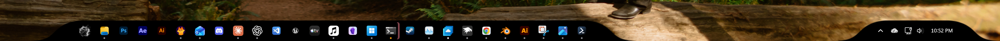

# NotchDock

**Author**: [frozt](https://github.com/frozt-src)



A black, Apple-style notch for the Windows 11 taskbar. The app icons sit in a centred notch whose
ends run down to the screen edge in a smooth S-curve, and the clock and system icons get a matching
notch of their own near the right edge. App buttons have no plates: a small dot under each running
app shows its state (dim for running, bright for the app in front, orange for attention).

## For the best experience

**Install [Notch Liquid Hover](https://windhawk.net/mods/notch-liquid-hover) alongside this theme.**
It makes the notch's top edge swell up under the hovered icon like a liquid surface and follow the
pointer, on both notches. The theme works without it; with it, the notches come alive.

Also recommended: [Taskbar Dock Animation](https://windhawk.net/mods/taskbar-dock-animation) for icon
magnification on hover.

## Notes

- Built for a taskbar at the bottom of the screen. On a left or right taskbar the theme leaves
  Windows' own layout in place; a top taskbar is not supported.
- Sizes follow the taskbar's height, so both the small and the default Windows taskbar sizes work.
- The Widgets button and the date line are hidden; only the time is shown.
- Tested on Windows 11 build 26300, including the newer layout in which Windows places the system
  tray inside the taskbar's button row.
- The notch colour is set by the `DockFill` constant, but the notch's curved ends are images drawn
  in black, so changing the colour needs matching images.

## Customizing

Set these under **Style constants** in the mod's settings, keeping the theme selected:

- `AttentionPlate=Transparent` (default) hides Windows' red plate on an app that wants attention;
  the orange dot still shows it. To bring the plate back, set a colour as `#AARRGGBB`, for example
  `AttentionPlate=#80C42B1C`.
- `TrayGap=0` is the space in pixels between the tray notch and the right screen edge.

## Theme selection

Select **NotchDock** in the mod's theme list once it is available there; until then, install it
manually as shown below.

## Manual installation

<details>
<summary>Theme YAML (paste into Windows 11 Taskbar Styler > Settings > Textual mode)</summary>

```yaml
styleConstants:
  - DockFill=#FF000000
  - NotchDir=https://raw.githubusercontent.com/ramensoftware/windows-11-taskbar-styling-guide/refs/heads/main/Themes/NotchDock/Assets
  - TrayGap=0
  - HoverFade=0:0:0.15
  - AttentionPlate=Transparent
  - Headroom=0
  - NativeTraySpacing=6
  - MinimumNotchGap=12
  - NestedTray=(taskbarDock==`vertical`?0:EmbeddedWidth==``?0:IslandSpan==``?0:RepeaterSpan==``?0:dockH==``?0:EmbeddedWidth>0)
  - DockInset=(dockH*2.1875)
  - AppSpan=max(RepeaterSpan-EmbeddedWidth-$NativeTraySpacing,0)
  - DockSpan=($AppSpan+2*$DockInset)
  - DockLeft=max(min((IslandSpan-$DockSpan)/2,IslandSpan-$TrayGap-EmbeddedWidth-$DockSpan-$MinimumNotchGap),0)
  - ItemShift=($DockLeft+$DockInset)
  - TrayShift=(IslandSpan-RepeaterSpan+$NativeTraySpacing-$TrayGap-$ItemShift)
controlStyles:
  - target: Taskbar.TaskbarFrame > Grid#RootGrid@DockingStates
    styles:
      - Tag=horizontal
      - Tag@DockedLeft=vertical
      - Tag@DockedRight=vertical
      - Tag=>taskbarDock
  - target: ':root > ScrollViewer > ScrollContentPresenter > Border'
    styles:
      - ActualWidth=>IslandSpan
  - target: ':root > ScrollViewer > ScrollContentPresenter > Border > Grid'
    styles:
      - ColumnDefinitions:={{taskbarDock==`vertical`?skip():$NestedTray?skip():`<ColumnDefinitionCollection><ColumnDefinition Width="*"/><ColumnDefinition Width="Auto"/></ColumnDefinitionCollection>`}}
  - target: Taskbar.TaskbarFrame > Grid#RootGrid > Taskbar.TaskbarBackground
    styles:
      - ActualHeight=>dockH
  - target: Taskbar.TaskbarFrame
    styles:
      - Width={{taskbarDock==`vertical`?skip():`Auto`}}
      - Grid.Column={{taskbarDock==`vertical`?skip():$NestedTray?skip():0}}
      - Grid.ColumnSpan={{taskbarDock==`vertical`?skip():$NestedTray?skip():2}}
      - HorizontalAlignment={{taskbarDock==`vertical`?skip():$NestedTray?`Left`:`Center`}}
      - MinWidth={{$NestedTray?$DockLeft+$DockSpan:skip()}}
  - target: Taskbar.TaskbarFrame > Grid#RootGrid > Microsoft.UI.Xaml.Controls.ItemsRepeater#TaskbarFrameRepeater
    styles:
      - ActualWidth=>RepeaterSpan
      - HorizontalAlignment={{$NestedTray?`Left`:skip()}}
      - Margin={{$NestedTray?0:skip()}}
      - MaxWidth={{$NestedTray?max(EmbeddedWidth+$NativeTraySpacing,IslandSpan-2*$DockInset-$TrayGap-$MinimumNotchGap):skip()}}
  - target: Microsoft.UI.Xaml.Controls.ItemsRepeater#TaskbarFrameRepeater > Taskbar.ExperienceToggleButton, Microsoft.UI.Xaml.Controls.ItemsRepeater#TaskbarFrameRepeater > Taskbar.TaskListButton, Microsoft.UI.Xaml.Controls.ItemsRepeater#TaskbarFrameRepeater > Taskbar.OverflowToggleButton, Microsoft.UI.Xaml.Controls.ItemsRepeater#TaskbarFrameRepeater > Taskbar.TaskbarExtensionElement
    styles:
      - Margin={{$NestedTray?$ItemShift:skip()}},0,{{-$ItemShift}},0
  - target: Taskbar.TaskbarFrame > * > Taskbar.TaskbarExtensionElement > ContentPresenter > SystemTray.SystemTrayFrame
    styles:
      - ActualWidth=>EmbeddedWidth
  - target: SystemTray.SystemTrayFrame
    styles:
      - Grid.Column={{taskbarDock==`vertical`?skip():$NestedTray?skip():1}}
      - Width={{taskbarDock==`vertical`?skip():$NestedTray?skip():`Auto`}}
      - HorizontalAlignment={{taskbarDock==`vertical`?skip():$NestedTray?skip():`Right`}}
      - Margin={{taskbarDock==`vertical`?skip():$NestedTray?$TrayShift:0}},$Headroom,{{$NestedTray?$NativeTraySpacing-$TrayShift:$TrayGap}},0
  - target: Taskbar.TaskbarFrame > Grid#RootGrid
    styles:
      - Padding={{taskbarDock==`vertical`?skip():$NestedTray?0:$DockInset}},$Headroom,{{$NestedTray?0:$DockInset}},0
      - Margin=0
  - target: Taskbar.TaskbarFrame > Grid#RootGrid > Taskbar.TaskbarBackground > Grid
    styles:
      - BorderThickness=0
      - HorizontalAlignment={{$NestedTray?`Left`:skip()}}
      - Width={{$NestedTray?max($DockSpan-5*dockH,0):skip()}}
      - Margin={{taskbarDock==`vertical`?skip():$NestedTray?$DockLeft+2.5*dockH:dockH*0.3125}},0,{{$NestedTray?0:dockH*0.3125}},0
      - Background={{taskbarDock==`vertical`?skip():`$DockFill`}}
  - target: Taskbar.TaskbarFrame > Grid#RootGrid > Taskbar.TaskbarBackground > Grid > Rectangle#BackgroundFill
    styles:
      - Visibility=Visible
      - Fill:={{taskbarDock==`vertical`?skip():dockH<40?`<ImageBrush Stretch="Fill" ImageSource="$NotchDir/notch-cap-left-32.png" />`:`<ImageBrush Stretch="Fill" ImageSource="$NotchDir/notch-cap-left-48.png" />`}}
      - Width={{taskbarDock==`vertical`?skip():dockH*2.5}}
      - HorizontalAlignment={{taskbarDock==`vertical`?skip():`Left`}}
      - Margin={{taskbarDock==`vertical`?skip():-dockH*2.5}},0,0,0
  - target: Taskbar.TaskbarFrame > Grid#RootGrid > Taskbar.TaskbarBackground > Grid > Rectangle#BackgroundStroke
    styles:
      - Visibility={{taskbarDock==`vertical`?skip():`Visible`}}
      - Fill:={{taskbarDock==`vertical`?skip():dockH<40?`<ImageBrush Stretch="Fill" ImageSource="$NotchDir/notch-cap-right-32.png" />`:`<ImageBrush Stretch="Fill" ImageSource="$NotchDir/notch-cap-right-48.png" />`}}
      - Width={{taskbarDock==`vertical`?skip():dockH*2.5}}
      - Height={{taskbarDock==`vertical`?skip():`Auto`}}
      - VerticalAlignment={{taskbarDock==`vertical`?skip():`Stretch`}}
      - HorizontalAlignment={{taskbarDock==`vertical`?skip():`Right`}}
      - Margin={{taskbarDock==`vertical`?skip():0}},0,{{-dockH*2.5}},0
  - target: StackPanel#SystemTrayFrameGrid, Grid#SystemTrayFrameGrid
    styles:
      - Background:={{taskbarDock==`vertical`?skip():dockH<36?`<ImageBrush Stretch="None" AlignmentX="Left" AlignmentY="Bottom" ImageSource="$NotchDir/notch-left-body-32.png" />`:dockH<44?`<ImageBrush Stretch="None" AlignmentX="Left" AlignmentY="Bottom" ImageSource="$NotchDir/notch-left-body-40.png" />`:`<ImageBrush Stretch="None" AlignmentX="Left" AlignmentY="Bottom" ImageSource="$NotchDir/notch-left-body-48.png" />`}}
      - BorderBrush:={{taskbarDock==`vertical`?skip():dockH<36?`<ImageBrush Stretch="None" AlignmentX="Right" AlignmentY="Bottom" ImageSource="$NotchDir/notch-tray-right-32-top$Headroom.png" />`:dockH<44?`<ImageBrush Stretch="None" AlignmentX="Right" AlignmentY="Bottom" ImageSource="$NotchDir/notch-tray-right-40-top$Headroom.png" />`:`<ImageBrush Stretch="None" AlignmentX="Right" AlignmentY="Bottom" ImageSource="$NotchDir/notch-tray-right-48-top$Headroom.png" />`}}
      - BorderThickness={{taskbarDock==`vertical`?skip():0}},0,{{dockH*2.5}},0
      - BackgroundSizing={{taskbarDock==`vertical`?skip():`InnerBorderEdge`}}
      - Padding={{taskbarDock==`vertical`?skip():dockH*1.875}},$Headroom,{{-dockH*0.625}},0
      - Margin=0
  - target: SystemTray.ChevronIconView
    styles:
      - Padding=0
  - target: SystemTray.NotifyIconView#NotifyItemIcon
    styles:
      - Padding=0
  - target: SystemTray.OmniButton
    styles:
      - Padding=0
  - target: SystemTray.CopilotIcon
    styles:
      - Padding=0
  - target: SystemTray.IconView#SystemTrayIcon > Grid#ContainerGrid > ContentPresenter#ContentPresenter > Grid#ContentGrid > SystemTray.TextIconContent > Grid#ContainerGrid
    styles:
      - Padding=0
  - target: SystemTray.StackListView#IconStack > ItemsPresenter > StackPanel > ContentPresenter > SystemTray.IconView#SystemTrayIcon
    styles:
      - Padding=0
  - target: SystemTray.OmniButton > Grid > Border#BackgroundBorder
    styles:
      - Background=Transparent
      - BorderBrush=Transparent
  - target: 'SystemTray.IconView > Grid#ContainerGrid > Border#BackgroundBorder, SystemTray.ChevronIconView > Grid#ContainerGrid > Border#BackgroundBorder, SystemTray.NotifyIconView > Grid#ContainerGrid > Border#BackgroundBorder'
    styles:
      - Background=Transparent
      - BorderBrush=Transparent
  - target: Taskbar.Gripper#GripperControl
    styles:
      - Width=Auto
      - MinWidth=24
  - target: 'Grid#IconPanel@CommonStates > Border#BackgroundElement, Taskbar.TaskListLabeledButtonPanel@CommonStates > Border#BackgroundElement'
    styles:
      - CornerRadius=8
      - BorderThickness=0
      - Background=Transparent
      - BorderBrush=Transparent
      - Opacity=0
      - BackgroundTransition:=<BrushTransition Duration="$HoverFade" />
      - Background@RequestingAttention=$AttentionPlate
      - Background@RequestingAttentionPointerOver=$AttentionPlate
      - Background@RequestingAttentionPressed=$AttentionPlate
      - Background@RequestingAttentionMulti=$AttentionPlate
      - Background@RequestingAttentionMultiPointerOver=$AttentionPlate
      - Background@RequestingAttentionMultiPressed=$AttentionPlate
      - Background@RequestingAttentionMultiWindowSharing=$AttentionPlate
      - Background@RequestingAttentionMultiWindowSharingPointerOver=$AttentionPlate
      - Background@RequestingAttentionMultiWindowSharingPressed=$AttentionPlate
      - Opacity@RequestingAttention=1
      - Opacity@RequestingAttentionPointerOver=1
      - Opacity@RequestingAttentionPressed=1
      - Opacity@RequestingAttentionMulti=1
      - Opacity@RequestingAttentionMultiPointerOver=1
      - Opacity@RequestingAttentionMultiPressed=1
      - Opacity@RequestingAttentionMultiWindowSharing=1
      - Opacity@RequestingAttentionMultiWindowSharingPointerOver=1
      - Opacity@RequestingAttentionMultiWindowSharingPressed=1
  - target: 'Grid#IconPanel@CommonStates > Border#MultiWindowElement, Taskbar.TaskListLabeledButtonPanel@CommonStates > Border#MultiWindowElement'
    styles:
      - Background@RequestingAttentionMulti=$AttentionPlate
      - Background@RequestingAttentionMultiPointerOver=$AttentionPlate
      - Background@RequestingAttentionMultiPressed=$AttentionPlate
      - Background@RequestingAttentionMultiWindowSharing=$AttentionPlate
      - Background@RequestingAttentionMultiWindowSharingPointerOver=$AttentionPlate
      - Background@RequestingAttentionMultiWindowSharingPressed=$AttentionPlate
      - BorderBrush@RequestingAttentionMulti=$AttentionPlate
      - BorderBrush@RequestingAttentionMultiPointerOver=$AttentionPlate
      - BorderBrush@RequestingAttentionMultiPressed=$AttentionPlate
  - target: 'Grid#IconPanel@RunningIndicatorStates > Rectangle#RunningIndicator, Taskbar.TaskListLabeledButtonPanel@RunningIndicatorStates > Rectangle#RunningIndicator'
    styles:
      - Height={{dockH<40?3:4}}
      - RadiusX=2
      - RadiusY=2
      - Width={{dockH<40?3:4}}
      - Width@ActiveRunningIndicator={{dockH<40?3:4}}
      - Width@RequestingAttentionRunningIndicator={{dockH<40?3:4}}
      - Fill=#8E8E93
      - Fill@ActiveRunningIndicator=#F5F5F7
      - Fill@RequestingAttentionRunningIndicator=#FF9F0A
  - target: Taskbar.AugmentedEntryPointButton#AugmentedEntryPointButton
    styles:
      - Visibility=Collapsed
  - target: TextBlock#DateInnerTextBlock
    styles:
      - Visibility=Collapsed
  - target: 'Taskbar.ExperienceToggleButton#LaunchListButton[AutomationProperties.AutomationId=StartButton] > Taskbar.TaskListButtonPanel > Grid > Border#BackgroundElement, Taskbar.ExperienceToggleButton#LaunchListButton[AutomationProperties.AutomationId=StartButton] > Taskbar.TaskListButtonPanel > Border#BackgroundElement'
    styles:
      - Background=Transparent
      - BorderThickness=0
      - BorderBrush=Transparent
```

</details>
