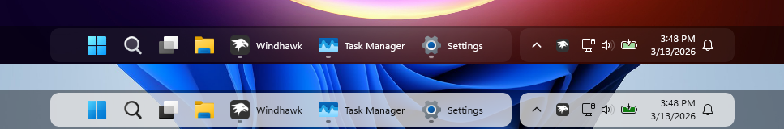

# UltraWideFriendly theme for Windows 11 Taskbar Styler

A minimal, floating dual-island taskbar inspired by macOS dock aesthetics. Separates the app icons and system tray into two distinct rounded islands with a semi-transparent ghost bar behind them.

**Author**: [CryptoProgenitor](https://github.com/CryptoProgenitor)



## Features

- **Dual Islands**: App icons and system tray float as separate rounded containers
- **Ghost Bar**: Semi-transparent backdrop ties the composition together
- **Centered Layout**: Both islands center automatically using flexible grid columns
- **Floating Effect**: Small vertical margin creates a subtle lift from screen edge
- **Clean Aesthetic**: Theme-aware backgrounds with rounded corners (10px radius)

## Customization

To apply the customizations below, set the corresponding style constants in the mod settings under "Style constants".

### Taskbar frame max width

Set `TaskbarFrameMaxWidth` to limit the maximum width of the taskbar. For example: `TaskbarFrameMaxWidth=800` will cap the taskbar at 800px.

### Island background color

Set `IslandBackgroundColor` to your preferred color. Example values:
* `IslandBackgroundColor=#FF202020`  → Dark gray (default)
* `IslandBackgroundColor=#FF000000`  → Pure black
* `IslandBackgroundColor=#FF1a1a2e`  → Dark navy

### Ghost bar opacity

Set `GhostBarBackgroundColor` to adjust the opacity of the ghost bar behind the islands. The default is `#66000000`, which is black with 40% opacity. You can increase or decrease the opacity by changing the alpha channel (the first two digits):
* `GhostBarBackgroundColor=#66000000`   → 40% opacity (default)
* `GhostBarBackgroundColor=#99000000`   → 60% opacity
* `GhostBarBackgroundColor=#33000000`   → 20% opacity
* `GhostBarBackgroundColor=Transparent` → No ghost bar

### Adjust island float (vertical gap)

Set `IslandVerticalMargin` to adjust the vertical margins of the islands, creating more or less of a floating effect:
* `IslandVerticalMargin=3`  → 3px float (default)
* `IslandVerticalMargin=6`  → 6px float (more dramatic)
* `IslandVerticalMargin=0`  → No float

### Adjust island gap

Set `IslandHorizontalMargin` to change the horizontal margins between islands:
* `IslandHorizontalMargin=5`  → 10px gap (default)
* `IslandHorizontalMargin=10` → 20px gap

## Notes

- Designed for Windows 11 with taskbar icons centered
- Works with both light and dark system themes
- The app island has wider padding (25px) for more clickable area; tray has tighter padding (5px)

## Theme selection

The theme is integrated into the mod and can be selected directly from the mod's
settings:

* Open the Windows 11 Taskbar Styler mod in Windhawk.
* Go to the "Settings" tab.
* Select the theme and save the settings.

## Manual installation

The theme styles can also be imported manually. To do that, follow these steps:

* Open the Windows 11 Taskbar Styler mod in Windhawk.
* Go to the "Settings" tab and select "Textual mode".
* Copy the content below to the text box and click "Save settings".

<details>
<summary>Content to import (click to expand)</summary>

```yaml
styleConstants:
  - GhostBarBackgroundColor=#66000000
  - IslandBackgroundColor={ThemeResource ControlFillColorDefault}
  - IslandVerticalMargin=3
  - IslandHorizontalMargin=5
  - TaskbarFrameMaxWidth=8000
controlStyles:
  - target: ':root > ScrollViewer > ScrollContentPresenter > Border > Grid'
    styles:
      - ColumnDefinitions:=<ColumnDefinitionCollection><ColumnDefinition Width="*"/><ColumnDefinition Width="Auto"/><ColumnDefinition Width="Auto"/><ColumnDefinition Width="*"/></ColumnDefinitionCollection>
      - HorizontalAlignment=Stretch
      - Background:=<SolidColorBrush Color="$GhostBarBackgroundColor"/>
  - target: Taskbar.TaskbarFrame > Grid#RootGrid@DockingStates
    styles:
      - Tag=horizontal
      - Tag@DockedLeft=vertical
      - Tag@DockedRight=vertical
      - Tag=>taskbarDock
  - target: Taskbar.TaskbarFrame
    styles:
      - Grid.Column={{TrayInFrameWidth==``?1:taskbarDock==`vertical`?1:0}}
      - Grid.ColumnSpan={{TrayInFrameWidth==``?skip():taskbarDock==`vertical`?skip():4}}
      - Width={{taskbarDock==`vertical`?skip():`Auto`}}
      - HorizontalAlignment={{TrayInFrameWidth==``?`Right`:taskbarDock==`vertical`?`Right`:`Left`}}
      - Margin=0,0,$IslandHorizontalMargin,0
      - MaxWidth={{TrayInFrameWidth==``?(containerGridWidth>0?min($TaskbarFrameMaxWidth,containerGridWidth):$TaskbarFrameMaxWidth):taskbarDock==`vertical`?(containerGridWidth>0?min($TaskbarFrameMaxWidth,containerGridWidth):$TaskbarFrameMaxWidth):`Infinity`}}
      - MinWidth={{TrayInFrameWidth==``?skip():taskbarDock==`vertical`?skip():max((containerGridWidth-IslandRepeaterWidth-25)/2,0)+IslandRepeaterWidth-TrayInFrameWidth-2*$IslandHorizontalMargin+25}}
      - // Makes room for the island background on builds where the tray is an item of the taskbar frame, since the item offset below isn't part of the repeater's width.
  - target: Taskbar.TaskbarFrame > Grid
    styles:
      - Background:={{TrayInFrameWidth==``?`<SolidColorBrush Color="$IslandBackgroundColor"/>`:taskbarDock==`vertical`?`<SolidColorBrush Color="$IslandBackgroundColor"/>`:skip()}}
      - CornerRadius={{TrayInFrameWidth==``?10:taskbarDock==`vertical`?10:0}}
      - Padding={{TrayInFrameWidth==``?`25,0,25,0`:taskbarDock==`vertical`?`25,0,25,0`:0}}
      - Margin={{TrayInFrameWidth==``?`0,$IslandVerticalMargin,0,$IslandVerticalMargin`:taskbarDock==`vertical`?`0,$IslandVerticalMargin,0,$IslandVerticalMargin`:0}}
  - target: SystemTray.SystemTrayFrame
    styles:
      - Grid.Column=2
      - Width=Auto
      - HorizontalAlignment=Left
      - Margin={{TrayInFrameWidth==``?$IslandHorizontalMargin:taskbarDock==`vertical`?$IslandHorizontalMargin:25+2*$IslandHorizontalMargin}},0,0,0
  - target: StackPanel#SystemTrayFrameGrid, Grid#SystemTrayFrameGrid
    styles:
      - Background:=<SolidColorBrush Color="$IslandBackgroundColor"/>
      - CornerRadius=10
      - Padding=5,0,5,0
      - Margin=0,$IslandVerticalMargin,0,$IslandVerticalMargin
  - target: Taskbar.TaskbarBackground#BackgroundControl
    styles:
      - Visibility={{TrayInFrameWidth==``?`Collapsed`:taskbarDock==`vertical`?`Collapsed`:`Visible`}}
  - target: Taskbar.TaskbarFrame > Grid#RootGrid > Taskbar.TaskbarBackground > Grid
    styles:
      - Background:={{TrayInFrameWidth==``?skip():taskbarDock==`vertical`?skip():`<SolidColorBrush Color="$IslandBackgroundColor"/>`}}
      - CornerRadius=10
      - Margin={{TrayInFrameWidth==``?skip():taskbarDock==`vertical`?skip():max((containerGridWidth-IslandRepeaterWidth-25)/2,0)}},$IslandVerticalMargin,{{TrayInFrameWidth==``?skip():taskbarDock==`vertical`?skip():max(TrayInFrameWidth+2*$IslandHorizontalMargin-25-max((containerGridWidth-IslandRepeaterWidth-25)/2,0),0)}},$IslandVerticalMargin
  - target: Taskbar.TaskbarFrame > Grid#RootGrid > Taskbar.TaskbarBackground > Grid > Rectangle#BackgroundFill
    styles:
      - Fill=Transparent
  - target: Taskbar.TaskbarFrame > Grid#RootGrid > Taskbar.TaskbarBackground > Grid > Rectangle#BackgroundStroke
    styles:
      - Visibility=Collapsed
  - target: Taskbar.TaskbarExtensionElement > ContentPresenter > SystemTray.SystemTrayFrame
    styles:
      - ActualWidth=>TrayInFrameWidth
  - target: Taskbar.TaskbarFrame > Grid#RootGrid > Microsoft.UI.Xaml.Controls.ItemsRepeater#TaskbarFrameRepeater
    styles:
      - HorizontalAlignment={{TrayInFrameWidth==``?skip():taskbarDock==`vertical`?skip():`Left`}}
      - MaxWidth={{TrayInFrameWidth==``?skip():taskbarDock==`vertical`?skip():min($TaskbarFrameMaxWidth-25+TrayInFrameWidth+2*$IslandHorizontalMargin,containerGridWidth-25)}}
      - ActualWidth=>IslandRepeaterWidth
      - // Builds where the tray is an item of the taskbar frame. The frame and the repeater stay at the left edge, since Explorer positions the tray, its flyouts and the jump lists from item positions within the repeater as if it started there. The islands are moved by margins on the items instead.
  - target: Microsoft.UI.Xaml.Controls.ItemsRepeater#TaskbarFrameRepeater > Taskbar.ExperienceToggleButton, Microsoft.UI.Xaml.Controls.ItemsRepeater#TaskbarFrameRepeater > Taskbar.TaskListButton, Microsoft.UI.Xaml.Controls.ItemsRepeater#TaskbarFrameRepeater > Taskbar.AugmentedEntryPointButton, Microsoft.UI.Xaml.Controls.ItemsRepeater#TaskbarFrameRepeater > Taskbar.TaskbarExtensionElement
    styles:
      - Margin={{TrayInFrameWidth==``?skip():taskbarDock==`vertical`?skip():25+max((containerGridWidth-IslandRepeaterWidth-25)/2,0)}},0,{{TrayInFrameWidth==``?skip():taskbarDock==`vertical`?skip():-(25+max((containerGridWidth-IslandRepeaterWidth-25)/2,0))}},0
      - // Moves each item by the island offset. The negative right margin keeps the item's width, and so the repeater's, independent of the offset. Also replaces the gap Explorer adds before the tray.
  - target: :root > ScrollViewer > ScrollContentPresenter > Border
    styles:
      - ActualWidth=>containerGridWidth
      - Background:={{TrayInFrameWidth==``?skip():`<SolidColorBrush Color="$GhostBarBackgroundColor"/>`}}
```
</details>
